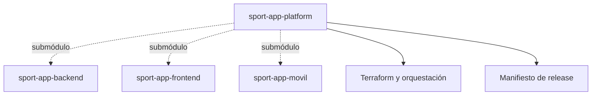

# SportApp Platform

`sport-app-platform` integra backend, aplicación web, aplicación móvil, documentación, backlog e infraestructura compartida de SportApp.

## Repositorios

| Componente | Repositorio | Versionado |
| --- | --- | --- |
| Backend | [`sport-app-backend`](https://github.com/lfnavarroj1/sport-app-backend) | SemVer independiente, versión en `pyproject.toml` e imágenes OCI por digest |
| Frontend web | [`sport-app-frontend`](https://github.com/lfnavarroj1/sport-app-frontend) | SemVer independiente, versión en `package.json` |
| Aplicación móvil | [`sport-app-movil`](https://github.com/lfnavarroj1/sport-app-movil) | SemVer en `versionName` y `versionCode` creciente |
| Plataforma | `sport-app-platform` | versión de sprint y manifiesto de composición |

Los tres componentes se incorporan como submódulos. Cada repositorio conserva su historial, ramas, CI/CD y releases; la plataforma fija una combinación compatible mediante un manifiesto.



## Clonado

Para trabajar solo en Terraform o en la plataforma, clone el repositorio como carpeta hermana de los demás proyectos. Este comando **no** descarga el contenido de los submódulos:

> Procedimiento completo: [Guía de clonado seguro](docs/guia-clonado-seguro.md).

```text
git clone --no-recurse-submodules https://github.com/lfnavarroj1/sport-app-platform.git platform
cd platform
git config --local submodule.recurse false
git config --local fetch.recurseSubmodules false
git config --local push.recurseSubmodules no
git submodule status
```

El prefijo `-` en cada línea de `git submodule status` confirma que los componentes siguen sin inicializar. `.gitmodules` los deja además con `update = none`. Solo los jobs de integración/E2E los habilitan expresamente con `git submodule update --init --checkout`. Los árboles creados bajo `components/` no reemplazan los clones de desarrollo.

Un push de plataforma se realiza con `git push --no-recurse-submodules origin <rama>`; así no intenta publicar backend, frontend ni móvil. La actualización de un puntero de componente es un cambio de release deliberado y requiere su propio PR y manifiesto.

## Gestión del proyecto

- La [wiki](https://github.com/lfnavarroj1/sport-app-platform/wiki) explica el proyecto, su arquitectura, avance, métricas y entregas.
- El [GitHub Project SportApp Platform](https://github.com/users/lfnavarroj1/projects/4) administra el backlog vigente, los sprints, estados, responsables y evidencia.
- El [manual de versiones](docs/manual-versionado.md) define la relación entre sprint, HU, ramas, versiones y releases.
- El [esquema de CI y release](docs/esquema-ci-y-release.md) explica qué ocurre con cada push y cómo se libera una composición compatible.
- La [arquitectura Terraform](docs/arquitectura-terraform.md) define su ubicación, clonación, frontera con los componentes, pruebas en local/GCP y ciclo de encendido, suspensión y destrucción para controlar costos.
- La [preparación de Terraform](docs/preparacion-terraform-local-gcp.md) reúne los prerrequisitos locales, proyectos y APIs GCP, autenticación, estado, variables, WIF y comprobaciones previas al primer plan.
- La arquitectura detallada se publicará gradualmente en la wiki sin copiar las guías internas destinadas a agentes.

## Infraestructura

Terraform, la composición por ambiente y la promoción coordinada pertenecen a `sport-app-platform` porque afectan conjuntamente backend, frontend y servicios compartidos. Cada componente conserva sus `Dockerfile`, pruebas, migraciones y configuración interna. La decisión está aprobada y documentada; los módulos, estados y workflows aún deben implementarse.

Los ambientes no productivos serán recreables: `suspend` reducirá cómputo con posibles costos residuales y `destroy` eliminará los recursos después de revisar un plan. Deshabilitar la facturación se reserva para emergencias; la [arquitectura Terraform](docs/arquitectura-terraform.md) contiene el procedimiento y los controles de presupuesto.

## Estado

El repositorio público [`sport-app-platform`](https://github.com/lfnavarroj1/sport-app-platform) fue creado el 2026-10-09. Esta carpeta continúa siendo la fuente local de su portada y manuales.

Backend, frontend y móvil se publicaron después de revisar sus archivos e historial para descartar secretos y material no publicable. Los submódulos de la plataforma pueden clonarse sin autorización adicional y continúan fijados a commits concretos.
