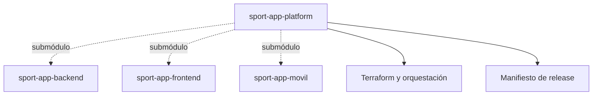

# SportApp Platform

`sport-app-platform` integra backend, aplicación web, aplicación móvil, documentación, backlog e infraestructura compartida de SportApp.

## Repositorios

| Componente | Repositorio | Versionado |
| --- | --- | --- |
| Backend | [`sport-app-backend`](https://github.com/lfnavarroj1/sport-app-backend) | SemVer independiente, versión en `pyproject.toml` e imágenes OCI por digest |
| Frontend web | [`sport-app-frontend`](https://github.com/lfnavarroj1/sport-app-frontend) | SemVer independiente, versión en `package.json` |
| Aplicación móvil | [`sport-app-movil`](https://github.com/lfnavarroj1/sport-app-movil) | SemVer en `versionName` y `versionCode` creciente |
| Plataforma | `sport-app-platform` | versión de sprint y manifiesto de composición |

Los tres componentes se incorporan como submódulos. Cada repositorio conserva su historial, ramas, CI/CD y releases; la plataforma fija una combinación compatible mediante un manifiesto.

## Gestión del proyecto

- La [wiki](https://github.com/lfnavarroj1/sport-app-platform/wiki) explica el proyecto, su arquitectura, avance, métricas y entregas.
- El [GitHub Project](https://github.com/users/lfnavarroj1/projects/2) administra el backlog, los sprints, estados, responsables y evidencia.
- El [manual de versiones](docs/manual-versionado.md) define la relación entre sprint, HU, ramas, versiones y releases.
- La arquitectura detallada se publicará gradualmente en la wiki sin copiar las guías internas destinadas a agentes.

## Infraestructura

Terraform, la composición por ambiente y la promoción coordinada pertenecen a `sport-app-platform` porque afectan conjuntamente backend, frontend y servicios compartidos. Cada componente conserva sus `Dockerfile`, pruebas, migraciones y configuración interna.

## Estado

El repositorio público [`sport-app-platform`](https://github.com/lfnavarroj1/sport-app-platform) fue creado el 2026-10-09. Esta carpeta continúa siendo la fuente local de su portada y manuales.

Backend, frontend y móvil se publicaron después de revisar sus archivos e historial para descartar secretos y material no publicable. Los submódulos de la plataforma pueden clonarse sin autorización adicional y continúan fijados a commits concretos.
