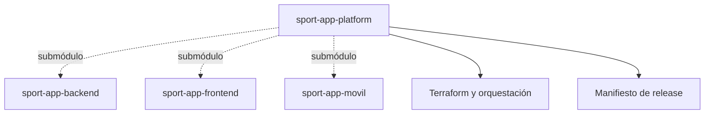
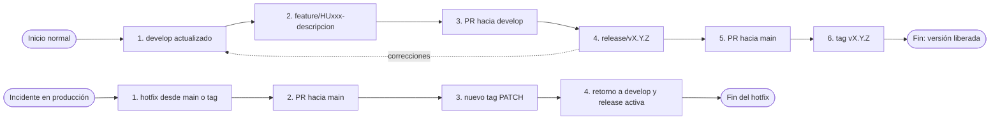

# SportApp Platform

`sport-app-platform` integra backend, aplicación web, aplicación móvil, documentación, backlog e infraestructura compartida de SportApp.

## Repositorios

| Componente | Repositorio | Versionado |
| --- | --- | --- |
| Backend | [`sport-app-backend`](https://github.com/lfnavarroj1/sport-app-backend) | SemVer independiente, versión en `pyproject.toml` e imágenes OCI por digest |
| Frontend web | [`sport-app-frontend`](https://github.com/lfnavarroj1/sport-app-frontend) | SemVer independiente, versión en `package.json` |
| Aplicación móvil | [`sport-app-movil`](https://github.com/lfnavarroj1/sport-app-movil) | SemVer en `versionName` y `versionCode` creciente |
| Plataforma | `sport-app-platform` | versión de sprint y manifiesto de composición |

Los tres componentes se incorporan como submódulos. Cada repositorio conserva su historial, ramas, CI/CD y releases; la plataforma fija una combinación compatible mediante un manifiesto.

La composición candidata se registra en [`release-manifest.yaml`](release-manifest.yaml), en la raíz del proyecto. Su estructura se valida con [`schemas/release-manifest.schema.json`](schemas/release-manifest.schema.json); `docs/` explica el procedimiento, pero no contiene el manifiesto operativo.



## Clonado

Para trabajar solo en Terraform o en la plataforma, clone el repositorio como carpeta hermana de los demás proyectos. Este comando **no** descarga el contenido de los submódulos:

> Procedimiento completo: [Guía de clonado seguro](docs/guia-clonado-seguro.md).

```text
git clone --no-recurse-submodules https://github.com/lfnavarroj1/sport-app-platform.git platform
cd platform
git config --local submodule.recurse false
git config --local fetch.recurseSubmodules false
git config --local push.recurseSubmodules no
git submodule status
```

El prefijo `-` en cada línea de `git submodule status` confirma que los componentes siguen sin inicializar. `.gitmodules` los deja además con `update = none`. Solo los jobs de integración/E2E los habilitan expresamente con `git submodule update --init --checkout`. Los árboles creados bajo `components/` no reemplazan los clones de desarrollo.

Un push de plataforma se realiza con `git push --no-recurse-submodules origin <rama>`; así no intenta publicar backend, frontend ni móvil. La actualización de un puntero de componente es un cambio de release deliberado y requiere su propio PR y manifiesto.

## Flujo de trabajo Git

SportApp utiliza GitFlow en los cuatro repositorios: backend, frontend, móvil y plataforma. Cada repositorio conserva sus propias ramas y pull requests; una rama de plataforma no contiene ni publica código interno de los componentes.



### Responsabilidad de cada rama

| Rama | Nace desde | Se integra en | Uso permitido |
| --- | --- | --- | --- |
| `main` | releases y hotfix aprobados | — | estado estable, liberable y etiquetado; no recibe desarrollo directo |
| `develop` | `main` al iniciar el flujo | `release/*` | integración del siguiente sprint; recibe features y retornos de release/hotfix |
| `feature/HUxxx-descripcion` | `develop` | `develop` mediante PR | implementación de una historia de usuario; no se mezcla directamente en `main` |
| `release/vX.Y.Z` | `develop` | `main` y retorno a `develop` | congelar el alcance y estabilizar; no admite funcionalidades nuevas |
| `hotfix/vX.Y.Z-descripcion` | `main` o el tag vigente | `main`, `develop` y una release activa si existe | corrección urgente, mínima y compatible, normalmente con incremento `PATCH` |

`main` y `develop` deben estar protegidas. Todo ingreso ocurre mediante PR, verificaciones obligatorias, revisión y aprobación. Un push o un resultado verde de CI nunca autoriza por sí solo una fusión.

### Flujo normal completo: desde `develop` hasta la liberación

**Punto de partida:** `develop` está actualizada y representa el trabajo integrado para el siguiente sprint. El recorrido normal nunca comienza directamente en `main`.

1. **Seleccionar la historia.** Priorizar la HU en GitHub Projects y crear las tareas técnicas necesarias en los repositorios propietarios.
2. **Actualizar `develop`.** En cada repositorio afectado, partir de la versión más reciente y verde de `develop`.
3. **Crear las ramas de trabajo.** Crear `feature/HUxxx-descripcion` desde `develop`. Se usa el mismo identificador de HU en todos los repositorios afectados, aunque cada rama y cada PR sean independientes.
4. **Implementar y probar.** Desarrollar la funcionalidad, agregar sus pruebas y usar commits convencionales que incluyan la HU, por ejemplo `feat(users): registrar usuario [HU001]`.
5. **Abrir los PR de la feature.** Cada `feature/*` abre su PR hacia `develop`; nunca se integra directamente en `main`. El PR debe enlazar la HU y declarar criterios cubiertos, contratos, pruebas, repositorios relacionados e impacto de versión.
6. **Integrar la historia en `develop`.** Fusionar cada PR solo cuando sus checks, revisión y aprobación estén completos. La rama `feature/*` termina aquí y puede eliminarse. La HU cuenta como entregada únicamente cuando el flujo vertical completo fue aceptado.
7. **Repetir los pasos 1 a 6.** Continuar con las demás historias hasta completar el alcance aprobado del sprint.
8. **Crear las ramas de release.** Cuando `develop` esté verde y el alcance esté completo, crear `release/vX.Y.Z` desde `develop` en cada repositorio que deba publicar una versión. Cada componente conserva su propia versión; `sport-app-platform` asigna la versión de la composición completa.
9. **Congelar y estabilizar.** En `release/*` no entran funcionalidades nuevas. Solo se admiten correcciones, cambios de versión, evidencia, migraciones y configuración indispensables para liberar.
10. **Publicar los componentes.** Versionar primero los componentes afectados y construir cada artefacto una sola vez. Las imágenes se identifican por digest y los paquetes por checksum.
11. **Cerrar la composición de plataforma.** En `develop` de `sport-app-platform`, actualizar en el mismo PR los punteros `components/*` y [`release-manifest.yaml`](release-manifest.yaml) a los tags publicados. Los scripts de release de los componentes preparan esos cambios. El commit declarado para cada componente debe coincidir con su submódulo.
12. **Validar el candidato.** Completar versiones, tags, contratos y artefactos; ejecutar contratos, integración, E2E, seguridad y smoke. El manifiesto cambia de `draft` a `released` únicamente cuando cumple el [JSON Schema](schemas/release-manifest.schema.json). En el mismo PR se crea la copia inmutable `releases/vX.Y.Z.yaml`.
13. **Integrar y sincronizar.** Fusionar la release en `main` mediante PR. Toda corrección hecha durante la estabilización también debe regresar mediante PR a `develop`, para que el siguiente sprint no pierda esos cambios.
14. **Etiquetar y promover.** Crear el tag `vX.Y.Z` sobre el commit de `main` que contiene el manifiesto liberado y su copia inmutable. Promover exactamente los mismos digests y checksums aprobados, sin reconstruir artefactos para producción.

**Punto final:** `main` contiene y etiqueta la composición liberada, mientras `develop` conserva tanto las historias entregadas como las correcciones hechas durante la release. Solo entonces termina el flujo normal.

Los pasos 10 a 14 se ejecutan con los scripts de release desde la estación del operador:
- [`sportapp-release.ps1`](scripts/sportapp-release.md): backend y frontend;
- [`sportapp-release-movil.ps1`](scripts/sportapp-release-movil.md): móvil;
- [`sportapp-release-plataforma.ps1`](scripts/sportapp-release-plataforma.md): versión de plataforma, con `release/vX.Y.Z`, manifiesto `released`, tag y retorno a `develop`.

Ejemplo de los pasos 2 y 3 cuando una misma historia afecta varios repositorios:

```text
sport-app-backend:  feature/HU001-registrar-usuario
sport-app-frontend: feature/HU001-registrar-usuario
sport-app-platform: feature/HU001-integracion
```

### Flujo de hotfix: desde el incidente hasta la sincronización

**Punto de partida:** existe un defecto urgente en la versión vigente de `main` o en su tag de producción. Un hotfix no nace desde `develop`.

1. **Identificar la versión afectada.** Confirmar el commit o tag vigente de `main`, delimitar el defecto y determinar los repositorios afectados.
2. **Crear la rama urgente.** Crear `hotfix/vX.Y.Z-descripcion` desde ese commit o tag en cada repositorio que necesite corrección.
3. **Corregir y probar.** Aplicar el cambio mínimo y agregar una prueba de regresión. La urgencia no elimina los controles de calidad.
4. **Validar mediante PR.** Abrir el PR del hotfix hacia `main` y fusionarlo únicamente después de completar checks, revisión y aprobación.
5. **Publicar el parche.** Incrementar la versión `PATCH`, construir los artefactos inmutables una sola vez y registrar sus digests o checksums.
6. **Actualizar la plataforma.** Si cambia la composición liberada, actualizar los punteros de componentes, `release-manifest.yaml` y la nueva copia histórica `releases/vX.Y.Z.yaml` mediante una release de plataforma.
7. **Etiquetar y promover.** Crear el nuevo tag sobre `main` y promover los mismos artefactos que fueron validados.
8. **Retornar la corrección.** Abrir PR con el cambio hacia `develop` y también hacia `release/*` si existe una release activa. Esto evita que el defecto reaparezca en la siguiente versión.

**Punto final:** `main` contiene el parche liberado y etiquetado, y la misma corrección está incorporada en `develop` y en cualquier release activa. Solo entonces puede cerrarse el hotfix.

La especificación operativa ampliada está en el [manual de versionado](docs/manual-versionado.md) y en el [esquema de CI y release](docs/esquema-ci-y-release.md). La justificación arquitectónica completa permanece en el repositorio oficial `documentacion`, bajo ADR-019, ADR-020 y las guías de `arquitectura/integracion-continua/`.

> **Estado actual:** el flujo es la política acordada, pero los workflows coordinados y todas las protecciones remotas aún deben terminar de configurarse y probarse. No se debe interpretar su descripción como automatización ya activa.

## Gestión del proyecto

- La [wiki](https://github.com/lfnavarroj1/sport-app-platform/wiki) explica el proyecto, su arquitectura, avance, métricas y entregas.
- El [GitHub Project SportApp Platform](https://github.com/users/lfnavarroj1/projects/4) administra el backlog vigente, los sprints, estados, responsables y evidencia: 40 HU (HU001–HU040), 100 PHU y 100 puntos de valor. Cada HU se construye con tareas técnicas `T-HUxxx-BE`/`WEB`/`MOB`/`PLAT` creadas justo a tiempo, sin PHU ni valor propios; solo una HU aceptada suma velocidad y valor ([reglas](project/README.md#historias-y-tareas-técnicas)).
- El [manual de versiones](docs/manual-versionado.md) define la relación entre sprint, HU, ramas, versiones y releases.
- El [esquema de CI y release](docs/esquema-ci-y-release.md) explica qué ocurre con cada push y cómo se libera una composición compatible.
- Las releases se publican con [`sportapp-release.ps1`](scripts/sportapp-release.md) (backend y frontend), [`sportapp-release-movil.ps1`](scripts/sportapp-release-movil.md) (móvil) y [`sportapp-release-plataforma.ps1`](scripts/sportapp-release-plataforma.md) (versión de plataforma).
- La preparación está separada por plataforma: la [guía local](docs/preparacion-terraform-local.md) deja listo Kubernetes kubeadm de Docker Desktop y la [guía de GCP](docs/preparacion-terraform-gcp.md) configura proyectos, Terraform manual, Cloud Build interno y Cloud Deploy con aprobación, sin entregar identidad GCP a GitHub.
- La [guía de Terraform](infra/terraform/README.md) explica paso a paso el desarrollo local, la producción en GCP y la actualización de backend y frontend.
- La [arquitectura Terraform](docs/arquitectura-terraform.md) define su ubicación, clonación, frontera con los componentes, pruebas en local/GCP y ciclo de encendido, suspensión y destrucción para controlar costos.
- La arquitectura detallada se publicará gradualmente en la wiki sin copiar las guías internas destinadas a agentes.

### Fuentes canónicas de documentación

| Contenido | Fuente que se edita |
| --- | --- |
| Portada y manuales operativos | `README.md` y `docs/` de este repositorio |
| Datos de respaldo del tablero | `project/` de este repositorio; el estado diario vive en GitHub Projects |
| Presentación, arquitectura resumida y entregas | GitHub Wiki; su fuente local se conserva únicamente en el repositorio documental bajo `presentacion-proyecto/wiki/` |
| Arquitectura detallada y guías para agentes | repositorio documental, bajo `arquitectura/` |

No se mantienen copias de `README.md`, `docs/` ni `project/` dentro de `documentacion/presentacion-proyecto`. Un cambio se realiza directamente en la fuente indicada y después se enlaza desde los demás destinos.

## Infraestructura

Terraform, la composición por ambiente y la promoción coordinada pertenecen a `sport-app-platform` porque afectan conjuntamente backend, frontend y servicios compartidos. Cada componente conserva sus `Dockerfile`, pruebas, migraciones y configuración interna. El [ambiente de desarrollo corre en local](infra/terraform/README.md#4-desarrollo-local-paso-a-paso), en el Kubernetes kubeadm de Docker Desktop, y [producción en GCP](infra/terraform/README.md#6-producción-en-gcp-paso-a-paso). Antes del primer `apply`, consulta la [preparación local](docs/preparacion-terraform-local.md) o la [preparación de GCP](docs/preparacion-terraform-gcp.md). Producción todavía no se ha aplicado. El código ya sigue el modelo sin autenticación GCP desde GitHub: Terraform solo desde la estación del operador, Cloud Build construye con identidades internas de GCP y Cloud Deploy despliega con aprobación humana ([preparación de GCP](docs/preparacion-terraform-gcp.md); si un estado anterior tenía WIF, la [migración](docs/migracion-retiro-wif-github.md)). El workflow `validate-platform.yml` de este repositorio solo valida, sin credenciales.

Desarrollo es desechable y no genera costos de nube: `terraform destroy` lo elimina del clúster local y `terraform apply` lo reconstruye. Producción puede suspenderse, reanudarse, destruirse o recrearse con confirmación explícita según la [guía de GCP](docs/preparacion-terraform-gcp.md#15-suspender-reanudar-destruir-y-recrear). Deshabilitar la facturación se reserva para emergencias; la [arquitectura Terraform](docs/arquitectura-terraform.md) contiene los controles de presupuesto.

## Estado

El repositorio público [`sport-app-platform`](https://github.com/lfnavarroj1/sport-app-platform) fue creado el 2026-10-09. Este repositorio es la fuente canónica de su portada, manuales y registros de apoyo al Project.

Backend, frontend y móvil se publicaron después de revisar sus archivos e historial para descartar secretos y material no publicable. Los submódulos de la plataforma pueden clonarse sin autorización adicional y continúan fijados a commits concretos.
