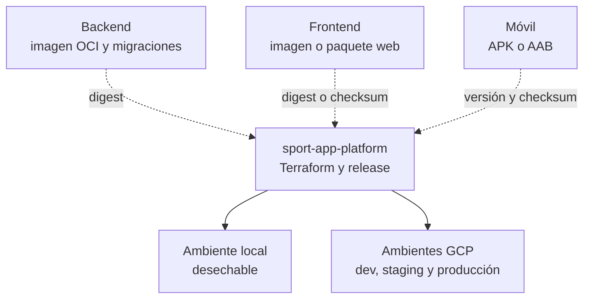
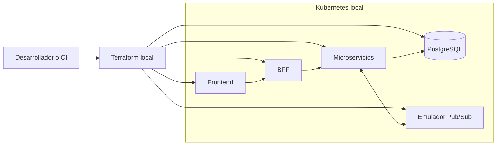
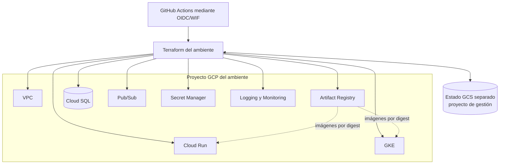
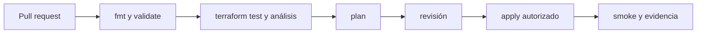

# Arquitectura Terraform de SportApp

## Decisión

Terraform se centraliza en `sport-app-platform`, bajo `infra/terraform/`. No vive dentro de backend, frontend ni móvil porque administra capacidades compartidas: ambientes, red, identidades, registro de artefactos, ejecución, datos, mensajería, secretos y observabilidad.

Esta decisión no convierte la plataforma en un monorepositorio con una sola versión. Cada componente conserva su repositorio, historial y release; la plataforma consume artefactos inmutables y declara qué combinación despliega.

## Dónde clonarlo y qué descarga

Se recomienda clonar la plataforma como una carpeta hermana de los repositorios actuales:

```text
aplicacion_proyecto_final/
├── backend/
├── frontend/
├── movil/
├── documentacion/
└── platform/          # sport-app-platform
```

Para comenzar solo con Terraform, documentación o automatización:

```text
cd "D:\04 - Mestría en Ingeniería de Software\08 - Ciclo 8\Proyecto final II\aplicacion_proyecto_final"
git clone --no-recurse-submodules https://github.com/lfnavarroj1/sport-app-platform.git platform
cd platform
git config --local submodule.recurse false
git config --local fetch.recurseSubmodules false
git config --local push.recurseSubmodules no
git submodule status
```

El prefijo `-` de las tres líneas de `git submodule status` confirma que únicamente se descargó la plataforma. Los punteros de `components/backend`, `components/frontend` y `components/mobile` están registrados, pero sus árboles no están inicializados.

`.gitmodules` define `update = none` y deshabilita el *fetch* recursivo. No se usa `git clone --recurse-submodules` para el desarrollo de Terraform. Cuando integración/E2E necesite expresamente los tres componentes:

```text
git submodule sync --recursive
git submodule update --init --checkout components/backend components/frontend components/mobile
```

Los submódulos son árboles adicionales fijados a versiones de integración; no reemplazan las carpetas `backend`, `frontend` y `movil` donde se desarrolla cada producto.

El push del trabajo de Terraform usa `git push --no-recurse-submodules origin <rama>`. No se emplea `--recurse-submodules=on-demand`; por tanto, el repositorio padre no publica commits de los componentes. Un cambio del puntero `components/*` se acepta únicamente mediante un PR de actualización de release que modifique también el manifiesto.

## Distribución de responsabilidades

| Repositorio | Conserva | No debe administrar |
| --- | --- | --- |
| `sport-app-backend` | código, dependencias, `Dockerfile`, migraciones, pruebas y manifiestos estrictamente internos | estado Terraform, red, GCP compartido o despliegue web |
| `sport-app-frontend` | código Angular, pruebas, empaquetado y `Dockerfile` si aplica | estado Terraform o infraestructura del backend |
| `sport-app-movil` | código Android, pruebas, APK/AAB y metadatos de versión | infraestructura compartida o despliegues de servidor |
| `sport-app-platform` | Terraform, composición local, Kubernetes compartido, ambientes, manifiesto de release y promoción | código funcional interno de cada componente |



## Estructura objetivo

```text
sport-app-platform/
├── infra/
│   ├── terraform/
│   │   ├── bootstrap/gcp-state/
│   │   ├── modules/
│   │   │   ├── common/
│   │   │   ├── local/
│   │   │   └── gcp/
│   │   └── environments/
│   │       ├── local/
│   │       ├── development/
│   │       ├── staging/
│   │       └── production/
│   ├── kubernetes/
│   │   ├── base/
│   │   └── overlays/
│   └── policies/
├── orchestration/local/
└── release-manifest.yaml
```

Cada carpeta de `environments/` es una raíz independiente. Los ambientes no se separan mediante workspaces de una única raíz; esto permite aislar estado, variables, identidad y aprobaciones.

## Pruebas en local

El perfil local valida la integración sin conectarse a GCP. Terraform compone un Kubernetes local desechable —por ejemplo Docker Desktop— con frontend, BFF, microservicios, PostgreSQL y emulador de Pub/Sub.



El estado local es desechable y se excluye de Git. Este ambiente prueba composición, conectividad, migraciones, outbox, eventos y flujos E2E; no pretende reproducir IAM, cuotas, alta disponibilidad ni comportamiento regional de GCP.

## Arquitectura en GCP



| Raíz | Estado | Forma de aplicación |
| --- | --- | --- |
| `local` | local, ignorado por Git | desarrollador o CI desechable |
| `development` | GCS exclusivo | aprobación técnica |
| `staging` | GCS exclusivo | ambiente protegido y ensayo de release |
| `production` | GCS exclusivo, protección reforzada | aprobación independiente sobre plan revisado |

El bootstrap crea los buckets de estado, versionado, bloqueo y permisos mínimos. Terraform crea recursos y referencias a secretos, pero no guarda valores secretos. Las imágenes se despliegan por digest tomado de `release-manifest.yaml`.

## Validación y promoción



- En ramas se ejecutan controles sin credenciales privilegiadas.
- En pull requests se genera un plan seguro; nunca se ejecuta `apply` desde código no confiable.
- `development`, `staging` y `production` usan identidades y estados diferentes.
- Si cambia el commit o el estado después de revisar el plan, se genera y aprueba uno nuevo.
- Las pruebas que crean recursos deben usar destinos efímeros y ejecutar limpieza incluso ante fallos.

## Encendido, apagado y control de costos

«Apagar» tiene dos modos operativos:

| Modo | Cuándo usarlo | Qué ocurre |
| --- | --- | --- |
| `suspend` | pausa corta | Cloud Run usa mínimo `0`, GKE reduce nodos y Cloud SQL se detiene; pueden continuar cobros de almacenamiento, IP, balanceadores, control plane, imágenes y logs |
| `destroy` | ambiente no productivo recreable | se revisa `terraform plan -destroy` y se eliminan los recursos administrados por la raíz del ambiente |

`development` se crea bajo demanda y se destruye al terminar la ventana de trabajo. `staging` se destruye después del ensayo y de conservar la evidencia necesaria. Producción nunca se incluye en una destrucción programada.

El estado Terraform y la automatización se conservan en un proyecto de gestión separado de las cargas desechables. Así se puede reconstruir un ambiente después de destruirlo. Las copias, imágenes o datos que se decida conservar pueden seguir generando costos.

Secuencia segura para un ambiente desechable:

```text
terraform plan -destroy -out=tfplan-destroy
terraform show tfplan-destroy
terraform apply tfplan-destroy
```

La deshabilitación de facturación se reserva para una emergencia: Google detiene los servicios y algunos recursos podrían eliminarse o no recuperarse. Tampoco se asume que una alerta de presupuesto limita el gasto; se configurarán presupuestos, límites cuando estén disponibles, fechas de caducidad, cuotas, máximos de escalamiento y limpieza de artefactos.

## Estado de implementación

La decisión y la arquitectura están aprobadas. Desde el 2026-10-10, `infra/terraform/` contiene el bootstrap (`bootstrap/gcp-state`), los módulos GCP y las raíces `development` y `production`. Su uso y los supuestos pendientes de ratificar se describen en [`infra/terraform/README.md`](../infra/terraform/README.md).

El código se verificó con `terraform validate` y con `terraform test` usando proveedores simulados. Todavía no se ha aplicado en GCP, por lo que no existe un ambiente operativo. Siguen pendientes las raíces `staging` y `local`, los workflows y los manifiestos Kubernetes de GCP.

Antes de implementar, complete la [Preparación local y de GCP para Terraform](preparacion-terraform-local-gcp.md). Esa guía evita iniciar con proyectos, credenciales, estado o presupuestos incompletos.

## Referencias

- [Google Cloud: prácticas recomendadas para módulos raíz](https://docs.cloud.google.com/docs/terraform/best-practices/root-modules)
- [HashiCorp: backend GCS](https://developer.hashicorp.com/terraform/language/backend/gcs)
- [HashiCorp: comando `terraform test`](https://developer.hashicorp.com/terraform/cli/commands/test)
- [Google Cloud: presupuestos y alertas](https://docs.cloud.google.com/billing/docs/how-to/budgets)
- [Google Cloud: deshabilitar facturación](https://docs.cloud.google.com/billing/docs/how-to/modify-project)
- [Cloud SQL: iniciar y detener instancias](https://docs.cloud.google.com/sql/docs/postgres/start-stop-restart-instance)
- [HashiCorp: `terraform destroy`](https://developer.hashicorp.com/terraform/cli/commands/destroy)
