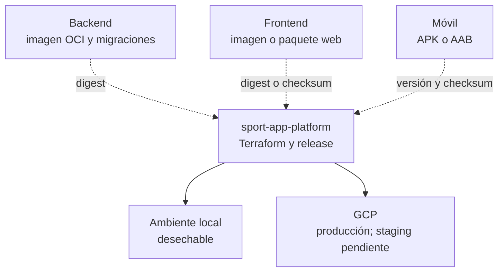
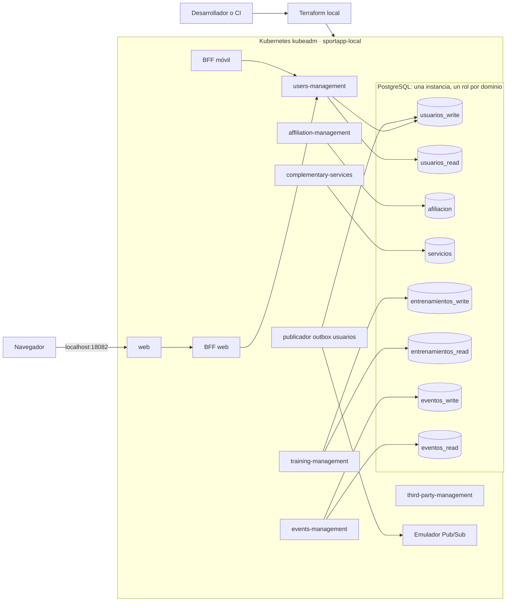
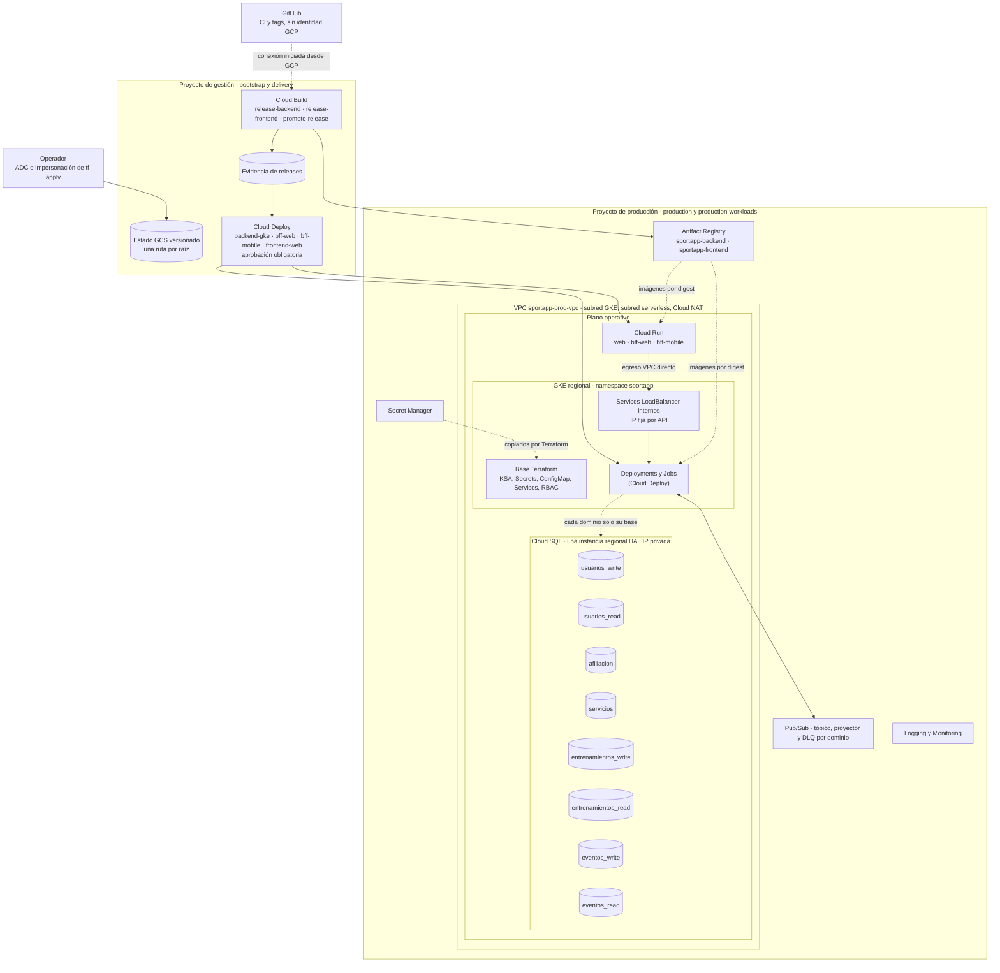
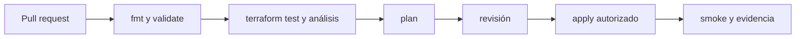

# Arquitectura Terraform de SportApp

## Decisión

Terraform se centraliza en `sport-app-platform`, bajo `infra/terraform/`. No vive dentro de backend, frontend ni móvil porque administra capacidades compartidas: ambientes, red, identidades, registro de artefactos, ejecución, datos, mensajería, secretos y observabilidad.

Esta decisión no convierte la plataforma en un monorepositorio con una sola versión. Cada componente conserva su repositorio, historial y release; la plataforma consume artefactos inmutables y declara qué combinación despliega.

## Dónde clonarlo y qué descarga

Se recomienda clonar la plataforma como una carpeta hermana de los repositorios actuales:

```text
aplicacion_proyecto_final/
├── backend/
├── frontend/
├── movil/
├── documentacion/
└── platform/          # sport-app-platform
```

Para comenzar solo con Terraform, documentación o automatización:

```text
cd "D:\04 - Mestría en Ingeniería de Software\08 - Ciclo 8\Proyecto final II\aplicacion_proyecto_final"
git clone --no-recurse-submodules https://github.com/lfnavarroj1/sport-app-platform.git platform
cd platform
git config --local submodule.recurse false
git config --local fetch.recurseSubmodules false
git config --local push.recurseSubmodules no
git submodule status
```

El prefijo `-` de las tres líneas de `git submodule status` confirma que únicamente se descargó la plataforma. Los punteros de `components/backend`, `components/frontend` y `components/mobile` están registrados, pero sus árboles no están inicializados.

`.gitmodules` define `update = none` y deshabilita el *fetch* recursivo. No se usa `git clone --recurse-submodules` para el desarrollo de Terraform. Cuando integración/E2E necesite expresamente los tres componentes:

```text
git submodule sync --recursive
git submodule update --init --checkout components/backend components/frontend components/mobile
```

Los submódulos son árboles adicionales fijados a versiones de integración; no reemplazan las carpetas `backend`, `frontend` y `movil` donde se desarrolla cada producto.

El push del trabajo de Terraform usa `git push --no-recurse-submodules origin <rama>`. No se emplea `--recurse-submodules=on-demand`; por tanto, el repositorio padre no publica commits de los componentes. Un cambio del puntero `components/*` se acepta únicamente mediante un PR de actualización de release que modifique también el manifiesto.

## Distribución de responsabilidades

| Repositorio | Conserva | No debe administrar |
| --- | --- | --- |
| `sport-app-backend` | código, dependencias, `Dockerfile`, migraciones, pruebas y manifiestos estrictamente internos | estado Terraform, red, GCP compartido o despliegue web |
| `sport-app-frontend` | código Angular, pruebas, empaquetado y `Dockerfile` si aplica | estado Terraform o infraestructura del backend |
| `sport-app-movil` | código Android, pruebas, APK/AAB y metadatos de versión | infraestructura compartida o despliegues de servidor |
| `sport-app-platform` | Terraform, composición local, Kubernetes compartido, ambientes, manifiesto de release y promoción | código funcional interno de cada componente |



## Estructura objetivo

```text
sport-app-platform/
├── infra/
│   ├── terraform/
│   │   ├── bootstrap/gcp-state/
│   │   ├── modules/
│   │   │   ├── common/
│   │   │   ├── local/
│   │   │   └── gcp/
│   │   └── environments/
│   │       ├── local/                  # desarrollo (Docker Desktop)
│   │       ├── staging/                # pendiente
│   │       ├── production/             # infraestructura GCP
│   │       ├── production-workloads/   # base Kubernetes en GKE (sin Deployments ni Jobs)
│   │       └── delivery/               # Cloud Build y Cloud Deploy (proyecto de gestión)
│   ├── kubernetes/
│   │   └── local/              # dependencias compartidas de desarrollo
│   └── policies/
├── deploy/clouddeploy/         # allowlist, Skaffold, overlay GKE y Cloud Run (entrega)
├── cloudbuild.promote.yaml     # promotor (trigger manual interno)
├── scripts/promote_release.py
├── orchestration/local/
└── release-manifest.yaml
```

Cada carpeta de `environments/` es una raíz independiente. Los ambientes no se separan mediante workspaces de una única raíz; esto permite aislar estado, variables, identidad y aprobaciones.

**Decisión del 2026-10-10:** el ambiente de desarrollo es local y corre completo en el Kubernetes de Docker Desktop (`environments/local`). GCP se usa solo para producción; `staging` queda pendiente. Por eso no existe una raíz `development` en GCP.

## Desarrollo local

El ambiente de desarrollo valida la integración sin conectarse a GCP. Terraform compone en el Kubernetes de Docker Desktop aprovisionado con kubeadm (contexto `docker-desktop`, namespace `sportapp-local`) las dependencias que mantiene la plataforma —PostgreSQL, emulador de Pub/Sub y sus tópicos— con los manifiestos `deploy/k8s/base` del backend y del frontend. La web corre en el clúster con la misma imagen que en Cloud Run y se publica en `localhost:18082`.



El estado local es desechable y se excluye de Git. Este ambiente prueba composición, conectividad, migraciones, outbox, eventos y flujos E2E; no pretende reproducir IAM, cuotas, alta disponibilidad ni comportamiento regional de GCP.

## Arquitectura en GCP

Así quedó aplicada en octubre de 2026. Cada raíz Terraform administra un bloque. El plano operativo, marcado en el diagrama, es el que `sportapp-gcp.ps1 down` destruye y `up` vuelve a crear.



| Raíz | Proyecto | Administra |
| --- | --- | --- |
| `bootstrap/gcp-state` | gestión | buckets de estado, `tf-plan`/`tf-apply` (solo operadores), identidades de build, promoción y ejecución, y presupuesto |
| `production` | producción | APIs, VPC, NAT, GKE, Cloud SQL, Pub/Sub, Artifact Registry, Secret Manager, Cloud Run base, IP internas, observabilidad y permisos cruzados |
| `production-workloads` | producción | namespace, KSA con Workload Identity, Secrets, ConfigMap `sportapp-runtime`, Services y el `Role` de Cloud Deploy; nunca Deployments ni Jobs |
| `delivery` | gestión | conexión de Cloud Build con GitHub, triggers, buckets de evidencia y de Cloud Deploy, pipelines, targets y aprobadores |

Los BFF de Cloud Run no pasan por un API Gateway. Llegan a cada API por su balanceador interno de IP fija, a través de la VPC. La capa de borde pública (dominio, TLS gestionado y protección perimetral) sigue pendiente.

### Bases de datos: lógicas por dominio, una instancia física

Cada microservicio tiene **sus propias bases** y su propio usuario, igual que en la [vista de despliegue de la arquitectura](https://github.com/lfnavarroj1/sport-app-platform/wiki). Lo que se comparte es la **instancia** (el servidor PostgreSQL) que las aloja:

| Dominio | Bases | Usuario | Contraseña (local / producción) |
| --- | --- | --- | --- |
| Usuarios | `usuarios_write`, `usuarios_read` | `usuarios` | `USUARIOS_DB_PASSWORD` / `db-password-usuarios` |
| Afiliación | `afiliacion` | `afiliacion` | `AFILIACION_DB_PASSWORD` / `db-password-afiliacion` |
| Servicios | `servicios` | `servicios` | `SERVICIOS_DB_PASSWORD` / `db-password-servicios` |
| Entrenamientos | `entrenamientos_write`, `entrenamientos_read` | `entrenamientos` | `ENTRENAMIENTOS_DB_PASSWORD` / `db-password-entrenamientos` |
| Eventos | `eventos_write`, `eventos_read` | `eventos` | `EVENTOS_DB_PASSWORD` / `db-password-eventos` |

Ningún servicio recibe la contraseña de otro dominio: cada carga solo lee el secreto del suyo. En local, cada rol es dueño de sus bases y se revoca el acceso público a ellas. En Cloud SQL, los usuarios creados pertenecen a `cloudsqlsuperuser`, así que restringir cada usuario a sus bases con `GRANT`/`REVOKE` sigue pendiente.

La topología física está decidida en ADR-023 de la documentación de arquitectura: una instancia por ambiente, por costo. según la estimación de costos de producción, la instancia consolidada ronda los USD 305 al mes, mientras que una instancia HA por cada uno de los cinco dominios lleva el costo mensual total a USD 3.200–3.800. Pasar a instancias separadas es un cambio del módulo `cloud-sql` y de los secretos, sin cambiar los nombres de bases ni de usuarios.

| Raíz | Estado | Forma de aplicación |
| --- | --- | --- |
| `local` (desarrollo) | local, ignorado por Git | desarrollador o CI desechable, sin GCP |
| `staging` (pendiente) | GCS exclusivo | ambiente protegido y ensayo de release |
| `production` | GCS exclusivo, protección reforzada | aprobación independiente sobre plan revisado |

El bootstrap crea los buckets de estado, versionado, bloqueo y permisos mínimos. Terraform se ejecuta desde la estación del operador; ningún workflow de GitHub obtiene identidad GCP. Cloud Build construye dentro de GCP y Cloud Deploy promueve por digest con aprobación. Terraform crea recursos y referencias a secretos, pero no guarda valores secretos.

## Validación y promoción



- En ramas se ejecutan controles sin credenciales privilegiadas.
- En pull requests se genera un plan seguro; nunca se ejecuta `apply` desde código no confiable.
- `staging` y `production` usan identidades y estados diferentes; desarrollo no usa credenciales de nube.
- Si cambia el commit o el estado después de revisar el plan, se genera y aprueba uno nuevo.
- Las pruebas que crean recursos deben usar destinos efímeros y ejecutar limpieza incluso ante fallos.

## Encendido, apagado y control de costos

«Apagar» tiene tres modos operativos:

| Modo | Cuándo usarlo | Qué ocurre |
| --- | --- | --- |
| `suspend` | pausa corta | Cloud Run usa mínimo `0`, GKE reduce nodos y Cloud SQL se detiene; pueden continuar cobros de almacenamiento, IP, balanceadores, control plane, imágenes y logs |
| `sportapp-gcp.ps1 down` / `up` | días o semanas sin uso | `down` destruye solo el plano operativo (GKE, Cloud SQL con sus datos y Cloud Run) con un destroy dirigido. Antes retira los Services de GKE para liberar los balanceadores, y se detiene si el plan alcanzara Artifact Registry u otro recurso del plano fijo. `up` lo recrea y reconcilia `production-workloads` y `delivery` ([uso del script](../scripts/sportapp-gcp.md)) |
| `destroy` completo | retirar el ambiente | se revisa `terraform plan -destroy` de `production` y se eliminan todos sus recursos, incluidas imágenes y secretos ([preparación de GCP, 15.3](preparacion-terraform-gcp.md#153-destruir-solamente-el-plano-operativo)) |

Desarrollo no genera costos en GCP: se crea y destruye en Docker Desktop con `terraform apply` y `terraform destroy`. `staging`, cuando exista, se destruirá después del ensayo y de conservar la evidencia necesaria. Producción nunca se incluye en una destrucción programada.

El estado Terraform y la automatización se conservan en un proyecto de gestión separado de las cargas desechables. Así se puede reconstruir un ambiente después de destruirlo. Las copias, imágenes o datos que se decida conservar pueden seguir generando costos.

Secuencia segura para un ambiente desechable:

```text
terraform plan -destroy -out=tfplan-destroy
terraform show tfplan-destroy
terraform apply tfplan-destroy
```

La deshabilitación de facturación se reserva para una emergencia: Google detiene los servicios y algunos recursos podrían eliminarse o no recuperarse. Tampoco se asume que una alerta de presupuesto limita el gasto; se configurarán presupuestos, límites cuando estén disponibles, fechas de caducidad, cuotas, máximos de escalamiento y limpieza de artefactos.

## Estado de implementación

La decisión y la arquitectura están aprobadas. Desde el 2026-10-10, `infra/terraform/` contiene la raíz `local` (desarrollo en Docker Desktop), el bootstrap (`bootstrap/gcp-state`), los módulos GCP y la raíz `production`. Su uso y los supuestos pendientes se describen en [`infra/terraform/README.md`](../infra/terraform/README.md).

Antes del primer `apply`, complete la guía correspondiente: [preparación local](preparacion-terraform-local.md) para activar kubeadm o [preparación de GCP](preparacion-terraform-gcp.md) para proyectos, estado, identidades internas, Cloud Build y Cloud Deploy sin autenticación GCP desde GitHub.

La raíz `local` se aplicó en Docker Desktop y se verificó con un registro de usuario de punta a punta (BFF, servicio, PostgreSQL, outbox y Pub/Sub). Desde el 2026-10-18 existen también `production-workloads` (base Kubernetes), `delivery` (Cloud Build y Cloud Deploy con aprobación) y la configuración de entrega en `deploy/clouddeploy`. El bootstrap ya no crea WIF para GitHub.

En octubre de 2026 se aplicaron en GCP el bootstrap, `production`, `production-workloads` y `delivery` con [`scripts/sportapp-gcp.ps1`](../scripts/sportapp-gcp.md). Las primeras releases de backend y frontend (`v0.2.0`) se construyeron en Cloud Build y se promovieron a Cloud Deploy. Ese primer ciclo corrigió:

- permisos de las cuentas de build, promoción y ejecución;
- el namespace de los manifiestos de GKE;
- el render de los BFF;
- la dependencia de Artifact Registry respecto de GKE en `down`.

Siguen pendientes:

- la evidencia completa de un rollout con smoke y de un rollback;
- `staging`;
- la capa de borde.

Propiedad: Terraform administra infraestructura, identidades, configuración compartida, Services, RBAC, pipelines y targets; Cloud Deploy administra imágenes, revisiones, tráfico, Deployments y Jobs. Ningún campo tiene dos dueños ([preparación de GCP, sección 6.4](preparacion-terraform-gcp.md#64-separar-propiedad-terraformcloud-deploy)).

## Referencias

- [Google Cloud: prácticas recomendadas para módulos raíz](https://docs.cloud.google.com/docs/terraform/best-practices/root-modules)
- [HashiCorp: backend GCS](https://developer.hashicorp.com/terraform/language/backend/gcs)
- [HashiCorp: comando `terraform test`](https://developer.hashicorp.com/terraform/cli/commands/test)
- [Google Cloud: presupuestos y alertas](https://docs.cloud.google.com/billing/docs/how-to/budgets)
- [Google Cloud: deshabilitar facturación](https://docs.cloud.google.com/billing/docs/how-to/modify-project)
- [Cloud SQL: iniciar y detener instancias](https://docs.cloud.google.com/sql/docs/postgres/start-stop-restart-instance)
- [HashiCorp: `terraform destroy`](https://developer.hashicorp.com/terraform/cli/commands/destroy)
