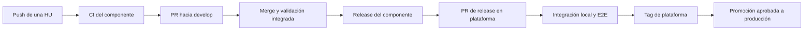

# Integración continua y release de SportApp

## Objetivo

SportApp conserva versiones independientes de backend, frontend web y móvil. Una versión de `sport-app-platform` identifica la combinación que fue integrada, probada y aceptada para un sprint.

Cada repositorio construye su artefacto una sola vez. La plataforma registra y promueve sus digests o checksums; nunca recompila un componente para pasarlo de staging a producción.

> **Actualización 2026-10-18:** desarrollo es local y GCP se usa solo para producción. GitHub Actions no obtiene identidad GCP. Un merge a `develop` no aprovisiona, publica ni despliega en GCP. Al etiquetar una release, Cloud Build —iniciado y autenticado dentro de GCP— construye y publica por digest; Cloud Deploy promueve la composición únicamente después de aprobación humana. Terraform se ejecuta manualmente desde la estación del operador.

## Situación actual

Al 11 de octubre de 2026 el backend ya ejecuta CI remota en push y pull request. La plataforma contiene Terraform para desarrollo local y producción, además de un `release-manifest.yaml` candidato y su JSON Schema. El manifiesto permanece en `status: draft` porque los componentes fijados aún no tienen tags y artefactos de release registrados. Todavía no existen los workflows de release coordinada; frontend y móvil conservan pendientes según sus registros.

Desde el 2026-10-18 la plataforma contiene, sin aplicar en GCP, el plano de entrega completo: triggers `release-backend` y `release-frontend` de Cloud Build, evidencia `backend-release.json`/`frontend-release.json` validada por [JSON Schema](../schemas/backend-release.schema.json), el promotor [`cloudbuild.promote.yaml`](../cloudbuild.promote.yaml) y los pipelines de Cloud Deploy `backend-gke`, `bff-web`, `bff-mobile` y `frontend-web`, todos con aprobación. Backend y frontend ya tienen su `cloudbuild.release.yaml`. GitHub Actions solo valida: nunca publica, promueve ni despliega.

## Qué hace cada evento

| Evento | Validación | Artefacto | Despliegue |
| --- | --- | --- | --- |
| Push a `feature/**`, `fix/**` o `chore/**` | rápida | no publica | ninguno |
| PR hacia `develop` | completa | candidato no publicado | ninguno; usa servicios de CI o composición local |
| Merge a `develop` | completa sobre la revisión integrada | no publica | ninguno; el ambiente local se actualiza bajo demanda |
| PR `release/**` hacia `main` de un componente | release del componente | Cloud Build publica al etiquetar | no libera todo SportApp ni entrega identidad GCP a GitHub |
| PR `release/**` en la plataforma | manifiesto, contratos, integración y E2E disponibles | reutiliza artefactos publicados | no producción; staging está pendiente |
| Tag de plataforma | congela la composición | manifiesto y notas | habilita producción |
| Promoción manual aprobada | smoke y comprobación | mismos digests | producción |



Un push de una rama de trabajo nunca fusiona ni despliega por sí mismo.

## Desde dónde se lanza cada release

| Release | Repositorio | Resultado |
| --- | --- | --- |
| Backend | `sport-app-backend` | versión backend y ocho imágenes OCI por digest |
| Frontend | `sport-app-frontend` | versión web y artefacto por checksum o digest |
| Móvil | `sport-app-movil` | versión móvil, `versionCode` y APK/AAB por checksum |
| SportApp completo | `sport-app-platform` | manifiesto compatible, pruebas transversales y versión del sprint |

## Cómo lanzar una release completa

Antes de iniciar, backend y frontend deben tener tags y artefactos publicados. Luego se ejecuta en `sport-app-platform` el workflow objetivo `prepare-platform-release.yml` con la versión de plataforma y las referencias de los componentes:

```powershell
gh workflow run prepare-platform-release.yml --repo lfnavarroj1/sport-app-platform --ref main -f platform_version=0.1.0 -f backend_ref=v0.2.0 -f frontend_ref=v0.1.0 -f mobile_ref=v0.1.0
```

Este comando funcionará cuando el workflow sea implementado. Su ejecución debe:

1. comprobar que los tags existen y obtener sus commits;
2. recuperar los descriptores y artefactos publicados;
3. actualizar los submódulos y `release-manifest.yaml`;
4. crear `release/v0.1.0` y un PR, sin desplegar producción;
5. ejecutar contratos, integración local, E2E y seguridad; incorporar staging cuando sea definido;
6. permitir aprobación y creación del tag de plataforma;
7. promover a producción los mismos digests mediante un ambiente protegido.

## Manifiesto de composición

El manifiesto registra números independientes y prueba qué versiones funcionan juntas:

- el archivo operativo está en [`../release-manifest.yaml`](../release-manifest.yaml), fuera de `docs/`;
- el esquema está en [`../schemas/release-manifest.schema.json`](../schemas/release-manifest.schema.json);
- `draft` representa una composición todavía no publicable y `released` activa las restricciones completas;
- al etiquetar la plataforma se conserva una copia inmutable en `releases/vX.Y.Z.yaml`.

```yaml
schemaVersion: 1
platformVersion: 0.1.0
status: released
sprint: Sprint 1
acceptedStories: [HU010, HU011]
components:
  backend:
    repository: https://github.com/lfnavarroj1/sport-app-backend
    version: 0.2.0
    ref: v0.2.0
    commit: <sha-completo>
    contractVersion: 1.0.0
    artifacts:
      bff-web: <imagen-por-digest>
      users-management: <imagen-por-digest>
  frontend:
    repository: https://github.com/lfnavarroj1/sport-app-frontend
    version: 0.1.0
    ref: v0.1.0
    commit: <sha-completo>
    expectedBffContract: 1.0.0
    artifact:
      uri: <imagen-por-digest>
```

El fragmento es ilustrativo; [`schemas/release-manifest.schema.json`](../schemas/release-manifest.schema.json) es el contrato completo y exige también los demás artefactos backend y el componente móvil. En una release real no se permiten marcadores. Backend y frontend no necesitan compartir el mismo número; deben coincidir en el contrato declarado y en la combinación aprobada por la plataforma.

## Verificación de las versiones desplegadas

- el frontend publica `version.json` con versión, commit y contrato esperado;
- el BFF publica `GET /version` con versión, commit y contrato ofrecido;
- la plataforma inyecta su versión como configuración de despliegue;
- el smoke posterior compara esos datos y los digests desplegados contra el manifiesto;
- cualquier diferencia bloquea la promoción o inicia el procedimiento de rollback.

```text
Plataforma: v0.1.0
Frontend:   v0.1.0 · commit 89abcdef...
Backend:    v0.2.0 · commit 01234567...
Contrato:   v1.0.0 · compatible
```

## Workflows que deben implementarse

| Ubicación | Workflows principales |
| --- | --- |
| Backend | `ci.yml`, `release-backend.yml` (`deliver-development.yml` debe retirarse o transformarse) |
| Frontend | `ci-web.yml`, `release-web.yml` (no se crea entrega automática de development) |
| Móvil | `ci-mobile.yml`, `release-mobile.yml` |
| Plataforma | `validate-platform.yml` (implementado: Markdown, YAML, JSON, scripts y Terraform con mocks); `prepare-platform-release.yml` y `test-platform-release.yml` (pendientes). La promoción y el rollback **no** son workflows de GitHub: son el trigger interno `promote-release` y Cloud Deploy con aprobación ([preparación de GCP, secciones 10 a 14](preparacion-terraform-gcp.md#10-configurar-construcción-y-publicación)) |

## Condiciones previas de activación

1. normalizar `master` a `main` o ajustar conscientemente los triggers;
2. crear y proteger `develop` y `main`;
3. confirmar y publicar el código y los workflows locales;
4. integrar la validación del esquema y la coincidencia de submódulos en CI;
5. retirar OIDC/WIF y cualquier variable o secreto GCP de GitHub (código listo; en GitHub y en un estado aplicado, seguir la [migración](migracion-retiro-wif-github.md));
6. aplicar en GCP las conexiones de lectura, cuentas Cloud Build separadas, Artifact Registry y manifiestos por digest (código listo en `bootstrap`, `production` y `delivery`);
7. aplicar Cloud Deploy, targets productivos, cuenta de ejecución mínima y aprobación humana (código listo en `delivery` y `deploy/clouddeploy`);
8. separación de la propiedad de imágenes/workloads entre Terraform y Cloud Deploy (implementada y probada);
9. implementar `version.json`, `GET /version` y el verificador posterior al despliegue.
