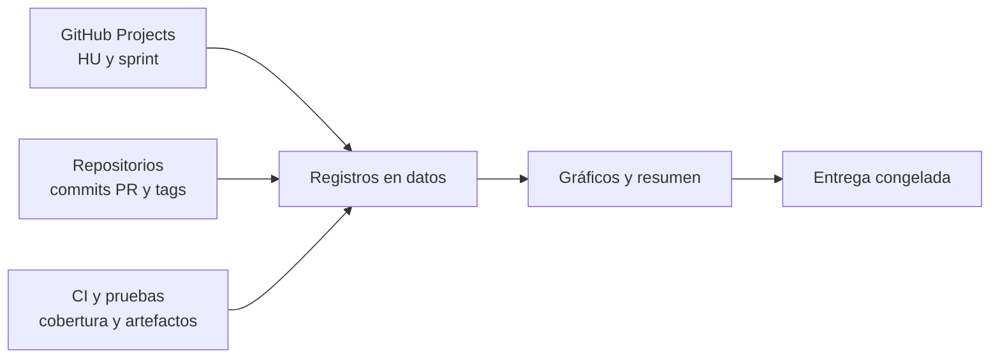

# Guía de actualización de avances

Este archivo se mantiene directamente como `docs/guia-de-actualizacion.md` en `sport-app-platform`.

## Cuándo actualizar

Actualice los registros de `project/` en cuatro momentos:

1. al planear un sprint;
2. diariamente, solo para el burndown del sprint;
3. al cerrar la revisión del sprint;
4. antes de una entrega, demo o sustentación.

La fecha de corte debe aparecer en cada informe. Nunca mezcle datos de cortes diferentes sin indicarlo.

## Flujo de actualización

1. Revise el [GitHub Project SportApp Platform](https://github.com/users/lfnavarroj1/projects/4) y actualice `project/catalogo-historias.md` cuando corresponda conservar evidencia.
2. Registre allí fechas, compromiso, versión objetivo y cierre del sprint.
3. Durante el sprint actualice el saldo diario de burndown.
4. Enlace resultados de CI, pruebas, cobertura y artefactos.
5. Actualice las páginas de [métricas](https://github.com/lfnavarroj1/sport-app-platform/wiki/04-metricas-y-graficos) y [calidad](https://github.com/lfnavarroj1/sport-app-platform/wiki/05-calidad-pruebas-y-cobertura) desde la única fuente local de Wiki: `documentacion/presentacion-proyecto/wiki/`.
6. Revise el resumen, los riesgos y los próximos pasos.
7. Cree una copia fechada a partir de la plantilla publicada en la wiki.

## Definición de terminado para medir una HU

Una HU se considera terminada solamente cuando, según aplique:

- cumple los criterios de aceptación aprobados;
- tiene cliente web o móvil integrado con su BFF;
- tiene contrato versionado, lógica, persistencia y migración;
- supera pruebas unitarias, integración, contrato y E2E necesarias;
- está integrada en la rama acordada y tiene evidencia de CI;
- fue demostrada y aceptada en la revisión del sprint.

Además, todas las tareas técnicas requeridas por su canal deben estar entregadas e integradas: `T-HUxxx-BE` + `T-HUxxx-WEB` en HU001–HU025, más `T-HU003-MOB` en HU003, y `T-HUxxx-BE` + `T-HUxxx-MOB` en HU026–HU040.

Un backend aislado, una pantalla con datos simulados, una rama sin integrar o una tarea técnica terminada se registran como avance parcial, pero no suman velocidad ni valor entregado.

## Estados permitidos

Son los mismos estados del Project 4 y de la documentación central.

| Estado | Uso |
| --- | --- |
| Backlog | No existe trabajo verificable de la HU. |
| Preparada | Las tareas obligatorias están identificadas y no hay ambigüedades bloqueantes para iniciar. |
| En curso | Al menos una tarea técnica tiene rama y responsable; no hay incremento vertical completo. |
| Bloqueada | No puede avanzar por una dependencia o decisión explícita. |
| En revisión | Todas las tareas requeridas están entregadas y existe una versión integrable que espera validación. |
| Aceptada | Cumple la definición de terminado y fue aceptada. |
| Retirada | Salió del alcance mediante una decisión registrada. |

Las tareas `T-HUxxx-*` registran su propio estado (por ejemplo, una tarea móvil `Bloqueada`), pero la HU solo cambia según las condiciones anteriores. Si un bloqueo de tarea impide el resultado, la HU se marca `Bloqueada` o mantiene el riesgo explícito.

No use porcentajes subjetivos como «90 % terminada» para calcular velocidad. El trabajo parcial se explica cualitativamente y conserva sus PHU pendientes.

## Responsabilidades

| Dato | Responsable de proponer | Evidencia requerida |
| --- | --- | --- |
| Sprint, compromiso y estado de HU | Equipo de producto | GitHub Projects y revisión del sprint |
| Aceptación y valor de negocio | Product Owner o responsable del proyecto | Criterios y acta/reporte de revisión |
| Commits, PR, versión y artefacto | Responsable del repositorio | Git, GitHub Actions y registro de artefactos |
| Pruebas y cobertura | Responsable de calidad/repositorio | Reportes generados por CI |
| Riesgos y decisiones | Equipo y responsable de arquitectura | ADR, issue o registro de riesgo |
