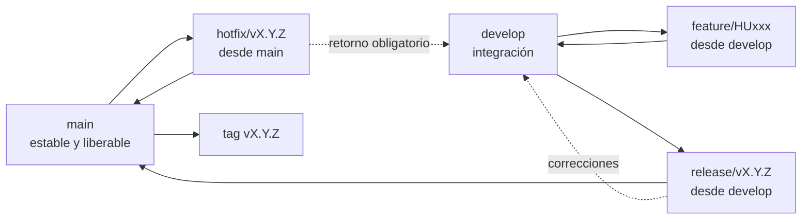

# Manual de versiones de SportApp

Este archivo se publicará como `docs/manual-versionado.md` en `sport-app-platform`.

## Objetivo

Este manual define cómo se relacionan los sprints, las historias de usuario, las ramas, las versiones de componentes y las versiones integradas de `sport-app-platform`.

El flujo de automatización, los efectos de cada push y el lanzamiento de una composición completa se detallan en el [esquema de CI y release](esquema-ci-y-release.md).

Se aplican dos reglas de negocio acordadas:

1. cada HU se implementa como un `feature` trazable;
2. cada sprint aceptado produce una versión de la plataforma.

Una HU no produce automáticamente una release individual. Las HU aceptadas durante el sprint se agrupan en la versión de cierre correspondiente.

## Unidades versionables

| Unidad | Fuente de versión | Etiqueta | Independencia |
| --- | --- | --- | --- |
| Backend | `pyproject.toml` | `vX.Y.Z` | independiente |
| Frontend | `package.json` | `vX.Y.Z` | independiente |
| Móvil | `versionName` y `versionCode` | `vX.Y.Z` | independiente |
| Plataforma | `release-manifest.yaml` | `vX.Y.Z` | combina versiones compatibles |

No se obliga a que los cuatro números coincidan. La plataforma cambia cuando cambia la combinación entregable; un componente cambia solo cuando su código o artefacto cambia.

### Fuente normativa y ubicación del manifiesto

La especificación arquitectónica completa y su impacto se mantienen en el repositorio oficial `documentacion`, principalmente en `arquitectura/decisiones/ADR-020-repositorio-integrador-y-versionado.md` y `arquitectura/integracion-continua/06-esquema-operativo-ci-y-release-integrado.md`. Este manual conserva únicamente el procedimiento operativo necesario para trabajar en la plataforma.

El manifiesto no pertenece a `docs/`: el candidato vigente es [`release-manifest.yaml`](../release-manifest.yaml), su contrato validable es [`schemas/release-manifest.schema.json`](../schemas/release-manifest.schema.json) y las copias inmutables de versiones publicadas se guardan en `releases/vX.Y.Z.yaml`.

Mientras no existan tags y artefactos publicados, el manifiesto permanece en `status: draft`: registra los commits exactos de los submódulos, pero permite versiones, referencias y artefactos vacíos. `status: released` exige versiones SemVer, tags, contratos, los ocho digests OCI del backend, el digest del frontend y el checksum del artefacto móvil.

## Versión de plataforma por sprint

Mientras se construye el primer MVP se utiliza la serie `0.x`:

| Cierre | Versión de plataforma | Condición |
| --- | --- | --- |
| Sprint 1 | `v0.1.0` | incremento aceptado y reproducible del Sprint 1 |
| Sprint 2 | `v0.2.0` | incremento aceptado y reproducible del Sprint 2 |
| Sprint 3 | `v0.3.0` | incremento aceptado y reproducible del Sprint 3 |
| MVP aprobado | `v1.0.0` | alcance mínimo completo, aceptado y desplegable |

Después de `v1.0.0`, un sprint ordinario incrementa `MINOR`: `v1.1.0`, `v1.2.0`, etc. Una corrección urgente compatible incrementa `PATCH`. Un cambio incompatible aprobado incrementa `MAJOR`.

Si un sprint no produce un incremento aceptado, no se publica una versión vacía. El sprint conserva su registro y la siguiente release usa el siguiente número aprobado, documentando la desviación.

## GitFlow oficial

La línea `Master` del diagrama acordado se implementa con el nombre `main`. El flujo se aplica en backend, frontend, móvil y plataforma:



Reglas:

- `main` contiene únicamente releases y hotfix aprobados;
- `develop` integra el trabajo del siguiente sprint;
- `feature/HUxxx-*` parte de `develop` y vuelve mediante PR;
- `release/vX.Y.Z` congela el alcance del sprint y solo admite estabilización;
- `hotfix/vX.Y.Z-*` parte de `main` y vuelve tanto a `main` como a `develop`;
- el tag se crea sobre `main` después de la aceptación;
- ningún workflow fusiona automáticamente por el solo hecho de pasar las pruebas.

Para el Sprint 1, por ejemplo, la plataforma crea `release/v0.1.0` desde `develop`; después de aceptar el incremento, la integra en `main` y etiqueta `v0.1.0`.

## Una HU como feature

Cada historia usa el mismo identificador en GitHub Projects, ramas, commits, PR, pruebas y documentación.

Una HU es una sola historia aunque participen varios repositorios. Su trabajo se reparte en tareas técnicas hijas, que no tienen PHU ni valor y no cierran la HU por separado:

| Tarea | Repositorio | Cuándo existe |
| --- | --- | --- |
| `T-HUxxx-BE` | `sport-app-backend` | en las 40 HU (microservicio y BFF del canal) |
| `T-HUxxx-WEB` | `sport-app-frontend` | HU001–HU025 |
| `T-HUxxx-MOB` | `sport-app-movil` | HU026–HU040 y HU003 |
| `T-HUxxx-PLAT` | `sport-app-platform` | solo si la HU requiere trabajo real en la plataforma |

Las ramas y los commits usan el identificador de la **HU**, no el de la tarea.

Patrón de rama:

```text
feature/HU001-registrar-usuario
feature/HU031-integrar-strava
```

Cuando una HU afecta varios repositorios, cada uno crea su propia rama con el mismo identificador:

```text
sport-app-backend:  feature/HU001-registrar-usuario
sport-app-frontend: feature/HU001-registrar-usuario
sport-app-platform: feature/HU001-integracion
```

La rama de plataforma solo contiene contratos transversales, pruebas E2E, composición o documentación; no copia el código de los componentes.

## Commits y pull requests

Se usan commits convencionales con referencia a la HU:

```text
feat(users): registrar usuario [HU001]
test(web): cubrir validaciones de registro [HU001]
fix(auth): evitar duplicado de correo [HU001]
docs(platform): actualizar evidencia de HU001
```

El título recomendado del PR es:

```text
[HU001] Registrar usuario en <componente>
```

El PR debe enlazar el ítem central del backlog y declarar:

- criterios cubiertos;
- repositorios relacionados;
- contratos modificados;
- pruebas y cobertura;
- impacto de versión;
- evidencia pendiente para la aceptación vertical.

## Regla de incremento por componente

| Cambio acumulado desde la última release | Incremento |
| --- | --- |
| Corrección compatible | `PATCH` |
| Una o más HU compatibles | `MINOR` |
| Contrato o comportamiento público incompatible | `MAJOR` |
| Solo documentación sin alterar el artefacto | no cambia el componente |

Antes de `1.0.0`, el equipo conserva estas reglas deliberadamente aunque SemVer permita mayor flexibilidad. Todo cambio incompatible debe quedar marcado y aprobado; no se oculta dentro de un incremento ordinario.

Varias HU del mismo sprint y componente producen una sola versión acumulada del componente. Por ejemplo, HU001, HU005 y HU006 pueden producir backend `v0.2.0`; no requieren tres versiones consecutivas.

## Ciclo de una HU

```mermaid
flowchart LR
    B[HU priorizada en Project]
    F[Rama feature/HUxxx]
    PR[PR del componente]
    CI[CI y revisión]
    D[Integración en develop]
    CR[Release del componente]
    PP[PR de plataforma]
    E2E[Contratos integración y E2E]
    A[Aceptación]
    SP[Release del sprint]

    B --> F --> PR --> CI --> D --> CR --> PP --> E2E --> A --> SP
```



Una HU suma velocidad únicamente al llegar a `Aceptada`. Código parcial, PR abiertos o backend sin cliente no se incluyen en las notas de release como funcionalidad terminada.

## Cierre del sprint

1. congelar la lista comprometida y registrar cambios de alcance;
2. identificar las HU aceptadas;
3. publicar versiones de los componentes que cambiaron;
4. actualizar los submódulos a los tags publicados;
5. completar `release-manifest.yaml` con tags, commits, artefactos por digest y la evidencia validada por el promotor (`evidence`: manifiesto de Cloud Build, su sha256 y el ID del build);
6. ejecutar contratos, integración, E2E, seguridad y smoke;
7. aceptar el incremento en la revisión del sprint;
8. crear el tag de plataforma correspondiente;
9. copiar el manifiesto a `releases/vX.Y.Z.yaml`;
10. publicar notas de release y actualizar Project y wiki.

## Manifiesto de la versión

Cada versión de plataforma registra como mínimo:

```yaml
schemaVersion: 1
platformVersion: 0.1.0
status: released
sprint: Sprint 1
acceptedStories:
  - HU010
  - HU011
components:
  backend:
    repository: https://github.com/lfnavarroj1/sport-app-backend
    version: 0.2.0
    ref: v0.2.0
    commit: <sha-completo>
    contractVersion: 1.0.0
    artifacts:
      users-management: <imagen-oci-por-digest>
      affiliation-management: <imagen-oci-por-digest>
      complementary-services: <imagen-oci-por-digest>
      training-management: <imagen-oci-por-digest>
      events-management: <imagen-oci-por-digest>
      third-party-management: <imagen-oci-por-digest>
      bff-web: <imagen-oci-por-digest>
      bff-mobile: <imagen-oci-por-digest>
  frontend:
    repository: https://github.com/lfnavarroj1/sport-app-frontend
    version: 0.1.0
    ref: v0.1.0
    commit: <sha-completo>
    expectedBffContract: 1.0.0
    artifact:
      uri: <imagen-oci-por-digest>
  mobile:
    repository: https://github.com/lfnavarroj1/sport-app-movil
    version: 0.1.0
    versionCode: 1
    ref: v0.1.0
    commit: <sha-completo>
    artifact:
      sha256: <checksum-apk-o-aab>
```

Una versión real no puede conservar marcadores `<...>` ni referencias a ramas móviles. Todos los valores `imagen-oci-por-digest` deben usar la forma inmutable `registro/ruta@sha256:<64-hex>`.

## Historias incompletas o trasladadas

- Una HU no aceptada no aparece en `acceptedStories`.
- Sus PHU no suman velocidad.
- La rama puede continuar o recrearse según la política de integración, pero el trabajo pendiente vuelve a planearse de forma visible.
- Si una parte ya fusionada es necesaria técnicamente, se documenta como avance parcial y no como valor funcional entregado.
- El sprint de aceptación, no el de inicio, determina la versión funcional donde se anuncia.

## Hotfix

Un defecto urgente usa:

```text
hotfix/vX.Y.Z-descripcion
```

El componente afectado incrementa `PATCH`. La plataforma también incrementa `PATCH`, actualiza el manifiesto, repite los controles aplicables y reconcilia el cambio con la rama de integración. No se sustituye un digest bajo una etiqueta existente.

## Campos requeridos en GitHub Projects

| Campo | Uso de versionado |
| --- | --- |
| HU | identificador estable |
| Tipo | `Historia` o `Tarea BE`/`WEB`/`MOB`/`PLAT`; PHU y valor solo en `Historia` |
| Parent issue | HU padre de cada tarea (sub-issue nativa) |
| Sprint | versión objetivo de plataforma |
| Estado | progreso y aceptación |
| PHU | velocidad al aceptar |
| Repositorios afectados | backend, frontend, móvil o plataforma |
| Versión objetivo | tag de plataforma previsto |
| PR relacionados | trazabilidad por componente |
| Versión entregada | tag real de plataforma |
| Evidencia | CI, demo, artefacto y aceptación |

Las tareas técnicas `T-HUxxx-*` se crean en el repositorio propietario **justo a tiempo**, al preparar o iniciar la HU, y se enlazan como sub-issues de la HU (relación nativa `Parent issue`, campo `Tipo` y campo `HU`); no se crean anticipadamente. Ramas, PR, CI, contratos y evidencia quedan enlazados bajo la HU padre. El backlog funcional principal (40 HU, 100 PHU y 100 puntos de valor) se administra desde el proyecto asociado a `sport-app-platform`.

## Notas de release

Cada release de plataforma debe listar:

- sprint y objetivo;
- HU aceptadas;
- versiones de backend, frontend y móvil;
- cambios de contratos o migraciones;
- artefactos y checksums/digests;
- resultados de pruebas y cobertura;
- riesgos conocidos;
- instrucciones de despliegue y rollback.

## Responsabilidades

| Responsabilidad | Propietario |
| --- | --- |
| Priorizar y aceptar HU | responsable de producto |
| Proponer incremento del componente | equipo propietario del repositorio |
| Verificar compatibilidad integrada | responsables de `sport-app-platform` |
| Aprobar versión de sprint | responsable de producto y responsable técnico |
| Crear tag y notas | workflow autorizado de release |
| Construir y publicar por digest | Cloud Build en GCP, con la cuenta del componente (`release-backend`, `release-frontend`) |
| Crear releases de Cloud Deploy | operador mediante el trigger interno `promote-release` (cuenta `release-promoter`) |
| Aprobar el rollout productivo | aprobadores humanos (`approvers`); nunca una automatización |
| Actualizar wiki y tablero | responsable de seguimiento con evidencia de CI |
