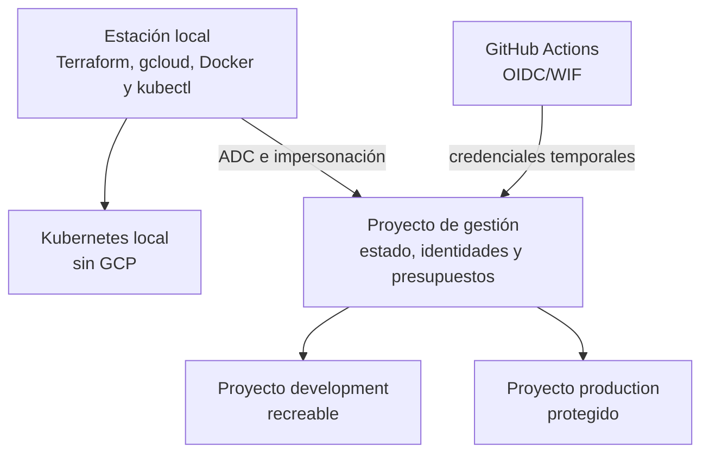

# Preparación local y de GCP para Terraform

## Propósito

Preparar una estación Windows, el entorno local Kubernetes y Google Cloud antes de crear o aplicar la infraestructura Terraform de SportApp. Esta guía no aprovisiona recursos por sí sola ni autoriza un despliegue en producción.

Terraform se ejecutará desde `sport-app-platform/infra/terraform/`. Backend, frontend y móvil no almacenan estado, credenciales ni infraestructura transversal.

## Resultado esperado

Al terminar debe existir:

- un clon seguro de `sport-app-platform` sin los submódulos inicializados;
- Terraform, Google Cloud CLI, Docker Desktop, `kubectl`, Git y GitHub CLI disponibles;
- Kubernetes local activo en el contexto esperado;
- proyectos GCP separados para gestión, desarrollo y producción;
- facturación, presupuestos y APIs controlados;
- autenticación local mediante Application Default Credentials —preferiblemente con suplantación—;
- Workload Identity Federation para GitHub Actions, sin llaves JSON;
- buckets GCS de estado creados mediante bootstrap, con versionado, bloqueo y acceso mínimo;
- archivos de variables no sensibles y ejemplos versionados;
- secretos fuera de `.tf`, `.tfvars`, planes, estado y Git.

## 1. Estructura de ambientes



| Ambiente | Uso | Quién puede aplicar | Ciclo |
| --- | --- | --- | --- |
| `local` | aprendizaje, composición y pruebas sin nube | desarrollador o CI local | desechable |
| `development` | integración con servicios reales GCP | identidad técnica aprobada | crear y destruir bajo demanda |
| `production` | operación estable | pipeline protegido con aprobación | persistente; sin destrucción programada |

## 2. Clonar solamente la plataforma

Desde la carpeta que contiene los repositorios:

```powershell
git clone --no-recurse-submodules https://github.com/lfnavarroj1/sport-app-platform.git
cd sport-app-platform

git config --local submodule.recurse false
git config --local fetch.recurseSubmodules false
git config --local push.recurseSubmodules no
git submodule status
```

Las tres líneas de `git submodule status` deben comenzar con `-`. Consulte la [guía de clonado seguro](guia-clonado-seguro.md) antes de crear una rama.

## 3. Preparar la estación local

### Herramientas necesarias

| Herramienta | Uso | Verificación |
| --- | --- | --- |
| Terraform CLI | formato, validación, plan y apply | `terraform version` |
| Google Cloud CLI | proyectos, ADC, APIs y diagnóstico | `gcloud version` |
| Docker Desktop | contenedores y Kubernetes local | `docker version` |
| `kubectl` | verificar el clúster local | `kubectl version --client` |
| Git | ramas y revisiones | `git version` |
| GitHub CLI | autenticación y evidencia de PR/workflow | `gh --version` |

Instale Terraform desde la [distribución oficial](https://developer.hashicorp.com/terraform/install) y Google Cloud CLI desde la [guía oficial](https://docs.cloud.google.com/sdk/docs/install-sdk). Cierre y vuelva a abrir PowerShell después de modificar el `PATH`.

Verificación conjunta:

```powershell
terraform version
gcloud version
docker version
kubectl version --client
git version
gh --version
```

La versión de Terraform admitida se fija posteriormente en `required_version`; la selección del proveedor se fija en `.terraform.lock.hcl`. No se depende de «la última versión» sin revisión.

## 4. Preparar Kubernetes local

En Docker Desktop:

1. use contenedores Linux;
2. abra **Kubernetes**;
3. cree o habilite el clúster;
4. espere a que aparezca como operativo;
5. compruebe explícitamente el contexto antes de aplicar.

```powershell
kubectl config get-contexts
kubectl config use-context docker-desktop
kubectl cluster-info
kubectl get nodes
```

Regla de seguridad: la raíz `environments/local` debe rechazar cualquier contexto diferente del contexto local aprobado. Nunca debe recibir credenciales, proyecto o endpoint de producción.

El laboratorio local utilizará estado desechable ignorado por Git. PostgreSQL, emulador Pub/Sub, namespaces y cargas se crearán únicamente dentro del clúster local.

## 5. Definir identificadores antes de crear GCP

Los identificadores reales deben decidirse antes del bootstrap. Ejemplo de archivo personal de preparación —no se confirma en Git—:

```powershell
$sportAppBillingAccount = "000000-000000-000000"
$sportAppManagementProject = "sportapp-mgmt-IDENTIFICADOR"
$sportAppDevelopmentProject = "sportapp-dev-IDENTIFICADOR"
$sportAppProductionProject = "sportapp-prod-IDENTIFICADOR"
$sportAppRegion = "us-central1"
$sportAppStateLocation = "US"
```

El identificador de proyecto es globalmente único y no se puede cambiar. Antes de usar `us-central1`, confirme requisitos de residencia de datos, latencia y costo.

## 6. Preparar proyectos y facturación

Se requieren, como mínimo:

| Proyecto | Contenido |
| --- | --- |
| Gestión | estado Terraform, WIF, identidades de pipeline y automatización financiera |
| Development | recursos recreables para integración |
| Production | recursos productivos protegidos |

Creación controlada de ejemplo:

```powershell
gcloud init
gcloud auth login

gcloud projects create $sportAppManagementProject --name="SportApp Management"
gcloud projects create $sportAppDevelopmentProject --name="SportApp Development"
gcloud projects create $sportAppProductionProject --name="SportApp Production"

gcloud billing projects link $sportAppManagementProject --billing-account=$sportAppBillingAccount
gcloud billing projects link $sportAppDevelopmentProject --billing-account=$sportAppBillingAccount
gcloud billing projects link $sportAppProductionProject --billing-account=$sportAppBillingAccount
```

Estos comandos modifican GCP y pueden habilitar consumo facturable. Ejecútelos únicamente cuando los nombres, permisos, cuenta de facturación y presupuestos hayan sido revisados.

No use una sola identidad con `Owner` o `Editor` para todos los ambientes. El bootstrap, el plan y el apply deben tener responsabilidades separadas y permisos mínimos.

## 7. APIs que deben estar disponibles

### Proyecto de gestión

```text
cloudresourcemanager.googleapis.com
serviceusage.googleapis.com
iam.googleapis.com
iamcredentials.googleapis.com
sts.googleapis.com
storage.googleapis.com
cloudbilling.googleapis.com
billingbudgets.googleapis.com
```

### Proyectos de ambiente

```text
serviceusage.googleapis.com
compute.googleapis.com
container.googleapis.com
run.googleapis.com
artifactregistry.googleapis.com
sqladmin.googleapis.com
servicenetworking.googleapis.com
pubsub.googleapis.com
secretmanager.googleapis.com
logging.googleapis.com
monitoring.googleapis.com
iam.googleapis.com
iamcredentials.googleapis.com
```

Ejemplo para habilitarlas en `development` después de aprobar el alcance:

```powershell
gcloud services enable `
  serviceusage.googleapis.com `
  compute.googleapis.com `
  container.googleapis.com `
  run.googleapis.com `
  artifactregistry.googleapis.com `
  sqladmin.googleapis.com `
  servicenetworking.googleapis.com `
  pubsub.googleapis.com `
  secretmanager.googleapis.com `
  logging.googleapis.com `
  monitoring.googleapis.com `
  iam.googleapis.com `
  iamcredentials.googleapis.com `
  --project=$sportAppDevelopmentProject
```

Production se prepara de forma independiente; no copie permisos, cuotas o activaciones sin revisión.

## 8. Autenticación local sin archivos de credenciales

Terraform usa Application Default Credentials. Para una primera validación autorizada en `development`:

```powershell
gcloud auth application-default login
gcloud auth application-default set-quota-project $sportAppDevelopmentProject
gcloud config set project $sportAppDevelopmentProject
gcloud projects describe $sportAppDevelopmentProject
```

La opción preferida, una vez creada la identidad de Terraform, es suplantar una cuenta de servicio por ambiente:

```powershell
$sportAppTerraformDevServiceAccount = "terraform-dev@$sportAppDevelopmentProject.iam.gserviceaccount.com"

gcloud auth application-default login `
  --impersonate-service-account=$sportAppTerraformDevServiceAccount
```

La persona necesita permiso para generar tokens sobre esa cuenta, y la cuenta técnica recibe únicamente los roles requeridos por los módulos reales.

No crear ni descargar una llave JSON como camino normal. No agregar al proveedor:

```hcl
# Prohibido para el flujo ordinario
credentials = file("service-account-key.json")
```

## 9. Identidades por responsabilidad

| Identidad | Alcance |
| --- | --- |
| `terraform-bootstrap` | crear estado, WIF e identidades iniciales; uso excepcional |
| `terraform-plan-dev` | leer development y generar planes |
| `terraform-apply-dev` | modificar únicamente development |
| `terraform-plan-prod` | leer producción y generar planes |
| `terraform-apply-prod` | aplicar un plan aprobado en producción |

Los nombres son orientativos. Los roles exactos se obtienen del inventario de recursos; no se concede `Owner`, `Editor` o permisos de producción a una estación personal.

## 10. Estado remoto y bootstrap

El backend GCS requiere que el bucket exista antes de ejecutar `terraform init` sobre un ambiente. La raíz `bootstrap/gcp-state` se ejecutará una vez con estado local controlado para crear:

- bucket o separación aprobada por ambiente;
- acceso uniforme por IAM y prevención de acceso público;
- versionado de objetos;
- política de retención y recuperación acordada;
- permisos separados para plan y apply;
- presupuesto y alertas del proyecto de gestión.

Después se migra el estado del propio bootstrap a un backend protegido. No se elimina el proyecto de gestión al destruir `development`.

Ejemplos versionables de configuración del backend:

```hcl
# backend-development.hcl.example
bucket = "REEMPLAZAR-STATE-BUCKET-DEVELOPMENT"
prefix = "terraform/development/platform"
```

```hcl
# backend-production.hcl.example
bucket = "REEMPLAZAR-STATE-BUCKET-PRODUCTION"
prefix = "terraform/production/platform"
```

Los archivos reales `backend-*.hcl` se ignoran si contienen identificadores que el equipo clasifique como sensibles. Nunca contienen credenciales.

Inicialización posterior al bootstrap:

```powershell
terraform init -backend-config=backend-development.hcl -reconfigure
```

GCS proporciona bloqueo del estado. No use `-lock=false` ni `force-unlock` como operación ordinaria.

## 11. Variables permitidas

Cada raíz tendrá `terraform.tfvars.example` versionado con marcadores:

```hcl
project_id  = "REEMPLAZAR-PROYECTO"
region      = "us-central1"
environment = "development"

github_owner      = "lfnavarroj1"
github_repository = "sport-app-platform"

labels = {
  application = "sport-app"
  environment = "development"
  managed_by  = "terraform"
  owner       = "REEMPLAZAR-RESPONSABLE"
}
```

El archivo real puede llamarse `development.auto.tfvars` y debe permanecer ignorado. Solo contiene configuración no secreta.

No se permiten en `.tfvars`:

- contraseñas de bases de datos;
- tokens de GitHub;
- llaves privadas o JSON de cuentas de servicio;
- secretos OAuth de Strava;
- claves API;
- contenido de certificados;
- datos personales;
- valores de versiones de Secret Manager.

Terraform crea el contenedor, metadatos e IAM del secreto. La carga y rotación del valor se realiza mediante un canal operativo independiente porque cualquier valor suministrado a Terraform puede terminar en el plan o el estado.

## 12. Archivos ignorados y versionados

La raíz de `sport-app-platform` debe ignorar:

```gitignore
.terraform/
*.tfstate
*.tfstate.*
*.tfplan
crash.log
crash.*.log
*.auto.tfvars
*.auto.tfvars.json
backend-*.hcl
*.pem
*.key
*service-account*.json
```

Sí se versionan:

```text
*.tf
.terraform.lock.hcl
*.tfvars.example
backend-*.hcl.example
README.md
tests/*.tftest.hcl
```

Antes de cualquier commit:

```powershell
git status --short
git diff --cached
git diff --cached --submodule=log
```

## 13. Preparar GitHub Actions con WIF

GitHub Actions debe autenticarse mediante OIDC y Workload Identity Federation. No almacene una llave de cuenta de servicio en `Secrets`.

Preparación conceptual:

1. crear un Workload Identity Pool en el proyecto de gestión;
2. crear un proveedor OIDC para GitHub;
3. restringir atributos a `lfnavarroj1/sport-app-platform` y a las ramas/ambientes autorizados;
4. permitir suplantar una cuenta de plan o apply específica;
5. guardar el nombre del proveedor WIF y correo de la cuenta como variables de GitHub;
6. conceder al job `contents: read` e `id-token: write`;
7. usar GitHub Environments diferentes para `development` y `production`;
8. exigir aprobación para production.

Production no usa la misma cuenta de servicio ni el mismo environment de GitHub que development.

## 14. Presupuestos y control de costos

Antes del primer `apply` real:

- cree un presupuesto por proyecto;
- configure umbrales tempranos y destinatarios;
- use un límite de gasto cuando el servicio y la cuenta lo admitan;
- defina máximos conservadores de instancias y réplicas;
- configure `min-instances = 0` para Cloud Run no productivo;
- asigne propietario y fecha de caducidad a development;
- documente `suspend` y `destroy`;
- confirme que las alertas normales de presupuesto no detienen automáticamente el gasto.

Consulte la sección de [encendido, apagado y control de costos](arquitectura-terraform.md#encendido-apagado-y-control-de-costos).

## 15. Validación sin aplicar infraestructura

Cuando exista el código Terraform:

```powershell
terraform fmt -check -recursive
terraform init -backend=false
terraform validate
terraform test
```

Para verificar acceso a development después del bootstrap:

```powershell
terraform init -backend-config=backend-development.hcl -reconfigure
terraform plan -var-file=development.auto.tfvars -out=development.tfplan
terraform show development.tfplan
```

El plan puede contener información sensible: no se confirma en Git ni se adjunta a un canal público. Ningún comando de esta sección aplica cambios.

## 16. Condiciones adicionales para producción

Production se considera preparado solamente cuando:

- development fue creado, probado y destruido de forma reproducible;
- existen pruebas de restauración de estado y datos;
- WIF, GitHub Environment y aprobación están activos;
- el plan se genera para el commit que se aprobará;
- no hay credenciales personales en el proceso;
- imágenes y paquetes se referencian por digest/checksum;
- backups, RPO/RTO, red, DNS, certificados y observabilidad están aprobados;
- los recursos persistentes tienen protección contra destrucción accidental;
- el rollback y las migraciones fueron ensayados en staging o equivalente.

Un equipo personal puede generar validaciones estáticas o planes limitados, pero el `apply` de producción pertenece al pipeline protegido.

## 17. Lista de preparación

### Local

- [ ] El clon no inicializó los submódulos.
- [ ] Terraform y herramientas responden desde PowerShell.
- [ ] Docker Desktop usa contenedores Linux.
- [ ] Kubernetes local está operativo.
- [ ] El contexto de `kubectl` es el local aprobado.
- [ ] Estado, planes y variables reales están ignorados.

### GCP común

- [ ] Los IDs y la región fueron aprobados.
- [ ] La cuenta de facturación está identificada.
- [ ] Existen proyectos separados de gestión, development y production.
- [ ] Hay presupuestos y alertas antes del primer apply.
- [ ] Las APIs necesarias están habilitadas por proyecto.
- [ ] El backend GCS existe, está versionado y bloquea el estado.
- [ ] No existen llaves JSON en el repositorio o GitHub Secrets.

### Development

- [ ] ADC funciona con cuenta autorizada o suplantación.
- [ ] Las identidades de plan y apply tienen permisos mínimos.
- [ ] `terraform init`, `validate`, `test` y `plan` terminan correctamente.
- [ ] `destroy` y la comprobación de costos residuales están preparados.

### Production

- [ ] WIF y GitHub Environment están protegidos.
- [ ] La cuenta de producción es distinta de development.
- [ ] El apply requiere aprobación explícita.
- [ ] Backups, restauración, rollback y observabilidad tienen evidencia.
- [ ] No existe destrucción automática de producción.

## Referencias oficiales

- [HashiCorp: instalar Terraform](https://developer.hashicorp.com/terraform/install)
- [Google Cloud: autenticación para Terraform](https://docs.cloud.google.com/docs/terraform/authentication)
- [Google Cloud: habilitar APIs y servicios](https://docs.cloud.google.com/service-usage/docs/enable-disable)
- [HashiCorp: backend GCS](https://developer.hashicorp.com/terraform/language/backend/gcs)
- [Google Cloud: WIF para pipelines](https://docs.cloud.google.com/iam/docs/best-practices-for-using-service-accounts-in-deployment-pipelines)
- [Docker Desktop: Kubernetes local](https://docs.docker.com/desktop/use-desktop/kubernetes/)
- [Google Cloud: presupuestos y alertas](https://docs.cloud.google.com/billing/docs/how-to/budgets)
