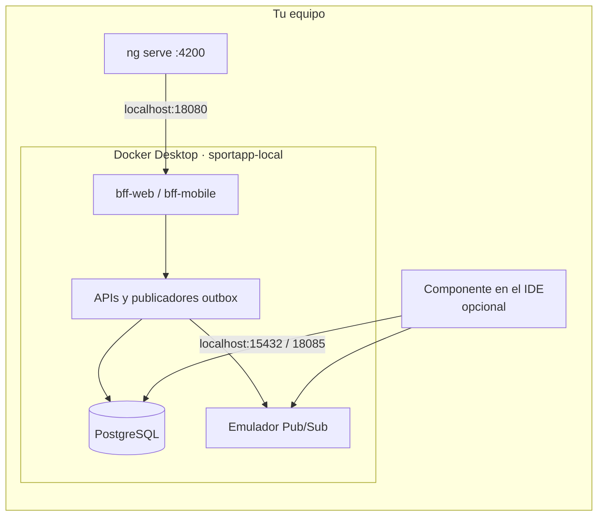
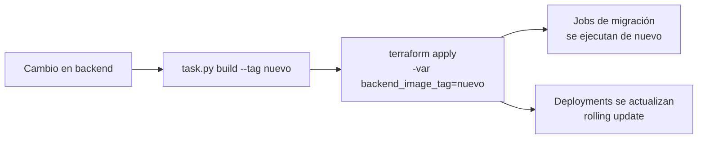
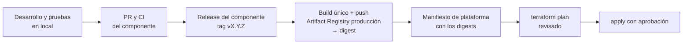

# Terraform de SportApp

Este directorio crea y mantiene los dos ambientes de SportApp:

| Ambiente | Dónde corre | Raíz Terraform |
| --- | --- | --- |
| **Desarrollo** | tu equipo, en el clúster Kubernetes **kubeadm** de Docker Desktop | [`environments/local`](environments/local) |
| **Producción** | Google Cloud Platform | [`environments/production`](environments/production) |

Desarrollo no usa GCP ni credenciales en la nube. Implementa la [arquitectura Terraform](../../docs/arquitectura-terraform.md) de la plataforma.

> **Estado (2026-10-10):** desarrollo local se aplicó en Docker Desktop y se verificó con un registro de usuario real, desde el BFF hasta Pub/Sub. Producción está validada con `terraform validate` y `terraform test`, pero todavía no se ha aplicado en GCP.

## Tabla de contenido

1. [Antes de empezar](#1-antes-de-empezar)
   - [1.1 ¿Qué quieres hacer?](#11-qué-quieres-hacer)
   - [1.2 Conceptos mínimos](#12-conceptos-mínimos)
2. [Los dos ambientes](#2-los-dos-ambientes)
3. [Estructura del código](#3-estructura-del-código)
4. [Desarrollo local paso a paso](#4-desarrollo-local-paso-a-paso)
   - [4.1 Requisitos](#41-requisitos)
   - [4.2 Construir las imágenes del backend](#42-construir-las-imágenes-del-backend)
   - [4.3 Crear el ambiente](#43-crear-el-ambiente)
   - [4.4 Verificar](#44-verificar)
   - [4.5 Usar el ambiente](#45-usar-el-ambiente)
   - [4.6 Ejecutar un componente en el host](#46-ejecutar-un-componente-en-el-host)
   - [4.7 Destruir y recrear](#47-destruir-y-recrear)
5. [Cómo se actualizan backend y frontend en desarrollo](#5-cómo-se-actualizan-backend-y-frontend-en-desarrollo)
   - [5.1 Cambió el código del backend](#51-cambió-el-código-del-backend)
   - [5.2 Cambiaron los manifiestos del backend](#52-cambiaron-los-manifiestos-del-backend)
   - [5.3 Frontend web](#53-frontend-web)
   - [5.4 Cambiar las dependencias compartidas](#54-cambiar-las-dependencias-compartidas)
6. [Producción en GCP paso a paso](#6-producción-en-gcp-paso-a-paso)
   - [6.1 Qué crea](#61-qué-crea)
   - [6.2 Variables y credenciales](#62-variables-y-credenciales)
   - [6.3 Instalar Google Cloud CLI](#63-instalar-google-cloud-cli)
   - [6.4 Preparar los proyectos](#64-preparar-los-proyectos)
   - [6.5 Ejecutar el bootstrap](#65-ejecutar-el-bootstrap)
   - [6.6 Crear producción](#66-crear-producción)
   - [6.7 Cambios posteriores](#67-cambios-posteriores)
7. [Producción desde GitHub Actions](#7-producción-desde-github-actions)
8. [Cómo llegan backend y frontend a producción](#8-cómo-llegan-backend-y-frontend-a-producción)
   - [8.1 El ciclo completo](#81-el-ciclo-completo)
   - [8.2 Publicar la imagen](#82-publicar-la-imagen)
   - [8.3 Desplegar en Cloud Run](#83-desplegar-en-cloud-run)
   - [8.4 Desplegar en GKE](#84-desplegar-en-gke)
   - [8.5 Resumen por evento](#85-resumen-por-evento)
9. [Pruebas](#9-pruebas)
10. [Solución de problemas](#10-solución-de-problemas)
11. [Supuestos y pendientes](#11-supuestos-y-pendientes)

---

## 1. Antes de empezar

### 1.1 ¿Qué quieres hacer?

| Quiero… | Sección |
| --- | --- |
| Dejar lista mi plataforma por primera vez (activar Kubernetes kubeadm, o crear proyectos GCP y completar los archivos de credenciales) | [guía de preparación](../../docs/preparacion-terraform-local-gcp.md) |
| Levantar SportApp completo en mi equipo | [4](#4-desarrollo-local-paso-a-paso) |
| Probar un cambio del backend en desarrollo | [5.1](#51-cambió-el-código-del-backend) |
| Conectar el frontend al backend local | [5.3](#53-frontend-web) |
| Depurar un microservicio desde el IDE con la base de datos y Pub/Sub locales | [4.6](#46-ejecutar-un-componente-en-el-host) |
| Crear o cambiar la infraestructura de producción | [6](#6-producción-en-gcp-paso-a-paso) |
| Publicar una versión en producción | [8](#8-cómo-llegan-backend-y-frontend-a-producción) |
| Apagar o volver a encender un ambiente (suspender o destruir producción) | [guía de preparación, sección 9](../../docs/preparacion-terraform-local-gcp.md#9-apagar-y-volver-a-encender) |

### 1.2 Conceptos mínimos

- **Raíz:** carpeta donde se ejecuta `terraform`. Hay tres: `environments/local`, `environments/production` y `bootstrap/gcp-state` (preparación de producción). Cada una tiene su propio estado.
- **Estado:** registro de lo que administra Terraform. El de desarrollo es un archivo local ignorado por Git; el de producción está en un bucket GCS.
- **Plan / apply:** `plan` muestra qué cambiaría y `apply` lo ejecuta. Con `-out` se aplica exactamente el plan revisado.
- **Imagen y tag:** el backend se entrega como imágenes de contenedor `sportapp/<componente>:<tag>`. En desarrollo se usan imágenes construidas en tu Docker; en producción, imágenes de Artifact Registry identificadas por su digest (`@sha256:…`).

## 2. Los dos ambientes

| | Desarrollo (local) | Producción (GCP) |
| --- | --- | --- |
| Kubernetes | Docker Desktop aprovisionado con kubeadm, contexto `docker-desktop`, namespace `sportapp-local` | GKE regional privado |
| Web y BFF | BFF en Kubernetes; la web corre con `ng serve` | Cloud Run (`web`, `bff-web`, `bff-mobile`) |
| PostgreSQL | un pod con las 8 bases y un rol por dominio | Cloud SQL regional (HA) con PITR |
| Pub/Sub | emulador con los mismos tópicos, suscripciones y DLQ | Pub/Sub con IAM por carga |
| Contraseñas | generadas, en el Secret `sportapp-database` | generadas, en Secret Manager |
| Imágenes | locales, por tag (`local` por defecto) | Artifact Registry, por digest |
| Estado Terraform | `terraform.tfstate` local | bucket GCS en el proyecto de gestión |
| Credenciales | ninguna | ADC con impersonación o WIF; nunca llaves JSON |

En ambos ambientes se usan los mismos nombres: bases `usuarios_write/read`, `afiliacion`, `servicios`, `entrenamientos_write/read` y `eventos_write/read`, y tópicos `sportapp.{usuarios,entrenamientos,eventos}.v1` con `.read-projector`, `.dlq` y `.dlq.ops`. Gracias a eso, el código que funciona en local funciona igual en producción.



## 3. Estructura del código

```text
infra/
├── kubernetes/local/              # dependencias compartidas de desarrollo (propiedad de la plataforma)
│   ├── postgres.yaml              #   PostgreSQL + script que crea bases y roles
│   ├── pubsub-emulator.yaml       #   emulador de Pub/Sub
│   ├── pubsub-init.yaml           #   Job que crea tópicos, suscripciones y DLQ
│   └── access.yaml                #   puertos en localhost
└── terraform/
    ├── environments/
    │   ├── local/                 # DESARROLLO: Docker Desktop
    │   └── production/            # PRODUCCIÓN: GCP
    ├── bootstrap/gcp-state/       # una vez, antes de producción: estado, WIF, cuentas, presupuestos
    └── modules/gcp/               # módulos de producción (red, GKE, Cloud SQL, Pub/Sub, Cloud Run…)
```

Cada repositorio conserva lo que le pertenece:

| Repositorio | Aporta | Lo consume Terraform así |
| --- | --- | --- |
| backend | código, imágenes y manifiestos `deploy/k8s/base` (Deployments, Services, Jobs de migración) | en local, compone esos manifiestos tal como estén en tu clon; en producción, despliega imágenes por digest |
| frontend | código Angular (imagen pendiente) | en local corre con `ng serve`; en producción será el servicio `web` de Cloud Run |
| plataforma | PostgreSQL, Pub/Sub, configuración, secretos e infraestructura GCP | — |

## 4. Desarrollo local paso a paso

Los comandos son para PowerShell. La raíz se aplica siempre en el contexto `docker-desktop` y falla con cualquier otro, aunque tu contexto activo de `kubectl` sea un clúster GKE.

### 4.1 Requisitos

1. **Kubernetes de Docker Desktop aprovisionado con kubeadm**, en verde. Si es la primera vez, sigue la sección 4 de la [guía de preparación](../../docs/preparacion-terraform-local-gcp.md), que explica cómo activarlo y comprobar que es kubeadm.
2. **Terraform 1.11 o superior** y **kubectl**:

   ```powershell
   winget install --id Hashicorp.Terraform -e
   winget install --id Kubernetes.kubectl -e
   ```

3. El repositorio **backend** clonado como carpeta hermana de `platform`:

   ```text
   aplicacion_proyecto_final/
   ├── backend/
   ├── frontend/
   └── platform/
   ```

   Si lo tienes en otra ruta, crea `local.auto.tfvars` a partir de `local.auto.tfvars.example` y ajusta `backend_path`.

4. Comprueba que el clúster local responde:

   ```powershell
   kubectl --context docker-desktop get nodes   # debe mostrar el nodo en Ready
   ```

### 4.2 Construir las imágenes del backend

SportApp corre en Kubernetes, pero las imágenes se construyen con Docker. El clúster kubeadm usa el mismo motor Docker como runtime (`docker://` en `kubectl get nodes -o wide`), así que una imagen construida aquí está disponible de inmediato en Kubernetes, sin registro ni carga manual. En este equipo `uv` se invoca como `py -3.13 -m uv`.

```powershell
cd ..\backend
py -3.13 -m uv run python scripts/task.py build all     # crea sportapp/<componente>:local
docker images "sportapp/*"
```

### 4.3 Crear el ambiente

```powershell
cd ..\platform\infra\terraform\environments\local
terraform init
terraform plan -out=tfplan
terraform apply tfplan
```

El primer `apply` tarda alrededor de un minuto. Crea:

- el namespace `sportapp-local` y el Secret `sportapp-database`, con contraseñas generadas que no se guardan en el estado;
- el ConfigMap `sportapp-runtime`, con la configuración de los componentes;
- PostgreSQL con las bases y roles por dominio, y el emulador de Pub/Sub con sus tópicos;
- los componentes del backend: APIs, publicadores outbox, BFF y Jobs de migración;
- los accesos en `localhost` descritos en [4.5](#45-usar-el-ambiente).

Los primeros intentos de las migraciones fallan mientras PostgreSQL arranca y se reintentan solos. Es normal.

### 4.4 Verificar

```powershell
kubectl --context docker-desktop --namespace sportapp-local get pods,jobs
kubectl --context docker-desktop --namespace sportapp-local wait --for=condition=complete job --all --timeout=240s
curl.exe http://localhost:18080/health/ready
curl.exe http://localhost:18081/health/ready
```

Resultado esperado: todos los pods en `Running`, todos los Jobs en `Complete` y `200` en ambos BFF.

Para una prueba de punta a punta, registra un usuario sintético a través del BFF web:

```powershell
$body = '{"full_name":"Prueba Local","email":"prueba.local@example.com","password":"contrasena-de-prueba-123","actor_type":"athlete","accepted_policies_version":"local-dev"}'
curl.exe -X POST http://localhost:18080/v1/users -H "Content-Type: application/json" -H "Idempotency-Key: $([guid]::NewGuid())" -d $body
```

Debe responder `201`. El evento `usuario.registrado.v1` queda en la suscripción `sportapp.usuarios.v1.read-projector` del emulador.

### 4.5 Usar el ambiente

| Acceso | Dirección |
| --- | --- |
| BFF web | `http://localhost:18080` |
| BFF móvil | `http://localhost:18081`; desde el emulador de Android, `http://10.0.2.2:18081` |
| PostgreSQL | `localhost:15432`, roles `usuarios`, `afiliacion`, `servicios`, `entrenamientos` y `eventos` |
| Emulador Pub/Sub | `localhost:18085`, proyecto `sportapp-local` |

```powershell
terraform output                                             # accesos y comandos útiles
kubectl --context docker-desktop --namespace sportapp-local logs deployment/users-management -f

# Contraseña de un rol (el valor viene en base64):
$b64 = kubectl --context docker-desktop --namespace sportapp-local get secret sportapp-database -o jsonpath="{.data.USUARIOS_DB_PASSWORD}"
[Text.Encoding]::UTF8.GetString([Convert]::FromBase64String($b64))
```

### 4.6 Ejecutar un componente en el host

Para depurar un microservicio desde el IDE con recarga automática, el resto del ambiente puede seguir en Kubernetes. El componente local usa la base de datos y el emulador del clúster:

```text
DATABASE_WRITE_URL=postgresql+psycopg://usuarios:<contraseña>@127.0.0.1:15432/usuarios_write
DATABASE_READ_URL=postgresql+psycopg://usuarios:<contraseña>@127.0.0.1:15432/usuarios_read
PUBSUB_PROJECT_ID=sportapp-local
PUBSUB_EMULATOR_HOST=127.0.0.1:18085
```

Pon estos valores en el `.env` del backend y ejecuta `task.py run <componente>`. Si necesitas que el clúster no tenga ningún componente del backend, aplica con `-var="deploy_backend=false"` para dejar solo PostgreSQL y Pub/Sub.

### 4.7 Destruir y recrear

```powershell
terraform destroy
```

Se borra el namespace completo, incluidos los datos de PostgreSQL. Para recrearlo, repite [4.3](#43-crear-el-ambiente): se generan contraseñas nuevas y una base vacía.

## 5. Cómo se actualizan backend y frontend en desarrollo

Terraform no compila código. El backend entrega **imágenes** y **manifiestos**; Terraform los compone en Docker Desktop cada vez que ejecutas `apply`.



### 5.1 Cambió el código del backend

Construye con un **tag nuevo**. Si se reutiliza `local`, Kubernetes no detecta cambios y no reinicia nada.

```powershell
# En backend: un tag distinto por construcción
$tag = "dev-" + (Get-Date -Format "yyyyMMdd-HHmm")
py -3.13 -m uv run python scripts/task.py build all --tag $tag

# En platform\infra\terraform\environments\local
terraform plan -out=tfplan -var="backend_image_tag=$tag"
terraform apply tfplan
```

El plan muestra los Deployments como *update in-place* y los Jobs de migración como *must be replaced*: las migraciones se ejecutan de nuevo antes de usar el código nuevo.

Si solo reconstruiste un componente, declara únicamente ese en `local.auto.tfvars` (copia de `local.auto.tfvars.example`). PowerShell 5.1 pierde las comillas de un mapa pasado con `-var`, por eso se usa el archivo:

```hcl
backend_image_tags = {
  "users-management" = "dev-20261010-1530"
}
```

```powershell
py -3.13 -m uv run python scripts/task.py build users-management --tag dev-20261010-1530
terraform plan -out=tfplan
terraform apply tfplan
```

En ese archivo también puedes fijar `backend_image_tag` para no repetirlo en cada comando. Las imágenes antiguas se limpian con `docker image prune`.

### 5.2 Cambiaron los manifiestos del backend

Si el equipo backend agrega un componente, una variable, una migración o un worker en `deploy/k8s/base`, basta con actualizar tu clon y aplicar:

```powershell
git -C ..\..\..\..\..\backend pull
terraform plan -out=tfplan
terraform apply tfplan
```

Terraform lee los manifiestos directamente del clon del backend, así que la plataforma no duplica ni copia nada. Hay dos excepciones que sí requieren un cambio aquí:

- **Una imagen nueva** (un microservicio que hoy no existe): agrégala a `backend_components` en `environments/local/main.tf`.
- **Una variable nueva en el ConfigMap `sportapp-runtime`**: agrégala a `config_map_generator` en el mismo archivo.

### 5.3 Frontend web

El frontend aún no tiene imagen de contenedor. En desarrollo se ejecuta en el host con recarga automática, contra el BFF del clúster:

1. En `frontend/public/app-config.json` (copia local), apunta al BFF:

   ```json
   { "environment": "local", "bffWebBaseUrl": "http://localhost:18080" }
   ```

2. Inicia el servidor de desarrollo:

   ```powershell
   cd ..\frontend
   npm start          # http://localhost:4200
   ```

3. **Pendiente:** el BFF web no tiene CORS configurado, así que el navegador bloqueará las llamadas de `localhost:4200` a `localhost:18080`. Hay dos soluciones: que el BFF permita el origen `http://localhost:4200` (repositorio backend), o que el frontend use un `proxy.conf.json` de `ng serve` y llame al BFF como `/v1/...` desde el mismo origen (repositorio frontend).

Cuando el frontend tenga un `Dockerfile` y manifiestos propios (`deploy/k8s/base`), se agregará a esta composición igual que el backend.

### 5.4 Cambiar las dependencias compartidas

PostgreSQL, el emulador, los tópicos y los puertos de acceso están en `infra/kubernetes/local/`. Tras modificarlos, ejecuta `terraform plan` y `terraform apply`.

| Quiero… | Edito |
| --- | --- |
| Agregar un tópico o un dominio CQRS | `PUBSUB_DOMAINS` en `pubsub-init.yaml` (y el módulo GCP `pubsub` para producción) |
| Agregar una base o un rol | `postgres-init/01-create-domain-databases.sh` y `postgres.yaml`; luego destruir y recrear, porque el script solo corre con el volumen vacío |
| Cambiar un puerto de `localhost` | `access.yaml` |
| Cambiar el nivel de log | `log_level` en `local.auto.tfvars` |

## 6. Producción en GCP paso a paso

### 6.1 Qué crea

| Recurso | Configuración |
| --- | --- |
| Red | VPC propia, nodos privados, NAT de salida, Cloud SQL solo con IP privada |
| GKE | regional `us-central1`, `e2-standard-4`, 3–9 nodos, Workload Identity |
| Cloud SQL PostgreSQL 17 | `db-custom-2-7680` regional (HA), PITR, 14 respaldos, protección contra borrado |
| Pub/Sub | tópicos por dominio CQRS, proyector con reintentos y DLQ |
| Cloud Run | `web`, `bff-web` y `bff-mobile`, mínimo 1 instancia, imágenes por digest |
| Identidad | una cuenta de servicio por carga, con acceso solo a lo de su dominio |
| Operación | Artifact Registry con limpieza, Secret Manager y alertas |

El módulo rechaza el plan si falta la protección contra borrado, Cloud SQL regional o PITR.

### 6.2 Variables y credenciales

| Archivo | Contenido | ¿Va a Git? |
| --- | --- | --- |
| `environments/production/terraform.tfvars` | tamaños, red, retención y digests de Cloud Run | **sí**, se revisa en PR |
| `environments/production/gcp.auto.tfvars` (copia de `.example`) | proyecto, cuenta a impersonar, correos, IP del operador y publicadores de imágenes | **no** |
| `environments/production/backend.hcl` (copia de `.example`) | bucket del estado | **no** |
| `bootstrap/gcp-state/bootstrap.auto.tfvars` (copia de `.example`) | proyectos, operadores, facturación y presupuesto | **no** |

Ninguno contiene llaves ni contraseñas:

- En tu equipo, Terraform usa tu sesión (`gcloud auth application-default login`) e impersona `tf-apply-production`.
- En GitHub Actions usa WIF: `tf-plan-production` para cualquier job del repositorio y `tf-apply-production` solo para jobs con `environment: production`.
- Las contraseñas de Cloud SQL se generan como valores efímeros y se guardan en Secret Manager (`db-password-<dominio>`), nunca en el estado. Para rotarlas, incrementa `cloud_sql.password_version`.
- Los secretos de aplicación (JWT, Strava) se declaran en `app_secrets` y su valor se carga con `gcloud secrets versions add <secreto> --data-file=<archivo>`.

| Valor | Origen |
| --- | --- |
| `project_id` | proyecto de producción ([6.4](#64-preparar-los-proyectos)) |
| `impersonate_service_account` | salida `apply_service_accounts` del bootstrap |
| `bucket` (`backend.hcl`) | salida `state_buckets` del bootstrap |
| `artifact_registry_writers` | salida `delivery_service_accounts` del bootstrap |
| `cloud_run_images` | digest publicado ([8.2](#82-publicar-la-imagen)) |

### 6.3 Instalar Google Cloud CLI

```powershell
winget install --id Google.CloudSDK -e
gcloud version
```

### 6.4 Preparar los proyectos

Una sola vez. Se necesitan dos proyectos: **gestión** (estado e identidades; nunca se destruye) y **producción**. Los ID son únicos a nivel global.

```powershell
gcloud auth login
gcloud billing accounts list
gcloud projects create sportapp-mgmt-1234 --name="SportApp gestion"
gcloud projects create sportapp-prod-1234 --name="SportApp produccion"
gcloud billing projects link sportapp-mgmt-1234 --billing-account=XXXXXX-XXXXXX-XXXXXX
gcloud billing projects link sportapp-prod-1234 --billing-account=XXXXXX-XXXXXX-XXXXXX
```

Quien ejecute el bootstrap necesita `roles/owner` en ambos proyectos y `roles/billing.costsManager` en la cuenta de facturación para crear el presupuesto.

### 6.5 Ejecutar el bootstrap

```powershell
gcloud auth application-default login
cd infra\terraform\bootstrap\gcp-state
Copy-Item bootstrap.auto.tfvars.example bootstrap.auto.tfvars
notepad bootstrap.auto.tfvars
terraform init
terraform plan -out=tfplan
terraform apply tfplan
terraform output
```

| Salida | Uso |
| --- | --- |
| `state_buckets` | `bucket` en `backend.hcl` |
| `apply_service_accounts` / `plan_service_accounts` | impersonación local y CI |
| `delivery_service_accounts` | publicación de imágenes desde backend/frontend |
| `workload_identity_provider` | todos los workflows |

El estado del bootstrap queda en `terraform.tfstate`, en esa carpeta e ignorado por Git. Respáldalo o mígralo al bucket siguiendo el comentario de `versions.tf`.

### 6.6 Crear producción

1. Crea los archivos locales con las salidas del bootstrap:

   ```powershell
   cd ..\..\environments\production
   Copy-Item gcp.auto.tfvars.example gcp.auto.tfvars
   Copy-Item backend.hcl.example backend.hcl
   notepad gcp.auto.tfvars
   notepad backend.hcl
   ```

2. Comprueba que puedes impersonar la cuenta. Si responde 403, tu usuario no está en `operators`.

   ```powershell
   gcloud auth print-access-token --impersonate-service-account=tf-apply-production@sportapp-mgmt-1234.iam.gserviceaccount.com
   ```

3. Inicializa, genera el plan y haz que **otra persona** lo revise:

   ```powershell
   terraform init -backend-config=backend.hcl
   terraform plan -out=tfplan
   terraform show tfplan
   ```

4. Aplica exactamente ese plan. La primera vez tarda entre 20 y 30 minutos.

   ```powershell
   terraform apply tfplan
   ```

5. Verifica lo creado:

   ```powershell
   terraform output
   gcloud container clusters list --project sportapp-prod-1234
   gcloud sql instances list --project sportapp-prod-1234
   gcloud pubsub topics list --project sportapp-prod-1234 --format="value(name)"
   ```

Si `cloud_run_images` está vacío, no se crea ningún servicio Cloud Run. Esto permite crear la infraestructura antes de la primera release.

### 6.7 Cambios posteriores

1. Crea una rama y modifica `terraform.tfvars` o los módulos.
2. Valida sin GCP con `terraform fmt -recursive`, `terraform validate` y `terraform test`.
3. Ejecuta `terraform plan -out=tfplan` y adjunta el resumen al PR.
4. Después del merge y la revisión del plan, ejecuta `terraform apply tfplan`. Si cambian el código o el estado, genera un plan nuevo.

| Quiero cambiar… | Edito |
| --- | --- |
| Tamaño o número de nodos | `gke` en `terraform.tfvars` |
| Capacidad de la base de datos | `cloud_sql.tier`, `disk_*` |
| Rotar contraseñas | `cloud_sql.password_version` + 1 |
| Agregar un secreto de aplicación | `app_secrets` |
| Variables de un BFF | `cloud_run_env` |
| Versión de un BFF o de la web | `cloud_run_images` ([8.3](#83-desplegar-en-cloud-run)) |

## 7. Producción desde GitHub Actions

Es la forma prevista de operar después del arranque inicial. El workflow aún no existe en `.github/workflows/`.

1. En `sport-app-platform`, crea el Environment `production` con *required reviewers*.
2. Crea las variables del repositorio con las salidas del bootstrap. Ninguna es secreta: `GCP_WORKLOAD_IDENTITY_PROVIDER`, `PROD_PROJECT_ID`, `PROD_STATE_BUCKET`, `PROD_TF_PLAN_SA`, `PROD_TF_APPLY_SA`, `PROD_ALERT_EMAILS` (JSON) y `PROD_ARTIFACT_REGISTRY_WRITERS` (JSON).

   ```powershell
   gh variable set PROD_TF_APPLY_SA --repo lfnavarroj1/sport-app-platform --body "tf-apply-production@sportapp-mgmt-1234.iam.gserviceaccount.com"
   ```

3. Configura el workflow de referencia: un PR genera el plan con `tf-plan-production` y un tag de plataforma lo aplica con aprobación. Antes de usarlo, fija `hashicorp/setup-terraform` a un SHA completo.

```yaml
name: terraform-production

on:
  pull_request:
    paths: ["infra/terraform/**"]
  push:
    tags: ["v*"]

permissions:
  contents: read
  id-token: write

concurrency:
  group: terraform-production
  cancel-in-progress: false

env:
  TF_IN_AUTOMATION: "true"
  TF_STATE_BUCKET: ${{ vars.PROD_STATE_BUCKET }}
  TF_VAR_project_id: ${{ vars.PROD_PROJECT_ID }}
  TF_VAR_alert_emails: ${{ vars.PROD_ALERT_EMAILS }}
  TF_VAR_artifact_registry_writers: ${{ vars.PROD_ARTIFACT_REGISTRY_WRITERS }}

defaults:
  run:
    working-directory: infra/terraform/environments/production

jobs:
  plan:
    if: github.event_name == 'pull_request'
    runs-on: ubuntu-24.04
    steps:
      - uses: actions/checkout@3d3c42e5aac5ba805825da76410c181273ba90b1 # v7.0.1
        with:
          persist-credentials: false
      - uses: google-github-actions/auth@7c6bc770dae815cd3e89ee6cdf493a5fab2cc093 # v3.0.0
        with:
          workload_identity_provider: ${{ vars.GCP_WORKLOAD_IDENTITY_PROVIDER }}
          service_account: ${{ vars.PROD_TF_PLAN_SA }}
      - uses: hashicorp/setup-terraform@<sha-completo> # fijar por SHA
        with:
          terraform_version: 1.16.5
      - run: terraform fmt -check -recursive ../..
      - run: terraform init -input=false -backend-config="bucket=$TF_STATE_BUCKET"
      - run: terraform validate
      - run: terraform test
      - run: terraform plan -input=false

  apply:
    if: startsWith(github.ref, 'refs/tags/v')
    runs-on: ubuntu-24.04
    environment: production # aprobación obligatoria; habilita tf-apply-production por WIF
    steps:
      - uses: actions/checkout@3d3c42e5aac5ba805825da76410c181273ba90b1 # v7.0.1
        with:
          persist-credentials: false
      - uses: google-github-actions/auth@7c6bc770dae815cd3e89ee6cdf493a5fab2cc093 # v3.0.0
        with:
          workload_identity_provider: ${{ vars.GCP_WORKLOAD_IDENTITY_PROVIDER }}
          service_account: ${{ vars.PROD_TF_APPLY_SA }}
      - uses: hashicorp/setup-terraform@<sha-completo> # fijar por SHA
        with:
          terraform_version: 1.16.5
      - run: terraform init -input=false -backend-config="bucket=$TF_STATE_BUCKET"
      - run: terraform plan -input=false -out=tfplan
      - run: terraform apply -input=false tfplan
```

En CI no existen `gcp.auto.tfvars` ni `backend.hcl`: sus valores llegan como `TF_VAR_*` y `-backend-config`.

## 8. Cómo llegan backend y frontend a producción

### 8.1 El ciclo completo



| Contenedor | Corre en | Lo despliega |
| --- | --- | --- |
| `bff-web`, `bff-mobile` | Cloud Run | Terraform (`cloud_run_images`) |
| `web` (imagen pendiente) | Cloud Run | Terraform (`cloud_run_images`) |
| APIs, publicadores outbox, proyectores y Jobs de migración | GKE | Kustomize con un overlay de producción (pendiente) |

### 8.2 Publicar la imagen

Cada componente se construye **una sola vez** por release y se publica en el Artifact Registry de producción. La cuenta `ci-delivery-production` solo puede publicar imágenes y la usan los jobs de backend y frontend que declaren `environment: production`.

En el repositorio del componente, Environment `production`:

| Variable | Valor |
| --- | --- |
| `GCP_WORKLOAD_IDENTITY_PROVIDER` | salida `workload_identity_provider` del bootstrap |
| `GCP_DELIVERY_SERVICE_ACCOUNT` | salida `delivery_service_accounts.production` |
| `GCP_ARTIFACT_REGISTRY` | salida `artifact_registry_url` (`us-central1-docker.pkg.dev/<proyecto>/sportapp`) |
| `GCP_ARTIFACT_REGISTRY_HOST` | `us-central1-docker.pkg.dev` |

El workflow `deliver-development.yml` del backend ya construye, publica y reporta el digest, pero apunta al Environment `development` y se ejecuta con cada merge. Hay que adaptarlo para que se ejecute en la release, con `environment: production`. Mientras tanto, una release puede publicarse a mano:

```powershell
gcloud auth configure-docker us-central1-docker.pkg.dev
cd ..\backend
$version = "0.2.0"; $sha = git rev-parse HEAD
$registry = "us-central1-docker.pkg.dev/sportapp-prod-1234/sportapp"
py -3.13 -m uv run python scripts/task.py build bff-web --tag "v$version" --version $version --revision $sha
docker tag "sportapp/bff-web:v$version" "$registry/bff-web:v$version"
docker push "$registry/bff-web:v$version"
gcloud artifacts docker images describe "$registry/bff-web:v$version" --format="value(image_summary.fully_qualified_digest)"
```

Los tags son inmutables: no se puede volver a publicar `v0.2.0` con otro contenido.

### 8.3 Desplegar en Cloud Run

1. Registra los digests en `release-manifest.yaml` ([esquema de CI y release](../../docs/esquema-ci-y-release.md)) y cópialos en `environments/production/terraform.tfvars`:

   ```hcl
   cloud_run_images = {
     bff-web    = "us-central1-docker.pkg.dev/sportapp-prod-1234/sportapp/bff-web@sha256:<digest>"
     bff-mobile = "us-central1-docker.pkg.dev/sportapp-prod-1234/sportapp/bff-mobile@sha256:<digest>"
   }
   ```

2. Genera el plan: debe mostrar solo el cambio de imagen (*update in-place*). Haz que otra persona lo revise y aplícalo.
3. Cloud Run pasa el tráfico a la revisión nueva cuando `/health/ready` responde. Para revertir, restaura el digest anterior y aplica.
4. Comprueba que `GET /version` reporte la versión del manifiesto.

Para el frontend, el repositorio debe aportar una imagen que sirva `ng build` en el puerto 8080 y genere `app-config.json` al arrancar, con `bffWebBaseUrl` igual a la URL de `bff-web` (`terraform output cloud_run_urls`).

### 8.4 Desplegar en GKE

Terraform crea el clúster y la identidad de cada carga, pero no aplica manifiestos. Falta un overlay de producción, `infra/kubernetes/production`, con la misma idea que el local: los manifiestos base del backend más lo propio de producción. Ese overlay debe:

- crear el namespace `sportapp` y una KSA por carga, anotada con la salida `gke_workload_identities` (`iam.gke.io/gcp-service-account`);
- usar `DATABASE_HOST` = `cloud_sql.private_ip`, las contraseñas `db-password-<dominio>` mediante el complemento Secret Manager de GKE y `PUBSUB_PROJECT_ID` = proyecto, sin emulador;
- exponer con un Service `LoadBalancer` interno las APIs que llaman los BFF;
- fijar las imágenes por digest (`images[].digest` en Kustomize) y ejecutar las migraciones antes que las cargas.

### 8.5 Resumen por evento

| Evento | Backend / frontend | Plataforma |
| --- | --- | --- |
| Cambio en una rama | CI del componente | probar en local con un tag nuevo ([5.1](#51-cambió-el-código-del-backend)) |
| Merge a `develop` | CI completa | actualizar el clon y aplicar en local ([5.2](#52-cambiaron-los-manifiestos-del-backend)) |
| Release del componente | tag y publicación en Artifact Registry de producción | digests en el manifiesto y en `cloud_run_images` |
| Promoción aprobada | — | `apply` de producción con revisión |
| Rollback | — | digest anterior y `apply` |

## 9. Pruebas

Las pruebas usan proveedores simulados: no necesitan clúster, credenciales ni recursos.

```powershell
terraform fmt -check -recursive infra\terraform
cd infra\terraform\environments\local;      terraform init; terraform test
cd ..\production;                           terraform init -backend=false; terraform test
cd ..\..\modules\gcp\platform;              terraform init -backend=false; terraform test
```

| Prueba | Verifica |
| --- | --- |
| `environments/local/tests` | solo `docker-desktop` es aceptado y la ruta del backend debe existir |
| `environments/production/tests` | el `terraform.tfvars` de producción produce un plan válido con las protecciones obligatorias |
| `modules/gcp/platform/tests` | aislamiento de secretos por dominio, tópicos solo en dominios CQRS, rechazo de imágenes por tag y de secretos no declarados, reglas de producción |

## 10. Solución de problemas

| Síntoma | Causa probable | Solución |
| --- | --- | --- |
| `El ambiente local solo se aplica en el contexto docker-desktop` | se pasó otro `kube_context` | no cambies `kube_context`; activa Kubernetes en Docker Desktop |
| `No se encontró deploy/k8s/base del backend` | el backend no está como carpeta hermana | ajusta `backend_path` en `local.auto.tfvars` |
| Pods en `ErrImagePull` o `ImagePullBackOff` | la imagen con ese tag no existe en Docker | construye con [4.2](#42-construir-las-imágenes-del-backend) usando el mismo tag |
| El código nuevo no aparece | se reconstruyó con el mismo tag `local` | usa un tag nuevo ([5.1](#51-cambió-el-código-del-backend)) |
| `apply` espera hasta 10 minutos y falla | un Deployment no llega a estar listo | revisa `kubectl … logs deployment/<componente>` |
| `bind: address already in use` en un acceso | otro programa usa 18080, 18081, 15432 o 18085 | libera el puerto o cámbialo en `access.yaml` |
| El navegador bloquea las llamadas del frontend | el BFF no tiene CORS | ver [5.3](#53-frontend-web) |
| Error de autenticación en PostgreSQL después de cambiar `password_revision` | el rol conserva la contraseña de la primera inicialización | `terraform destroy` y `apply` |
| `403 … getAccessToken` (producción) | tu usuario no está en `operators` | agrégalo y aplica el bootstrap |
| `Error acquiring the state lock` (producción) | otro `apply` está en curso | espera; usa `terraform force-unlock` solo si nadie más está aplicando |

## 11. Supuestos y pendientes

| Decisión | Valor adoptado |
| --- | --- |
| Ambientes | desarrollo local en Docker Desktop y producción en GCP; staging no existe todavía |
| Región de producción | `us-central1` |
| GKE | Standard regional |
| Cloud SQL | una instancia regional con bases y usuarios por dominio |
| Capa de borde | sin decidir: `web` y los BFF son públicos en Cloud Run y validan su propio JWT |

Pendientes:

- CORS en el BFF o proxy en `ng serve` para el frontend local ([5.3](#53-frontend-web));
- imagen y manifiestos del frontend;
- overlay Kubernetes de producción ([8.4](#84-desplegar-en-gke));
- workflows de Terraform y adaptación de `deliver-development.yml` del backend a releases ([8.2](#82-publicar-la-imagen));
- retirar del backend el overlay `deploy/k8s/overlays/local`, reemplazado por esta raíz, para que no haya dos fuentes del ambiente local;
- permisos PostgreSQL por base en producción: los usuarios de Cloud SQL pertenecen a `cloudsqlsuperuser`.
