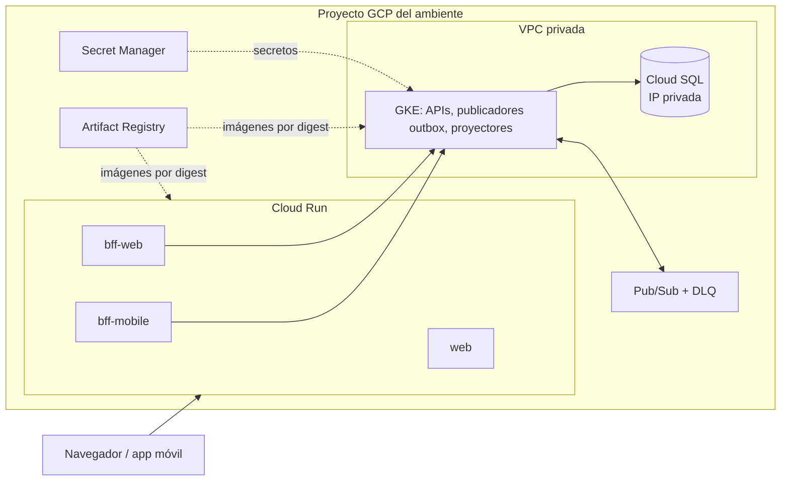
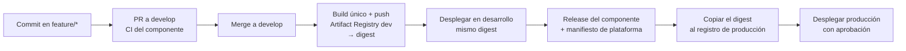

# Terraform de SportApp en GCP

Este directorio crea y mantiene la infraestructura de SportApp en Google Cloud para los ambientes de **desarrollo** y **producción**. Implementa la [arquitectura Terraform](../../docs/arquitectura-terraform.md) aprobada en ADR-021.

> **Estado (2026-10-10):** el código está verificado con `terraform validate` y `terraform test`, pero todavía no se ha aplicado en GCP.

## Tabla de contenido

1. [Antes de empezar](#1-antes-de-empezar)
   - [1.1 ¿Qué quieres hacer?](#11-qué-quieres-hacer)
   - [1.2 Conceptos mínimos](#12-conceptos-mínimos)
2. [Qué crea cada ambiente](#2-qué-crea-cada-ambiente)
3. [Estructura del código](#3-estructura-del-código)
4. [Variables y credenciales](#4-variables-y-credenciales)
   - [4.1 Qué archivo llenar](#41-qué-archivo-llenar)
   - [4.2 De dónde sale cada valor](#42-de-dónde-sale-cada-valor)
   - [4.3 Cómo se autentica Terraform](#43-cómo-se-autentica-terraform)
   - [4.4 Contraseñas y secretos](#44-contraseñas-y-secretos)
5. [Paso a paso desde tu equipo (local)](#5-paso-a-paso-desde-tu-equipo-local)
   - [5.1 Instalar las herramientas](#51-instalar-las-herramientas)
   - [5.2 Preparar los proyectos GCP](#52-preparar-los-proyectos-gcp)
   - [5.3 Ejecutar el bootstrap](#53-ejecutar-el-bootstrap)
   - [5.4 Crear el ambiente de desarrollo](#54-crear-el-ambiente-de-desarrollo)
   - [5.5 Verificar lo creado](#55-verificar-lo-creado)
   - [5.6 Crear producción](#56-crear-producción)
   - [5.7 Cambios del día a día](#57-cambios-del-día-a-día)
6. [Paso a paso desde GitHub Actions (GCP)](#6-paso-a-paso-desde-github-actions-gcp)
   - [6.1 Configurar el repositorio](#61-configurar-el-repositorio)
   - [6.2 Workflow de referencia](#62-workflow-de-referencia)
7. [Cómo se actualizan backend y frontend](#7-cómo-se-actualizan-backend-y-frontend)
   - [7.1 El ciclo completo](#71-el-ciclo-completo)
   - [7.2 Publicar la imagen](#72-publicar-la-imagen)
   - [7.3 Desplegar en Cloud Run](#73-desplegar-en-cloud-run)
   - [7.4 Desplegar en GKE](#74-desplegar-en-gke)
   - [7.5 Frontend web](#75-frontend-web)
   - [7.6 Promover a producción](#76-promover-a-producción)
   - [7.7 Resumen por evento](#77-resumen-por-evento)
8. [Suspender y destruir desarrollo](#8-suspender-y-destruir-desarrollo)
9. [Pruebas](#9-pruebas)
10. [Solución de problemas](#10-solución-de-problemas)
11. [Supuestos y pendientes](#11-supuestos-y-pendientes)

---

## 1. Antes de empezar

### 1.1 ¿Qué quieres hacer?

| Quiero… | Sección |
| --- | --- |
| Crear o modificar la infraestructura GCP desde mi computador | [5](#5-paso-a-paso-desde-tu-equipo-local) |
| Que GitHub Actions genere el plan y lo aplique | [6](#6-paso-a-paso-desde-github-actions-gcp) |
| Publicar una nueva versión del backend o del frontend | [7](#7-cómo-se-actualizan-backend-y-frontend) |
| Pasar una versión probada a producción | [7.6](#76-promover-a-producción) |
| Reducir costos cuando no se usa desarrollo | [8](#8-suspender-y-destruir-desarrollo) |
| Levantar SportApp completo en mi PC, sin GCP | Todavía no se hace con Terraform: la raíz `environments/local` está pendiente. Por ahora se usa el overlay Kustomize del backend (`deploy/k8s/overlays/local`), descrito en el README del backend. |

En esta guía, **«local»** significa ejecutar Terraform desde tu computador. Los recursos siempre se crean en GCP.

### 1.2 Conceptos mínimos

- **Raíz:** carpeta donde se ejecuta `terraform`. Hay tres: `bootstrap/gcp-state`, `environments/development` y `environments/production`. Cada una tiene su propio estado.
- **Estado:** registro de lo que Terraform administra. Se guarda en un bucket GCS del proyecto de gestión, nunca en Git.
- **Plan / apply:** `plan` muestra qué cambiaría y `apply` ejecuta exactamente ese plan. Siempre se aplica un plan guardado con `-out`.
- **Impersonación:** inicias sesión con tu cuenta y Terraform actúa como la cuenta `tf-apply-<ambiente>`. Así nadie necesita llaves.
- **Digest:** identificador inmutable de una imagen (`@sha256:…`). Terraform rechaza imágenes referenciadas por tag.

## 2. Qué crea cada ambiente

| Recurso | Desarrollo | Producción |
| --- | --- | --- |
| GKE | zonal `us-central1-a`, `e2-standard-2` spot, 0–3 nodos | regional `us-central1`, `e2-standard-4`, 3–9 nodos |
| Cloud SQL PostgreSQL 17 | `db-custom-1-3840` zonal, sin PITR | `db-custom-2-7680` regional (HA), PITR, 14 respaldos |
| Cloud Run | `web`, `bff-web` y `bff-mobile`, mínimo 0 instancias | mínimo 1 instancia |
| Protección contra borrado | no, porque es desechable | sí, y el módulo la exige |



Ambos ambientes tienen la misma topología:

- **Red:** VPC propia, nodos GKE privados con NAT de salida, Cloud SQL solo con IP privada y Direct VPC egress para los BFF.
- **Datos:** bases `usuarios_write/read`, `afiliacion`, `servicios`, `entrenamientos_write/read` y `eventos_write/read`, con un usuario PostgreSQL por dominio. Cada contraseña vive en el secreto `db-password-<dominio>`.
- **Mensajería:** `sportapp.{usuarios,entrenamientos,eventos}.v1`, cada uno con suscripción `.read-projector`, DLQ `.dlq` y suscripción operativa `.dlq.ops`.
- **Identidad:** una cuenta de servicio por carga. Cada carga lee solo el secreto de su dominio, el publicador solo publica en su tópico y el proyector solo consume su suscripción.
- **Operación:** alertas de CPU de Cloud SQL, mensajes en DLQ, atraso de proyección y errores 5xx de Cloud Run.

## 3. Estructura del código

```text
infra/terraform/
├── bootstrap/gcp-state/        # UNA VEZ: estado, WIF de GitHub, cuentas tf-plan/tf-apply/ci-delivery, presupuestos
├── modules/gcp/
│   ├── platform/               # composición completa de un ambiente (+ tests/)
│   ├── project-services/       # APIs
│   ├── network/                # VPC, subredes, NAT, Private Services Access
│   ├── gke/                    # GKE Standard privado con Workload Identity
│   ├── cloud-sql/              # PostgreSQL privado, bases y usuarios por dominio
│   ├── pubsub/                 # tópico, proyector y DLQ de un dominio CQRS
│   ├── iam/                    # una cuenta de servicio por carga
│   ├── secret-manager/         # secretos de aplicación (sin valores)
│   ├── cloud-run/              # web, BFF web y BFF móvil por digest
│   ├── artifact-registry/      # repositorio Docker con limpieza
│   └── observability/          # alertas base
└── environments/
    ├── development/            # raíz de desarrollo
    └── production/             # raíz de producción
```

Las raíces de desarrollo y producción tienen los mismos `.tf`; solo difieren en el nombre del ambiente y el prefijo del estado. Las diferencias de tamaño están en su `terraform.tfvars`.

## 4. Variables y credenciales

### 4.1 Qué archivo llenar

| Archivo | Contenido | ¿Va a Git? |
| --- | --- | --- |
| `environments/*/terraform.tfvars` | tamaños, red, retención y digests de Cloud Run | **sí**, se revisa en PR |
| `environments/*/gcp.auto.tfvars` (copia de `.example`) | proyecto, cuenta a impersonar, correos, IP del operador y publicadores de imágenes | **no** |
| `environments/*/backend.hcl` (copia de `.example`) | bucket del estado | **no** |
| `bootstrap/gcp-state/bootstrap.auto.tfvars` (copia de `.example`) | proyectos, operadores, facturación y presupuestos | **no** |

Ninguno de estos archivos contiene llaves ni contraseñas. Los archivos `*.auto.tfvars` se cargan solos y tienen prioridad sobre `terraform.tfvars`.

### 4.2 De dónde sale cada valor

| Valor | Archivo | Origen |
| --- | --- | --- |
| `management_project_id`, `environments.*.project_id` | `bootstrap.auto.tfvars` | proyectos creados en [5.2](#52-preparar-los-proyectos-gcp) |
| `billing_account` | `bootstrap.auto.tfvars` | `gcloud billing accounts list` |
| `operators` | `bootstrap.auto.tfvars` | `user:<correo>` de quienes ejecutarán Terraform |
| `project_id` | `gcp.auto.tfvars` | proyecto del ambiente |
| `impersonate_service_account` | `gcp.auto.tfvars` y `backend.hcl` | `terraform output apply_service_accounts` del bootstrap |
| `bucket` | `backend.hcl` | `terraform output state_buckets` del bootstrap |
| `artifact_registry_writers` | `gcp.auto.tfvars` (desarrollo) | `terraform output delivery_service_accounts` del bootstrap |
| `alert_emails` | `gcp.auto.tfvars` | correos del equipo |
| `cloud_run_images` | `terraform.tfvars` | digest publicado ([7.2](#72-publicar-la-imagen)) |

### 4.3 Cómo se autentica Terraform

No se usan llaves JSON de cuentas de servicio.

| Dónde | Mecanismo | Cuenta |
| --- | --- | --- |
| Tu equipo | `gcloud auth application-default login` + `impersonate_service_account` | `tf-apply-<ambiente>`, que el bootstrap autoriza a los `operators` |
| GitHub Actions, PR | Workload Identity Federation (WIF) | `tf-plan-<ambiente>`: solo lectura, disponible para cualquier job del repositorio |
| GitHub Actions, apply | WIF + `environment: <ambiente>` | `tf-apply-<ambiente>`: solo para jobs con ese GitHub Environment |
| CI de backend/frontend | WIF + `environment: development` | `ci-delivery-development`: solo publica imágenes |

### 4.4 Contraseñas y secretos

- **Bases de datos:** Terraform genera las contraseñas como valores efímeros y las envía con argumentos *write-only*. Llegan a Cloud SQL y a Secret Manager (`db-password-<dominio>`), pero nunca al estado. Para rotarlas, incrementa `cloud_sql.password_version` y aplica.
- **Secretos de aplicación** (JWT, Strava, etc.): decláralos en `app_secrets` dentro de `terraform.tfvars`. Terraform crea el contenedor y concede el acceso; el valor lo cargas tú:

  ```powershell
  gcloud secrets versions add jwt-signing-key --project <proyecto> --data-file=C:\ruta\jwt.pem
  ```

## 5. Paso a paso desde tu equipo (local)

Los comandos son para PowerShell y se ejecutan desde la raíz del repositorio `platform`.

### 5.1 Instalar las herramientas

Una sola vez:

```powershell
winget install --id Hashicorp.Terraform -e
winget install --id Google.CloudSDK -e
```

Abre una terminal nueva y comprueba las versiones:

```powershell
terraform version   # 1.11 o superior
gcloud version
```

### 5.2 Preparar los proyectos GCP

Una sola vez. Se necesitan tres proyectos: gestión (estado e identidades; nunca se destruye), desarrollo y producción. Los ID son únicos a nivel global, así que elige tus propios sufijos.

```powershell
gcloud auth login
gcloud billing accounts list

gcloud projects create sportapp-mgmt-1234 --name="SportApp gestion"
gcloud projects create sportapp-dev-1234  --name="SportApp desarrollo"
gcloud projects create sportapp-prod-1234 --name="SportApp produccion"

gcloud billing projects link sportapp-mgmt-1234 --billing-account=XXXXXX-XXXXXX-XXXXXX
gcloud billing projects link sportapp-dev-1234  --billing-account=XXXXXX-XXXXXX-XXXXXX
gcloud billing projects link sportapp-prod-1234 --billing-account=XXXXXX-XXXXXX-XXXXXX
```

Quien ejecute el bootstrap necesita `roles/owner` en los tres proyectos. Para crear presupuestos también necesita `roles/billing.costsManager` en la cuenta de facturación.

### 5.3 Ejecutar el bootstrap

Una sola vez, con tu cuenta de administrador.

1. Obtén las credenciales que usará Terraform:

   ```powershell
   gcloud auth application-default login
   ```

2. Crea y completa las variables:

   ```powershell
   cd infra\terraform\bootstrap\gcp-state
   Copy-Item bootstrap.auto.tfvars.example bootstrap.auto.tfvars
   notepad bootstrap.auto.tfvars
   ```

3. Genera el plan, revísalo y aplícalo:

   ```powershell
   terraform init
   terraform plan -out=tfplan
   terraform apply tfplan
   ```

4. Anota las salidas; las usarás en los pasos siguientes:

   ```powershell
   terraform output
   ```

   | Salida | Uso |
   | --- | --- |
   | `state_buckets` | `bucket` en `backend.hcl` |
   | `apply_service_accounts` | `impersonate_service_account` |
   | `plan_service_accounts` | CI ([6](#6-paso-a-paso-desde-github-actions-gcp)) |
   | `delivery_service_accounts` | CI de backend/frontend ([7.2](#72-publicar-la-imagen)) |
   | `workload_identity_provider` | todos los workflows |

El estado del bootstrap queda en `terraform.tfstate`, en esta carpeta, ignorado por Git. Respáldalo o migra el estado al bucket de gestión siguiendo el comentario de `versions.tf`.

### 5.4 Crear el ambiente de desarrollo

1. Crea los archivos locales y complétalos con las salidas del bootstrap:

   ```powershell
   cd ..\..\environments\development
   Copy-Item gcp.auto.tfvars.example gcp.auto.tfvars
   Copy-Item backend.hcl.example backend.hcl
   notepad gcp.auto.tfvars
   notepad backend.hcl
   ```

2. Comprueba que puedes impersonar la cuenta. El comando debe imprimir un token; si responde 403, tu usuario no está en `operators`.

   ```powershell
   gcloud auth print-access-token --impersonate-service-account=tf-apply-development@sportapp-mgmt-1234.iam.gserviceaccount.com
   ```

3. Inicializa Terraform con el estado remoto:

   ```powershell
   terraform init -backend-config=backend.hcl
   ```

4. Genera el plan y revisa el resumen final (`Plan: N to add, 0 to change, 0 to destroy`):

   ```powershell
   terraform plan -out=tfplan
   ```

5. Aplica el plan. La primera vez tarda entre 20 y 30 minutos por GKE y Cloud SQL.

   ```powershell
   terraform apply tfplan
   ```

Si `cloud_run_images` está vacío, no se crea ningún servicio Cloud Run. Esto permite crear la infraestructura antes de tener la primera imagen.

### 5.5 Verificar lo creado

```powershell
terraform output
gcloud container clusters list --project sportapp-dev-1234
gcloud sql instances list --project sportapp-dev-1234
gcloud pubsub topics list --project sportapp-dev-1234 --format="value(name)"
gcloud secrets list --project sportapp-dev-1234 --format="value(name)"
```

Debes ver el clúster `sportapp-dev-gke`, una instancia `sportapp-dev-pg-xxxx`, los tres tópicos con sus DLQ y los cinco secretos `db-password-*`.

### 5.6 Crear producción

Sigue los mismos pasos de [5.4](#54-crear-el-ambiente-de-desarrollo) en `environments\production`, con `tf-apply-production` y el bucket `...-tfstate-production`. Además:

- otra persona revisa el plan con `terraform show tfplan` antes de aplicarlo;
- se aplica exactamente ese archivo de plan. Si cambian el código o el estado, se genera un plan nuevo;
- el módulo rechaza el plan si falta la protección contra borrado, Cloud SQL regional o PITR.

### 5.7 Cambios del día a día

1. Crea una rama y modifica `terraform.tfvars` o los módulos.
2. Valida sin tocar GCP:

   ```powershell
   terraform fmt -recursive ..\..
   terraform validate
   terraform test
   ```

3. Ejecuta `terraform plan -out=tfplan` en desarrollo y pega el resumen en el PR.
4. Después del merge, aplica en desarrollo. Luego planifica y aplica producción con revisión.

| Quiero cambiar… | Edito |
| --- | --- |
| Tamaño o número de nodos | `gke` en `terraform.tfvars` |
| Capacidad de la base de datos | `cloud_sql.tier`, `disk_*` |
| Rotar contraseñas de BD | `cloud_sql.password_version` + 1 |
| Agregar un secreto de aplicación | `app_secrets` (y `cloud_run_secret_env` si lo usa un BFF) |
| Variables de un BFF | `cloud_run_env` |
| Versión de un BFF o de la web | `cloud_run_images` ([7.3](#73-desplegar-en-cloud-run)) |
| Quién recibe alertas | `alert_emails` en `gcp.auto.tfvars` |

## 6. Paso a paso desde GitHub Actions (GCP)

Esta es la forma prevista de operar después del arranque inicial. El workflow aún no está creado en `.github/workflows/`; esta sección define su configuración y una versión de referencia.

### 6.1 Configurar el repositorio

1. En `sport-app-platform`, abre **Settings → Environments** y crea los ambientes:
   - `development`, con aprobación opcional;
   - `production`, con *required reviewers* y restringido a tags o a `main`.

2. Crea estas **variables de repositorio**. Ninguna es secreta. Los valores salen de `terraform output` del bootstrap.

   | Variable | Valor |
   | --- | --- |
   | `GCP_WORKLOAD_IDENTITY_PROVIDER` | `workload_identity_provider` |
   | `DEV_PROJECT_ID` / `PROD_PROJECT_ID` | proyecto de cada ambiente |
   | `DEV_STATE_BUCKET` / `PROD_STATE_BUCKET` | `state_buckets` |
   | `DEV_TF_PLAN_SA` / `PROD_TF_PLAN_SA` | `plan_service_accounts` |
   | `DEV_TF_APPLY_SA` / `PROD_TF_APPLY_SA` | `apply_service_accounts` |
   | `DEV_ALERT_EMAILS` / `PROD_ALERT_EMAILS` | lista JSON, por ejemplo `["equipo@example.com"]` |
   | `DEV_ARTIFACT_REGISTRY_WRITERS` | mapa JSON, por ejemplo `{"component-ci":"serviceAccount:ci-delivery-development@..."}` |

   ```powershell
   gh variable set DEV_TF_APPLY_SA --repo lfnavarroj1/sport-app-platform --body "tf-apply-development@sportapp-mgmt-1234.iam.gserviceaccount.com"
   ```

En CI no existen `gcp.auto.tfvars` ni `backend.hcl`. Sus valores llegan como `TF_VAR_*` y `-backend-config`, sin impersonación, porque WIF ya entrega la identidad correcta.

### 6.2 Workflow de referencia

Desarrollo: un PR genera el plan y un merge a `develop` lo aplica. Producción es análogo, con las variables `PROD_*`, el disparador de tag de plataforma y `environment: production`. Antes de usarlo, fija `hashicorp/setup-terraform` a un SHA completo, como exige la política de CI.

```yaml
name: terraform-development

on:
  pull_request:
    paths: ["infra/terraform/**"]
  push:
    branches: [develop]
    paths: ["infra/terraform/**"]

permissions:
  contents: read
  id-token: write

concurrency:
  group: terraform-development
  cancel-in-progress: false

env:
  TF_IN_AUTOMATION: "true"
  TF_STATE_BUCKET: ${{ vars.DEV_STATE_BUCKET }}
  TF_VAR_project_id: ${{ vars.DEV_PROJECT_ID }}
  TF_VAR_alert_emails: ${{ vars.DEV_ALERT_EMAILS }}
  TF_VAR_artifact_registry_writers: ${{ vars.DEV_ARTIFACT_REGISTRY_WRITERS }}

defaults:
  run:
    working-directory: infra/terraform/environments/development

jobs:
  plan:
    if: github.event_name == 'pull_request'
    runs-on: ubuntu-24.04
    steps:
      - uses: actions/checkout@3d3c42e5aac5ba805825da76410c181273ba90b1 # v7.0.1
        with:
          persist-credentials: false
      - uses: google-github-actions/auth@7c6bc770dae815cd3e89ee6cdf493a5fab2cc093 # v3.0.0
        with:
          workload_identity_provider: ${{ vars.GCP_WORKLOAD_IDENTITY_PROVIDER }}
          service_account: ${{ vars.DEV_TF_PLAN_SA }}
      - uses: hashicorp/setup-terraform@<sha-completo> # fijar por SHA
        with:
          terraform_version: 1.16.5
      - run: terraform fmt -check -recursive ../..
      - run: terraform init -input=false -backend-config="bucket=$TF_STATE_BUCKET"
      - run: terraform validate
      - run: terraform test
      - run: terraform plan -input=false

  apply:
    if: github.event_name == 'push'
    runs-on: ubuntu-24.04
    environment: development # habilita tf-apply-development por WIF
    steps:
      - uses: actions/checkout@3d3c42e5aac5ba805825da76410c181273ba90b1 # v7.0.1
        with:
          persist-credentials: false
      - uses: google-github-actions/auth@7c6bc770dae815cd3e89ee6cdf493a5fab2cc093 # v3.0.0
        with:
          workload_identity_provider: ${{ vars.GCP_WORKLOAD_IDENTITY_PROVIDER }}
          service_account: ${{ vars.DEV_TF_APPLY_SA }}
      - uses: hashicorp/setup-terraform@<sha-completo> # fijar por SHA
        with:
          terraform_version: 1.16.5
      - run: terraform init -input=false -backend-config="bucket=$TF_STATE_BUCKET"
      - run: terraform plan -input=false -out=tfplan
      - run: terraform apply -input=false tfplan
```

## 7. Cómo se actualizan backend y frontend

Backend y frontend se entregan como **contenedores** (imágenes OCI). Terraform no compila código: recibe una imagen ya publicada e identificada por su digest. Cada componente se construye **una sola vez**, y esa misma imagen pasa de desarrollo a producción.

### 7.1 El ciclo completo



| Contenedor | Repositorio | Corre en | Lo despliega |
| --- | --- | --- | --- |
| `bff-web`, `bff-mobile` | backend | Cloud Run | Terraform (`cloud_run_images`) |
| `web` | frontend (imagen pendiente, [7.5](#75-frontend-web)) | Cloud Run | Terraform (`cloud_run_images`) |
| APIs `users-management`, `affiliation-management`, `complementary-services`, `training-management`, `events-management`, `third-party-management` | backend | GKE | Kustomize + `kubectl` ([7.4](#74-desplegar-en-gke)) |
| Publicadores outbox y proyectores | backend: misma imagen del dominio con otro comando | GKE | Kustomize + `kubectl` |
| Migraciones | backend: misma imagen como `Job` | GKE | antes de actualizar la API |

### 7.2 Publicar la imagen

**Automático (backend).** El workflow `deliver-development.yml` del backend se ejecuta con cada merge a `develop`. Construye cada componente una vez, lo etiqueta con el SHA del commit, lo publica y muestra el digest en el resumen del job. Para habilitarlo, configura en el repositorio del backend el Environment `development` con estas variables:

| Variable | Valor |
| --- | --- |
| `GCP_WORKLOAD_IDENTITY_PROVIDER` | salida `workload_identity_provider` del bootstrap |
| `GCP_DELIVERY_SERVICE_ACCOUNT` | salida `delivery_service_accounts.development` |
| `GCP_ARTIFACT_REGISTRY` | salida `artifact_registry_url` de desarrollo (`us-central1-docker.pkg.dev/<proyecto>/sportapp`) |
| `GCP_ARTIFACT_REGISTRY_HOST` | `us-central1-docker.pkg.dev` |

```powershell
gh variable set GCP_DELIVERY_SERVICE_ACCOUNT --env development --repo lfnavarroj1/sport-app-backend --body "ci-delivery-development@sportapp-mgmt-1234.iam.gserviceaccount.com"
```

El job `deploy` de ese workflow sigue bloqueado a propósito y termina en error: el despliegue en GCP corresponde a la plataforma, según los pasos [7.3](#73-desplegar-en-cloud-run) y [7.4](#74-desplegar-en-gke). Mientras el backend no ajuste ese job, la ejecución aparecerá fallida aunque las imágenes se hayan publicado.

**Manual (desde tu equipo).** Úsalo para pruebas puntuales. Los tags son inmutables, por lo que se usa el SHA del commit; en este equipo `uv` se invoca como `py -3.13 -m uv`.

```powershell
gcloud auth configure-docker us-central1-docker.pkg.dev
cd ..\backend
$sha = git rev-parse HEAD
$registry = "us-central1-docker.pkg.dev/sportapp-dev-1234/sportapp"
py -3.13 -m uv run python scripts/task.py build bff-web --tag $sha --version 0.2.0 --revision $sha
docker tag "sportapp/bff-web:$sha" "$registry/bff-web:$sha"
docker push "$registry/bff-web:$sha"
gcloud artifacts docker images describe "$registry/bff-web:$sha" --format="value(image_summary.fully_qualified_digest)"
```

El último comando devuelve la referencia completa `…/bff-web@sha256:<digest>` que necesitan los pasos siguientes.

### 7.3 Desplegar en Cloud Run

Aplica a `bff-web`, `bff-mobile` y `web`.

1. Copia la referencia por digest en `environments/development/terraform.tfvars`:

   ```hcl
   cloud_run_images = {
     bff-web    = "us-central1-docker.pkg.dev/sportapp-dev-1234/sportapp/bff-web@sha256:<digest>"
     bff-mobile = "us-central1-docker.pkg.dev/sportapp-dev-1234/sportapp/bff-mobile@sha256:<digest>"
   }
   ```

2. Si el servicio necesita configuración, edita `cloud_run_env`, por ejemplo `USERS_MANAGEMENT_BASE_URL` del BFF hacia el Service interno de GKE.
3. Ejecuta `terraform plan -out=tfplan`. Debe aparecer solo un cambio en la imagen del servicio, *update in-place*. Luego ejecuta `terraform apply tfplan`.
4. Cloud Run crea una revisión nueva y le pasa el tráfico cuando la sonda `/health/ready` responde. Para revertir, restaura el digest anterior y aplica.

`terraform output cloud_run_urls` muestra la URL de cada servicio.

### 7.4 Desplegar en GKE

Terraform crea el clúster y la identidad de cada carga, enlazada al namespace `sportapp`, pero **no crea el namespace ni aplica manifiestos**. Las cargas se despliegan con Kustomize a partir de los manifiestos base del backend y de un overlay GCP en `infra/kubernetes/overlays/<ambiente>`, que **todavía está pendiente**. Respecto del overlay local, ese overlay debe:

- crear el namespace `sportapp`;
- no incluir PostgreSQL ni el emulador de Pub/Sub, porque se usan Cloud SQL y Pub/Sub reales;
- separar los `Job` de migración en `migrations/`, para aplicarlos antes que las cargas;
- crear una KSA por carga con la anotación de la salida `gke_workload_identities`, y usarla en `serviceAccountName`:

  ```yaml
  apiVersion: v1
  kind: ServiceAccount
  metadata:
    name: users-management
    namespace: sportapp
    annotations:
      iam.gke.io/gcp-service-account: gke-users-api@sportapp-dev-1234.iam.gserviceaccount.com
  ```

- asignar `DATABASE_HOST` = `cloud_sql.private_ip`, tomar la contraseña del secreto `db-password-<dominio>` mediante el complemento Secret Manager de GKE (ya habilitado) y usar `PUBSUB_PROJECT_ID` = proyecto, sin `PUBSUB_EMULATOR_HOST`;
- exponer con un Service `LoadBalancer` interno las APIs que llaman los BFF desde Cloud Run;
- fijar las imágenes por digest:

  ```yaml
  images:
    - name: sportapp/users-management
      newName: us-central1-docker.pkg.dev/sportapp-dev-1234/sportapp/users-management
      digest: sha256:<digest>
  ```

Con el overlay creado, cada actualización sigue estos pasos:

```powershell
gcloud container clusters get-credentials sportapp-dev-gke --location us-central1-a --dns-endpoint --project sportapp-dev-1234
$ctx = "gke_sportapp-dev-1234_us-central1-a_sportapp-dev-gke"

# 1. Migraciones primero. Un Job es inmutable: se borra el anterior antes de aplicar otra imagen.
kubectl --context $ctx --namespace sportapp delete job --selector app.kubernetes.io/component=migration --ignore-not-found
kubectl --context $ctx --namespace sportapp apply -k infra/kubernetes/overlays/development/migrations
kubectl --context $ctx --namespace sportapp wait --for=condition=complete job --selector app.kubernetes.io/component=migration --timeout=300s

# 2. Después, las cargas
kubectl --context $ctx --namespace sportapp apply -k infra/kubernetes/overlays/development
kubectl --context $ctx --namespace sportapp rollout status deployment/users-management
```

Indica siempre `--context`, porque el equipo puede tener acceso a varios clústeres.

### 7.5 Frontend web

Estado actual: el frontend no tiene `Dockerfile`, no tiene workflow de entrega y su `app-config.json` deja `bffWebBaseUrl` en `null`. Para desplegarlo en el servicio `web`, el repositorio del frontend debe aportar:

1. una imagen que sirva el resultado de `ng build` en el puerto **8080**. Ese puerto es provisional y está definido en `cloud_run_services.web.port` de `modules/gcp/platform/main.tf`;
2. el archivo `app-config.json` de cada ambiente, con `bffWebBaseUrl` igual a `terraform output cloud_run_urls` → `bff-web`. Como la configuración se lee en tiempo de ejecución, una misma imagen sirve para desarrollo y producción si el contenedor genera ese archivo al arrancar a partir de una variable de entorno, definida en `cloud_run_env.web`;
3. un workflow de publicación equivalente al del backend, con las mismas variables de [7.2](#72-publicar-la-imagen). La cuenta `ci-delivery-development` ya acepta al repositorio `sport-app-frontend`.

La web y el BFF tienen dominios `*.run.app` distintos, así que el BFF debe permitir CORS desde la URL de `web` hasta que exista una capa de borde con un dominio único.

Después de esto, el frontend se actualiza igual que un BFF: se publica la imagen ([7.2](#72-publicar-la-imagen)) y se despliega su digest en `cloud_run_images.web` ([7.3](#73-desplegar-en-cloud-run)).

### 7.6 Promover a producción

Producción nunca recibe builds: recibe una copia de la imagen ya probada, con **el mismo digest**.

1. Crea la release del componente y el manifiesto de plataforma según el [esquema de CI y release](../../docs/esquema-ci-y-release.md).
2. Copia la imagen al registro de producción con [`crane`](https://github.com/google/go-containerregistry/blob/main/cmd/crane/README.md), que conserva el digest:

   ```powershell
   gcloud auth configure-docker us-central1-docker.pkg.dev
   crane copy us-central1-docker.pkg.dev/sportapp-dev-1234/sportapp/bff-web@sha256:<digest> us-central1-docker.pkg.dev/sportapp-prod-1234/sportapp/bff-web:v0.2.0
   ```

3. Actualiza `environments/production/terraform.tfvars` con la referencia del registro de producción y el mismo digest. Para las cargas de GKE, actualiza el overlay de producción.
4. Genera el plan, haz que otra persona lo revise y aplícalo ([5.6](#56-crear-producción)).
5. Comprueba que `GET /version` del BFF y `version.json` de la web reporten las versiones del manifiesto.

### 7.7 Resumen por evento

| Evento | Backend / frontend | Plataforma (este directorio) |
| --- | --- | --- |
| Push a `feature/*` | CI rápida, sin publicar | nada |
| PR a `develop` | CI completa | nada |
| Merge a `develop` | publica la imagen en el registro de desarrollo (digest) | copia el digest a `cloud_run_images` y al overlay de desarrollo, y aplica |
| Release del componente | tag y artefacto | manifiesto de release (staging pendiente) |
| Promoción aprobada | — | copia la imagen a producción y aplica con revisión |
| Rollback | — | restaura el digest anterior y aplica |

## 8. Suspender y destruir desarrollo

| Modo | Cómo | Costo que permanece |
| --- | --- | --- |
| `suspend` | `suspended = true` en `terraform.tfvars` y aplicar; luego escalar los Deployments a 0 para que el autoscaler retire los nodos | disco de Cloud SQL, plano de control de GKE, NAT, imágenes y logs |
| reanudar | `suspended = false`, aplicar y volver a escalar los Deployments | — |
| `destroy` | plan de destrucción revisado (abajo) | ninguno en el proyecto; el estado se conserva en el proyecto de gestión |

```powershell
cd infra\terraform\environments\development
terraform plan -destroy -out=tfplan-destroy
terraform show tfplan-destroy
terraform apply tfplan-destroy
```

Para recrear el ambiente, repite el paso 4 de [5.4](#54-crear-el-ambiente-de-desarrollo). Las contraseñas se generan de nuevo, y luego se vuelven a cargar los secretos de aplicación y a desplegar las cargas.

Producción rechaza ambos modos: `suspended` no está permitido y la protección contra borrado bloquea `destroy`.

## 9. Pruebas

Las pruebas usan proveedores simulados: no necesitan credenciales ni crean recursos.

```powershell
terraform fmt -check -recursive infra\terraform

cd infra\terraform\modules\gcp\platform
terraform init -backend=false
terraform test

cd ..\..\..\environments\development
terraform init -backend=false
terraform validate
terraform test
```

| Prueba | Verifica |
| --- | --- |
| `modules/gcp/platform/tests` | aislamiento de secretos por dominio, tópicos solo en dominios CQRS, rechazo de imágenes por tag y de secretos no declarados, protecciones de producción |
| `environments/*/tests` | que el `terraform.tfvars` versionado produce un plan válido |

## 10. Solución de problemas

| Síntoma | Causa probable | Solución |
| --- | --- | --- |
| `403 … iam.serviceAccounts.getAccessToken` | tu usuario no está en `operators` del bootstrap | agrégalo y aplica el bootstrap |
| `Error acquiring the state lock` | otro `apply` está en curso o se interrumpió | espera; usa `terraform force-unlock <id>` solo si nadie más está aplicando |
| `API … has not been used in project` en el primer apply | la API recién habilitada aún se propaga | repite el plan en unos minutos |
| `Las imágenes se referencian por digest` | se usó un tag | usa `…@sha256:<digest>` ([7.2](#72-publicar-la-imagen)) |
| Revisión de Cloud Run que no queda lista | la imagen no escucha en el puerto o falla la sonda | `gcloud run services logs read <servicio> --region us-central1 --project <proyecto>` |
| Error al conceder `allUsers` | una política de organización restringe el acceso público | quita el servicio de `cloud_run_public_services` o solicita una excepción |
| Falla la conexión de Private Services Access al destruir | Cloud SQL se eliminó hace poco | repite el plan de destrucción minutos después |
| `deletion_protection` impide destruir producción | comportamiento esperado | producción no se destruye desde Terraform |

## 11. Supuestos y pendientes

ADR-017 deja abiertas estas decisiones. La implementación adopta los valores indicados, que pueden cambiarse sin alterar la estructura.

| Decisión abierta | Valor adoptado |
| --- | --- |
| Región | `us-central1`, la región de referencia de la Entrega 8 |
| GKE Standard o Autopilot | Standard, porque el modo `suspend` documentado reduce nodos |
| Topología de Cloud SQL | una instancia por ambiente con bases y usuarios separados por dominio |
| Capa de borde (API Gateway / balanceador) | sin decidir: `web` y los BFF son públicos en Cloud Run y validan su propio JWT |
| Capacidades | iniciales; se ajustan con experimentos (ADR-011) |

Pendientes:

- raíces `staging` y `local`;
- workflows de Terraform en este repositorio ([6.2](#62-workflow-de-referencia));
- overlays Kubernetes de GCP ([7.4](#74-desplegar-en-gke));
- imagen y workflow de entrega del frontend ([7.5](#75-frontend-web));
- desbloquear el job `deploy` del backend;
- permisos PostgreSQL por base: los usuarios de Cloud SQL pertenecen a `cloudsqlsuperuser`, por lo que restringir cada usuario a su base requiere `GRANT`/`REVOKE` dentro de PostgreSQL;
- división del estado en raíces de fundación, datos, runtime y operación.
