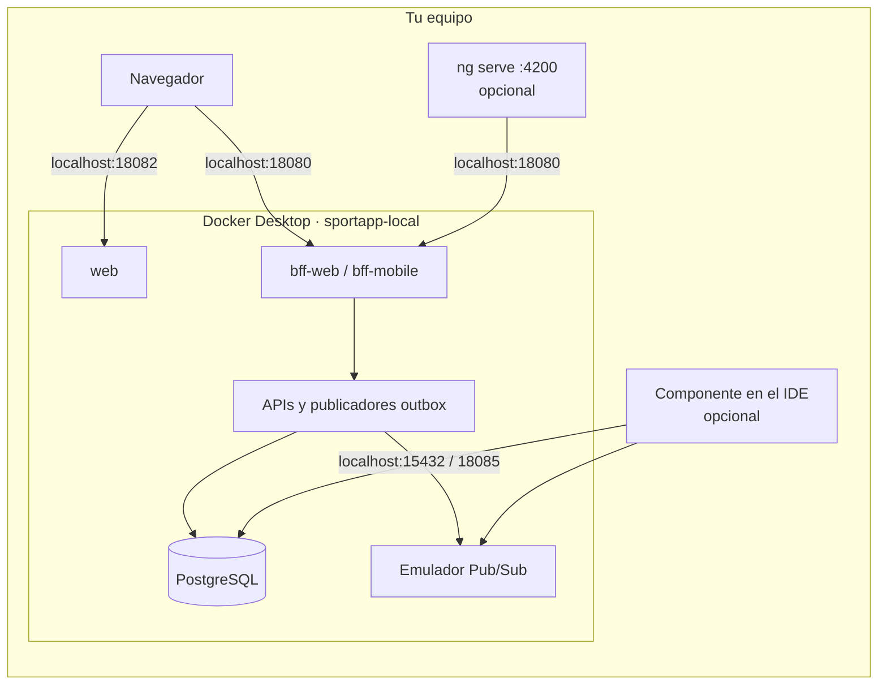
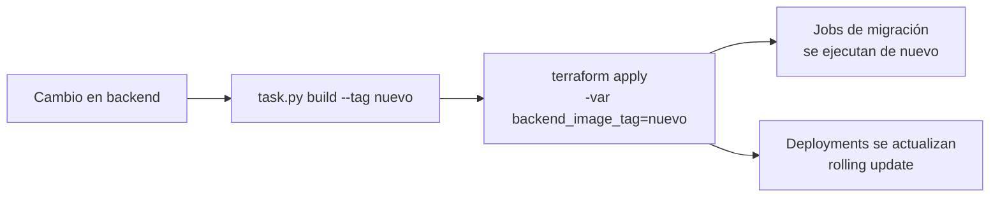
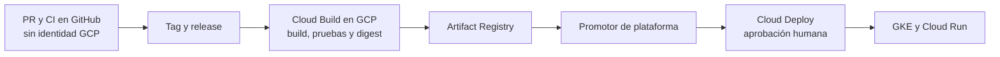

# Terraform de SportApp

Este directorio crea y mantiene los dos ambientes de SportApp:

| Ambiente | Dónde corre | Raíz Terraform |
| --- | --- | --- |
| **Desarrollo** | tu equipo, en el clúster Kubernetes **kubeadm** de Docker Desktop | [`environments/local`](environments/local) |
| **Producción** | Google Cloud Platform | [`environments/production`](environments/production) |

Desarrollo no usa GCP ni credenciales en la nube. Implementa la [arquitectura Terraform](../../docs/arquitectura-terraform.md) de la plataforma.

> **Estado (2026-10-10):** desarrollo local se aplicó en Docker Desktop y se verificó con un registro de usuario real, desde el BFF hasta Pub/Sub. Producción está validada con `terraform validate` y `terraform test`, pero todavía no se ha aplicado en GCP.

## Tabla de contenido

1. [Antes de empezar](#1-antes-de-empezar)
   - [1.1 ¿Qué quieres hacer?](#11-qué-quieres-hacer)
   - [1.2 Conceptos mínimos](#12-conceptos-mínimos)
2. [Los dos ambientes](#2-los-dos-ambientes)
3. [Estructura del código](#3-estructura-del-código)
4. [Desarrollo local paso a paso](#4-desarrollo-local-paso-a-paso)
   - [4.1 Requisitos](#41-requisitos)
   - [4.2 Construir las imágenes del backend](#42-construir-las-imágenes-del-backend)
   - [4.3 Crear el ambiente](#43-crear-el-ambiente)
   - [4.4 Verificar](#44-verificar)
   - [4.5 Usar el ambiente](#45-usar-el-ambiente)
   - [4.6 Ejecutar un componente en el host](#46-ejecutar-un-componente-en-el-host)
   - [4.7 Destruir y recrear](#47-destruir-y-recrear)
5. [Cómo se actualizan backend y frontend en desarrollo](#5-cómo-se-actualizan-backend-y-frontend-en-desarrollo)
   - [5.1 Cambió el código del backend](#51-cambió-el-código-del-backend)
   - [5.2 Cambiaron los manifiestos del backend](#52-cambiaron-los-manifiestos-del-backend)
   - [5.3 Frontend web](#53-frontend-web)
   - [5.4 Cambiar las dependencias compartidas](#54-cambiar-las-dependencias-compartidas)
6. [Producción en GCP paso a paso](#6-producción-en-gcp-paso-a-paso)
   - [6.1 Qué crea](#61-qué-crea)
   - [6.2 Variables y credenciales](#62-variables-y-credenciales)
   - [6.3 Instalar Google Cloud CLI](#63-instalar-google-cloud-cli)
   - [6.4 Preparar los proyectos](#64-preparar-los-proyectos)
   - [6.5 Ejecutar el bootstrap](#65-ejecutar-el-bootstrap)
   - [6.6 Crear producción](#66-crear-producción)
   - [6.7 Cambios posteriores](#67-cambios-posteriores)
7. [Producción sin acceso GCP desde GitHub](#7-producción-sin-acceso-gcp-desde-github)
8. [Cómo llegan backend y frontend a producción](#8-cómo-llegan-backend-y-frontend-a-producción)
9. [Pruebas](#9-pruebas)
10. [Solución de problemas](#10-solución-de-problemas)
11. [Supuestos y pendientes](#11-supuestos-y-pendientes)

---

## 1. Antes de empezar

### 1.1 ¿Qué quieres hacer?

| Quiero… | Sección |
| --- | --- |
| Dejar listo desarrollo local | [preparación local](../../docs/preparacion-terraform-local.md) |
| Preparar producción, identidades y entrega sin acceso GCP desde GitHub | [preparación de GCP](../../docs/preparacion-terraform-gcp.md) |
| Levantar SportApp completo en mi equipo | [4](#4-desarrollo-local-paso-a-paso) |
| Probar un cambio del backend en desarrollo | [5.1](#51-cambió-el-código-del-backend) |
| Conectar el frontend al backend local | [5.3](#53-frontend-web) |
| Depurar un microservicio desde el IDE con la base de datos y Pub/Sub locales | [4.6](#46-ejecutar-un-componente-en-el-host) |
| Crear o cambiar la infraestructura de producción | [6](#6-producción-en-gcp-paso-a-paso) |
| Publicar una versión en producción | [8](#8-cómo-llegan-backend-y-frontend-a-producción) |
| Apagar o volver a encender el ambiente local | [preparación local, sección 11](../../docs/preparacion-terraform-local.md#11-pausar-o-eliminar-el-ambiente) |
| Suspender, reanudar o destruir producción | [preparación de GCP, sección 15](../../docs/preparacion-terraform-gcp.md#15-suspender-reanudar-y-destruir) |

### 1.2 Conceptos mínimos

- **Raíz:** carpeta donde se ejecuta `terraform`. Hay cinco: `environments/local`, `bootstrap/gcp-state` (preparación de producción), `environments/production` (infraestructura), `environments/production-workloads` (base Kubernetes en GKE) y `environments/delivery` (Cloud Build y Cloud Deploy). Cada una tiene su propio estado y solo se ejecuta desde la estación del operador.
- **Estado:** registro de lo que administra Terraform. El de desarrollo es un archivo local ignorado por Git; el de producción está en un bucket GCS.
- **Plan / apply:** `plan` muestra qué cambiaría y `apply` lo ejecuta. Con `-out` se aplica exactamente el plan revisado.
- **Imagen y tag:** el backend se entrega como imágenes de contenedor `sportapp/<componente>:<tag>`. En desarrollo se usan imágenes construidas en tu Docker; en producción, imágenes de Artifact Registry identificadas por su digest (`@sha256:…`).

## 2. Los dos ambientes

| | Desarrollo (local) | Producción (GCP) |
| --- | --- | --- |
| Kubernetes | Docker Desktop aprovisionado con kubeadm, contexto `docker-desktop`, namespace `sportapp-local` | GKE regional privado |
| Web y BFF | `web`, `bff-web` y `bff-mobile` en Kubernetes, con la misma imagen que producción | Cloud Run (`web`, `bff-web`, `bff-mobile`) |
| PostgreSQL | un pod con las 8 bases y un rol por dominio | Cloud SQL regional (HA) con PITR |
| Pub/Sub | emulador con los mismos tópicos, suscripciones y DLQ | Pub/Sub con IAM por carga |
| Contraseñas | generadas, en el Secret `sportapp-database` | generadas, en Secret Manager |
| Imágenes | locales, por tag (`local` por defecto) | Artifact Registry, por digest |
| Estado Terraform | `terraform.tfstate` local | bucket GCS en el proyecto de gestión |
| Credenciales | ninguna | ADC del operador e impersonación de `tf-apply-production`; GitHub no obtiene identidad GCP y no hay llaves JSON |

En ambos ambientes se usan los mismos nombres: bases `usuarios_write/read`, `afiliacion`, `servicios`, `entrenamientos_write/read` y `eventos_write/read`, y tópicos `sportapp.{usuarios,afiliacion,servicios,entrenamientos,eventos}.v1`. Gracias a eso, el código que funciona en local funciona igual en producción. Cada suscripción entrega en orden, espera de 10 a 600 s entre reintentos y tiene una DLQ con su suscripción operativa `<DLQ>.ops`:

| Consumidor | Tópico | Suscripción | DLQ | Entregas |
| --- | --- | --- | --- | --- |
| `users-management-read-projector` (HU001, CMP-001) | `sportapp.usuarios.v1` | `proyector-usuarios-v1` | `sportapp.usuarios.proyeccion.dlq` | 5 |
| `affiliation-management-free-plan-consumer` (HU001, ADR-024) | `sportapp.usuarios.v1`, solo `attributes.event_type = "usuario.registrado.v1"` | `sportapp.afiliacion.alta-gratuita.v1` | `sportapp.afiliacion.alta-gratuita.dlq` | 10 |
| `training-management-read-projector` (HU010, CMP-003) | `sportapp.entrenamientos.v1` | `proyector-entrenamientos-v1` | `sportapp.entrenamientos.proyeccion.dlq` | 10 |
| `events-management-read-projector` (CMP-004) | `sportapp.eventos.v1` | `proyector-eventos-v1` | `sportapp.eventos.proyeccion.dlq` | 10 |

Los nombres son los que consume el backend (`<servicio>/settings.py`). `sportapp.afiliacion.v1` (de `affiliation-management-outbox-publisher`, ADR-024) y `sportapp.servicios.v1` (de `complementary-services-outbox-publisher`) no tienen suscripción mientras no exista un consumidor aprobado.

El ConfigMap `sportapp-runtime` publica la versión de políticas (`REGISTRATION_POLICIES_VERSION`, que leen `users-management` y `web`) y el catálogo que Afiliación exige para quedar lista (`AFFILIATION_EXPECTED_CATALOG_VERSION`). Los valores aprobados están en `variables.tf` (`registration_policies_version` y `affiliation_expected_catalog_version`). El catálogo se cambia en el mismo release que trae su migración (ADR-036).



## 3. Estructura del código

```text
infra/
├── kubernetes/local/              # dependencias compartidas de desarrollo (propiedad de la plataforma)
│   ├── postgres.yaml              #   PostgreSQL + script que crea bases y roles
│   ├── pubsub-emulator.yaml       #   emulador de Pub/Sub; al arrancar crea tópicos, suscripciones y DLQ
│   ├── pubsub-init/               #   script que crea esos recursos
│   └── access.yaml                #   puertos en localhost
└── terraform/
    ├── environments/
    │   ├── local/                 # DESARROLLO: Docker Desktop
    │   ├── production/            # PRODUCCIÓN: infraestructura GCP (red, GKE, Cloud SQL, Pub/Sub, Cloud Run base…)
    │   ├── production-workloads/  # PRODUCCIÓN: base Kubernetes (namespace, KSA, Secrets, ConfigMap, Services, RBAC)
    │   └── delivery/              # PRODUCCIÓN: Cloud Build, evidencia y Cloud Deploy (proyecto de gestión)
    ├── bootstrap/gcp-state/       # una vez, antes de producción: estado, tf-plan/tf-apply e identidades de entrega
    └── modules/gcp/               # módulos de producción (red, GKE, Cloud SQL, Pub/Sub, Cloud Run…)
deploy/clouddeploy/                # entrega controlada por la plataforma: allowlist, Skaffold, overlay GKE y Cloud Run
cloudbuild.promote.yaml            # promotor (trigger manual interno de Cloud Build) → scripts/promote_release.py
schemas/                           # release-manifest, backend-release y frontend-release
```

Cada repositorio conserva lo que le pertenece:

| Repositorio | Aporta | Lo consume Terraform así |
| --- | --- | --- |
| backend | código, `cloudbuild.release.yaml`, imágenes y manifiestos `deploy/k8s/base` (Deployments, Services, Jobs de migración) | en local, compone esos manifiestos tal como estén en tu clon; en producción, Terraform aplica sus Services y Cloud Deploy sus Deployments y Jobs, en el commit de la release |
| frontend | código Angular, `cloudbuild.release.yaml`, imagen `sportapp/web` y manifiestos `deploy/k8s/base` | en local, compone esos manifiestos desde el clon del frontend; en producción Cloud Deploy promueve la imagen por digest en Cloud Run |
| plataforma | PostgreSQL, Pub/Sub, configuración, secretos, infraestructura GCP, triggers, pipelines y promotor | — |

## 4. Desarrollo local paso a paso

Los comandos son para PowerShell. La raíz se aplica siempre en el contexto `docker-desktop` y falla con cualquier otro, aunque tu contexto activo de `kubectl` sea un clúster GKE.

### 4.1 Requisitos

1. **Kubernetes de Docker Desktop aprovisionado con kubeadm**, en verde. Si es la primera vez, sigue la sección 4 de la [preparación local](../../docs/preparacion-terraform-local.md#4-preparar-docker-desktop-y-kubernetes).
2. **Terraform 1.11 o superior** y **kubectl**:

   ```powershell
   winget install --id Hashicorp.Terraform -e
   winget install --id Kubernetes.kubectl -e
   ```

3. El repositorio **backend** clonado como carpeta hermana de `platform`:

   ```text
   aplicacion_proyecto_final/
   ├── backend/
   ├── frontend/
   └── platform/
   ```

   Si lo tienes en otra ruta, crea `local.auto.tfvars` a partir de `local.auto.tfvars.example` y ajusta `backend_path`.

4. Comprueba que el clúster local responde:

   ```powershell
   kubectl --context docker-desktop get nodes   # debe mostrar el nodo en Ready
   ```

### 4.2 Construir las imágenes del backend

SportApp corre en Kubernetes, pero las imágenes se construyen con Docker. El clúster kubeadm usa el mismo motor Docker como runtime (`docker://` en `kubectl get nodes -o wide`), así que una imagen construida aquí está disponible de inmediato en Kubernetes, sin registro ni carga manual. En este equipo `uv` se invoca como `py -3.13 -m uv`.

```powershell
cd ..\backend
py -3.13 -m uv run python scripts/task.py build all     # crea sportapp/<componente>:local
docker images "sportapp/*"
```

### 4.3 Crear el ambiente

```powershell
cd ..\platform\infra\terraform\environments\local
terraform init
terraform plan -out=tfplan
terraform apply tfplan
```

El primer `apply` tarda alrededor de un minuto. Crea:

- el namespace `sportapp-local`, el Secret `sportapp-database` con las contraseñas y el Secret `sportapp-users-jwt` con la clave Ed25519 de firma; esos valores se generan de forma efímera y no se guardan en el estado;
- el ConfigMap `sportapp-runtime`, con la configuración de los componentes;
- PostgreSQL con las bases y roles por dominio, y el emulador de Pub/Sub con sus tópicos;
- los componentes del backend: APIs, publicadores outbox, BFF y Jobs de migración;
- los accesos en `localhost` descritos en [4.5](#45-usar-el-ambiente).

Los primeros intentos de las migraciones fallan mientras PostgreSQL arranca y se reintentan solos. Es normal. Las réplicas de Afiliación se crean después de que su migración termina (`kubectl wait` desde Terraform), porque su readiness exige el catálogo completo (ADR-024).

### 4.4 Verificar

```powershell
kubectl --context docker-desktop --namespace sportapp-local get pods,jobs
kubectl --context docker-desktop --namespace sportapp-local wait --for=condition=complete job --all --timeout=240s
curl.exe http://localhost:18080/health/ready
curl.exe http://localhost:18081/health/ready
```

Resultado esperado: todos los pods en `Running`, todos los Jobs en `Complete` y `200` en ambos BFF. La aplicación web se abre en `http://localhost:18082` (`curl.exe http://localhost:18082/healthz` debe responder `200`).

Para una prueba de punta a punta, registra un usuario sintético a través del BFF web:

```powershell
$body = '{"full_name":"Prueba Local","email":"prueba.local@example.com","password":"contrasena-de-prueba-123","actor_type":"athlete","accepted_policies_version":"sportapp-c108-c108plus.v1"}'
curl.exe -X POST http://localhost:18080/v1/users -H "Content-Type: application/json" -H "Idempotency-Key: $([guid]::NewGuid())" -d $body
```

Debe responder `201`. `users-management-read-projector` proyecta el usuario y `affiliation-management-free-plan-consumer` le crea la suscripción `FREE`; tras iniciar sesión, `GET /v1/me/capabilities` responde `PROVISIONING` mientras tanto y luego `ACTIVE`.

### 4.5 Usar el ambiente

| Acceso | Dirección |
| --- | --- |
| Aplicación web | `http://localhost:18082` |
| BFF web | `http://localhost:18080` |
| BFF móvil | `http://localhost:18081`; desde el emulador de Android, `http://10.0.2.2:18081` |
| PostgreSQL | `localhost:15432`, roles `usuarios`, `afiliacion`, `servicios`, `entrenamientos` y `eventos` |
| Emulador Pub/Sub | `localhost:18085`, proyecto `sportapp-local` |

```powershell
terraform output                                             # accesos y comandos útiles
kubectl --context docker-desktop --namespace sportapp-local logs deployment/users-management -f

# Contraseña de un rol (el valor viene en base64):
$b64 = kubectl --context docker-desktop --namespace sportapp-local get secret sportapp-database -o jsonpath="{.data.USUARIOS_DB_PASSWORD}"
[Text.Encoding]::UTF8.GetString([Convert]::FromBase64String($b64))
```

### 4.6 Ejecutar un componente en el host

Para depurar un microservicio desde el IDE con recarga automática, el resto del ambiente puede seguir en Kubernetes. El componente local usa la base de datos y el emulador del clúster:

```text
DATABASE_WRITE_URL=postgresql+psycopg://usuarios:<contraseña>@127.0.0.1:15432/usuarios_write
DATABASE_READ_URL=postgresql+psycopg://usuarios:<contraseña>@127.0.0.1:15432/usuarios_read
PUBSUB_PROJECT_ID=sportapp-local
PUBSUB_EMULATOR_HOST=127.0.0.1:18085
```

Pon estos valores en el `.env` del backend y ejecuta `task.py run <componente>`. Si necesitas que el clúster no tenga ningún componente del backend, aplica con `-var="deploy_backend=false"` para dejar solo PostgreSQL y Pub/Sub.

### 4.7 Destruir y recrear

```powershell
terraform destroy
```

Se borra el namespace completo, incluidos los datos de PostgreSQL. Para recrearlo, repite [4.3](#43-crear-el-ambiente): se generan contraseñas nuevas y una base vacía.

## 5. Cómo se actualizan backend y frontend en desarrollo

Terraform no compila código. El backend entrega **imágenes** y **manifiestos**; Terraform los compone en Docker Desktop cada vez que ejecutas `apply`.



### 5.1 Cambió el código del backend

Construye con un **tag nuevo**. Si se reutiliza `local`, Kubernetes no detecta cambios y no reinicia nada.

```powershell
# En backend: un tag distinto por construcción
$tag = "dev-" + (Get-Date -Format "yyyyMMdd-HHmm")
py -3.13 -m uv run python scripts/task.py build all --tag $tag

# En platform\infra\terraform\environments\local
terraform plan -out=tfplan -var="backend_image_tag=$tag"
terraform apply tfplan
```

El plan muestra los Deployments como *update in-place* y los Jobs de migración como *must be replaced*: las migraciones se ejecutan de nuevo antes de usar el código nuevo.

Si solo reconstruiste un componente, declara únicamente ese en `local.auto.tfvars` (copia de `local.auto.tfvars.example`). PowerShell 5.1 pierde las comillas de un mapa pasado con `-var`, por eso se usa el archivo:

```hcl
backend_image_tags = {
  "users-management" = "dev-20261010-1530"
}
```

```powershell
py -3.13 -m uv run python scripts/task.py build users-management --tag dev-20261010-1530
terraform plan -out=tfplan
terraform apply tfplan
```

En ese archivo también puedes fijar `backend_image_tag` para no repetirlo en cada comando. Las imágenes antiguas se limpian con `docker image prune`.

### 5.2 Cambiaron los manifiestos del backend

Si el equipo backend agrega un componente, una variable, una migración o un worker en `deploy/k8s/base`, basta con actualizar tu clon y aplicar:

```powershell
git -C ..\..\..\..\..\backend pull
terraform plan -out=tfplan
terraform apply tfplan
```

Terraform lee los manifiestos directamente del clon del backend, así que la plataforma no duplica ni copia nada. Hay dos excepciones que sí requieren un cambio aquí:

- **Una imagen nueva** (un microservicio que hoy no existe): agrégala a `backend_components` en `environments/local/main.tf`.
- **Una variable nueva en el ConfigMap `sportapp-runtime`**: agrégala a `config_map_generator` en el mismo archivo.

### 5.3 Frontend web

El frontend corre en el clúster con la **misma imagen que en producción** (Cloud Run). Terraform compone sus manifiestos `deploy/k8s/base` desde el clon del frontend, igual que con el backend, y lo publica en `http://localhost:18082`.

Al arrancar, el contenedor genera su `app-config.json` a partir del ConfigMap `sportapp-runtime`: `APP_ENV=local`, `BFF_WEB_BASE_URL=http://localhost:18080` y `REGISTRATION_POLICIES_VERSION`. El BFF web acepta las llamadas del navegador porque el ConfigMap también define `CORS_ALLOWED_ORIGINS=http://localhost:18082,http://localhost:4200`.

**Actualizar el frontend** tras un cambio, en `aplicacion_proyecto_final\frontend`:

```powershell
docker build -t sportapp/web:local .
kubectl --context docker-desktop --namespace sportapp-local rollout restart deployment/web
```

**Programar con recarga automática:** `npm start` sigue disponible en `http://localhost:4200` y usa `public/app-config.json`, que ya apunta a `http://localhost:18080`. Ese origen también está permitido por CORS. Si no quieres el contenedor web en el clúster, aplica con `-var="deploy_frontend=false"`.

### 5.4 Cambiar las dependencias compartidas

PostgreSQL, el emulador, los tópicos y los puertos de acceso están en `infra/kubernetes/local/`. Tras modificarlos, ejecuta `terraform plan` y `terraform apply`.

| Quiero… | Edito |
| --- | --- |
| Agregar un tópico o una suscripción | `PUBSUB_TOPICS` o una línea `<suscripción> <tópico> <DLQ> <entregas> [filtro]` en `PUBSUB_SUBSCRIPTIONS` de `pubsub-emulator.yaml` y, para producción, `modules/gcp/platform/main.tf` (dominio CQRS con `pubsub_names`, o un módulo `pubsub-consumer`) |
| Agregar una base o un rol | `postgres-init/01-create-domain-databases.sh` y `postgres.yaml`; luego destruir y recrear, porque el script solo corre con el volumen vacío |
| Cambiar un puerto de `localhost` | `access.yaml` |
| Cambiar el nivel de log | `log_level` en `local.auto.tfvars` |

## 6. Producción en GCP paso a paso

### 6.1 Qué crea

| Recurso | Configuración |
| --- | --- |
| Red | VPC propia, nodos privados, NAT de salida, Cloud SQL solo con IP privada |
| GKE | regional `us-central1`, `e2-standard-4`, 3–9 nodos, Workload Identity |
| Cloud SQL PostgreSQL 17 | `db-custom-2-7680` regional (HA), PITR, 14 respaldos, protección contra borrado |
| Pub/Sub | tópicos por dominio CQRS, proyector con reintentos y DLQ |
| Cloud Run | `web`, `bff-web` y `bff-mobile`, mínimo 1 instancia; el digest inicial solo crea la primera revisión |
| Identidad | una cuenta de servicio por carga, con acceso solo a lo de su dominio |
| Artifact Registry | `sportapp-backend` y `sportapp-frontend`, tags inmutables y limpieza; cada cuenta de Cloud Build escribe solo en el suyo |
| Entrega (proyecto de gestión) | Cloud Build por tag, evidencia de releases, promotor y Cloud Deploy con aprobación (`environments/delivery`) |
| Operación | Secret Manager, alertas y Binary Authorization opcional (deshabilitada) |

El módulo rechaza el plan si falta Cloud SQL regional o PITR. También lo rechaza sin protección contra borrado, salvo en una [destrucción controlada](../../docs/preparacion-terraform-gcp.md#153-destruir-producción) con `destroy_confirmation` igual al ID del proyecto.

### 6.2 Variables y credenciales

| Archivo | Contenido | ¿Va a Git? |
| --- | --- | --- |
| `environments/production/terraform.tfvars` | tamaños, red, retención y versiones del ambiente | **sí**, se revisa en PR |
| `environments/production/gcp.auto.tfvars` (copia de `.example`) | proyecto, cuenta a impersonar, identidades de entrega, correos, IP del operador y digests iniciales de Cloud Run | **no** |
| `environments/delivery/gcp.auto.tfvars` (copia de `.example`) | proyecto de gestión, aprobadores, imagen de herramientas y estado de la conexión | **no** |
| `environments/production/backend.hcl` (copia de `.example`) | bucket del estado | **no** |
| `bootstrap/gcp-state/bootstrap.auto.tfvars` (copia de `.example`) | proyectos, operadores, facturación y presupuesto | **no** |

Ninguno contiene llaves ni contraseñas:

- En tu equipo, Terraform usa tu sesión (`gcloud auth application-default login`) e impersona `tf-apply-production`.
- GitHub Actions no se autentica contra GCP y no ejecuta planes ni aplicaciones remotas.
- Cloud Build y Cloud Deploy usan cuentas internas de GCP separadas, sin capacidad de impersonar `tf-apply-production`.
- Las contraseñas de Cloud SQL se generan como valores efímeros y se guardan en Secret Manager (`db-password-<dominio>`), nunca en el estado. Para rotarlas, incrementa `cloud_sql.password_version`.
- Los secretos de aplicación (JWT, Strava) se declaran en `app_secrets` y su valor se carga con `gcloud secrets versions add <secreto> --data-file=<archivo>`.

| Valor | Origen |
| --- | --- |
| `project_id` | proyecto de producción ([6.4](#64-preparar-los-proyectos)) |
| `impersonate_service_account` | salida `apply_service_accounts` del bootstrap |
| `bucket` (`backend.hcl`) | salida `state_buckets` del bootstrap |
| `delivery_identities` | salida `delivery_identities` del bootstrap (cuentas de Cloud Build, promoción y ejecución) |
| `cloud_run_images` | digests de la primera release; después las imágenes las promueve Cloud Deploy ([8](#8-cómo-llegan-backend-y-frontend-a-producción)) |

### 6.3 Instalar Google Cloud CLI

```powershell
winget install --id Google.CloudSDK -e
gcloud version
```

### 6.4 Preparar los proyectos

Una sola vez. Se necesitan dos proyectos: **gestión** (estado e identidades; nunca se destruye) y **producción**. Los ID son únicos a nivel global. Puedes definirlos directamente en la terminal o guardarlos en `platform\.env.ps1` (local, ignorado por Git) y cargarlos con `. .\.env.ps1`, como explica la [preparación de GCP](../../docs/preparacion-terraform-gcp.md#4-definir-identificadores). El ejemplo usa valores literales.

```powershell
gcloud auth login
gcloud billing accounts list
gcloud projects create sportapp-mgmt-1234 --name="SportApp gestion"
gcloud projects create sportapp-prod-1234 --name="SportApp produccion"
gcloud billing projects link sportapp-mgmt-1234 --billing-account=XXXXXX-XXXXXX-XXXXXX
gcloud billing projects link sportapp-prod-1234 --billing-account=XXXXXX-XXXXXX-XXXXXX
```

Quien ejecute el bootstrap necesita `roles/owner` en ambos proyectos y `roles/billing.costsManager` en la cuenta de facturación para crear el presupuesto.

### 6.5 Ejecutar el bootstrap

El bootstrap ya no crea Workload Identity Federation ni cuentas `ci-delivery-*`. Si un estado anterior todavía los contiene, sigue antes la [migración del retiro de WIF](../../docs/migracion-retiro-wif-github.md): el plan destruye esos recursos y debe revisarse.

```powershell
gcloud auth application-default login
cd infra\terraform\bootstrap\gcp-state
Copy-Item bootstrap.auto.tfvars.example bootstrap.auto.tfvars
notepad bootstrap.auto.tfvars
terraform init
terraform plan -out=tfplan
terraform apply tfplan
terraform output
```

| Salida | Uso |
| --- | --- |
| `state_buckets` | `bucket` en `backend.hcl` |
| `apply_service_accounts` | impersonación exclusivamente desde la estación del operador (solo `operators`) |
| `plan_service_accounts` | planes manuales de revisión, de solo lectura (solo `operators`) |
| `delivery_identities` | `cloud-build-backend`, `cloud-build-frontend`, `release-promoter` y `cloud-deploy-execution`, para `production` y `delivery` |

El estado del bootstrap queda en `terraform.tfstate`, en esa carpeta e ignorado por Git. Respáldalo o mígralo al bucket siguiendo el comentario de `versions.tf`.

### 6.6 Crear producción

1. Crea los archivos locales con las salidas del bootstrap:

   ```powershell
   cd ..\..\environments\production
   Copy-Item gcp.auto.tfvars.example gcp.auto.tfvars
   Copy-Item backend.hcl.example backend.hcl
   notepad gcp.auto.tfvars
   notepad backend.hcl
   ```

2. Comprueba que puedes impersonar la cuenta. Si responde 403, tu usuario no está en `operators`.

   ```powershell
   gcloud auth print-access-token --impersonate-service-account=tf-apply-production@sportapp-mgmt-1234.iam.gserviceaccount.com
   ```

3. Inicializa, genera el plan y haz que **otra persona** lo revise:

   ```powershell
   terraform init -backend-config=backend.hcl
   terraform plan -out=tfplan
   terraform show tfplan
   ```

4. Aplica exactamente ese plan. La primera vez tarda entre 20 y 30 minutos.

   ```powershell
   terraform apply tfplan
   ```

5. Verifica lo creado:

   ```powershell
   terraform output
   gcloud container clusters list --project sportapp-prod-1234
   gcloud sql instances list --project sportapp-prod-1234
   gcloud pubsub topics list --project sportapp-prod-1234 --format="value(name)"
   ```

Si `cloud_run_images` está vacío, no se crea ningún servicio Cloud Run. Esto permite crear la infraestructura antes de la primera release.

6. Aplica después, con el mismo procedimiento (plan guardado, revisión y apply del plan), `environments/production-workloads` (base Kubernetes) y `environments/delivery` (Cloud Build y Cloud Deploy). El orden completo, incluida la autorización de la GitHub App, está en la [primera release](../../docs/preparacion-terraform-gcp.md#13-primera-release).

### 6.7 Cambios posteriores

1. Crea una rama y modifica `terraform.tfvars` o los módulos.
2. Valida sin GCP con `terraform fmt -recursive`, `terraform validate` y `terraform test`.
3. Ejecuta `terraform plan -out=tfplan` y adjunta el resumen al PR.
4. Después del merge y la revisión del plan, ejecuta `terraform apply tfplan`. Si cambian el código o el estado, genera un plan nuevo.

| Quiero cambiar… | Edito |
| --- | --- |
| Tamaño o número de nodos | `gke` en `terraform.tfvars` |
| Capacidad de la base de datos | `cloud_sql.tier`, `disk_*` |
| Rotar contraseñas | `cloud_sql.password_version` + 1 |
| Agregar un secreto de aplicación | `app_secrets` |
| Variables de un BFF | `cloud_run_env` |
| Versión de un BFF o de la web | release y rollout aprobado de Cloud Deploy ([8](#8-cómo-llegan-backend-y-frontend-a-producción)) |
| Suspender o reanudar producción | `suspended` en `terraform.tfvars` ([preparación de GCP, sección 15](../../docs/preparacion-terraform-gcp.md#15-suspender-reanudar-y-destruir)) |
| Destruir producción | `-var deletion_protection=false -var destroy_confirmation=<proyecto>` ([destrucción controlada](../../docs/preparacion-terraform-gcp.md#153-destruir-producción)) |

## 7. Producción sin acceso GCP desde GitHub

GitHub Actions se limita a CI y validación de releases. No contiene credenciales GCP, no solicita tokens OIDC y no ejecuta `gcloud`, `kubectl` o Terraform.

Terraform se opera únicamente desde la estación autorizada:

1. autenticación humana con ADC;
2. impersonación de `tf-apply-production`;
3. `terraform plan` guardado;
4. revisión del plan;
5. `terraform apply` del plan exacto.

Para revisar un plan sin poder aplicarlo, impersona `tf-plan-production` (solo lectura, también limitada a `operators`).

Cloud Build se conecta desde GCP a los repositorios (GitHub App de Cloud Build) para leer tags y construir imágenes. Sus cuentas solo publican en su repositorio de Artifact Registry y escriben su evidencia; no pueden desplegar ni crear infraestructura.

El workflow [`validate-platform.yml`](../../.github/workflows/validate-platform.yml) de este repositorio solo valida Markdown, YAML, JSON, el promotor y Terraform con `init -backend=false`, `validate` y `test` con proveedores simulados. Tiene `permissions: contents: read`, no usa `id-token`, secretos ni estado remoto y no ejecuta planes. Consulta la [preparación completa de GCP](../../docs/preparacion-terraform-gcp.md).

## 8. Cómo llegan backend y frontend a producción



| Contenedor | Destino | Propietario del rollout |
| --- | --- | --- |
| `bff-web`, `bff-mobile` | Cloud Run | Cloud Deploy |
| `web` | Cloud Run | Cloud Deploy |
| APIs, workers, proyectores y Jobs | GKE | Cloud Deploy |

Propiedad de cada campo (ninguno tiene dos dueños):

| Recurso | Terraform | Cloud Deploy |
| --- | --- | --- |
| Servicio Cloud Run | servicio base, identidad, red, variables, secretos, escalado, sondas e IAM | imagen, revisión y tráfico (`lifecycle.ignore_changes` solo en esos campos) |
| GKE | namespace, KSA y Workload Identity, Secrets, ConfigMap `sportapp-runtime`, Services y balanceadores internos, RBAC | Deployments, Jobs de migración, imágenes por digest, réplicas, readiness y rollback |
| Pipelines y targets | `environments/delivery` (con `requireApproval` y los parámetros que repiten la configuración de Terraform) | releases y rollouts |

Recorrido de una release:

1. El tag `vX.Y.Z` de backend o frontend dispara `release-backend` o `release-frontend` (Cloud Build, cuenta del componente): pruebas, una construcción, publicación por digest y `backend-release.json`/`frontend-release.json` en su bucket.
2. Un operador ejecuta el trigger manual `promote-release` con `_COMPONENT`, `_VERSION` (y `_BACKEND_VERSION` para el frontend). [`scripts/promote_release.py`](../../scripts/promote_release.py) valida la evidencia contra la [allowlist](../../deploy/clouddeploy/allowlist.json) y crea las releases.
3. Cada rollout queda pendiente de aprobación. En `backend-gke`, la etapa `production-gke-migrations` aplica solo los Jobs de esa release y espera `Complete`; recién entonces puede promoverse y aprobarse `production-gke` (Deployments, rollout y smoke).
4. Rollback: una nueva release con los digests anteriores, aprobación, readiness y smoke. Los tags nunca se mueven y las migraciones destructivas no se revierten automáticamente.

Primera release, rollback y verificaciones: [Preparación de GCP para Terraform y entrega](../../docs/preparacion-terraform-gcp.md#13-primera-release).

## 9. Pruebas

Las pruebas usan proveedores simulados: no necesitan clúster, credenciales ni recursos.

```powershell
terraform fmt -check -recursive infra\terraform
cd infra\terraform\environments\local;      terraform init; terraform test
cd ..\production;                           terraform init -backend=false; terraform test
cd ..\production-workloads;                 terraform init -backend=false; terraform test
cd ..\delivery;                             terraform init -backend=false; terraform test
cd ..\..\bootstrap\gcp-state;               terraform init -backend=false; terraform test
cd ..\..\modules\gcp\platform;              terraform init -backend=false; terraform test
cd ..\cloud-run;                            terraform init -backend=false; terraform test
cd ..\pubsub;                               terraform init -backend=false; terraform test
cd ..\pubsub-consumer;                      terraform init -backend=false; terraform test
cd ..\observability;                        terraform init -backend=false; terraform test
```

| Prueba | Verifica |
| --- | --- |
| `environments/local/tests` | solo `docker-desktop` es aceptado, la ruta del backend debe existir, `sportapp-runtime` publica la versión de políticas y el catálogo aprobados y Afiliación toma el catálogo de allí |
| `environments/production/tests` | el `terraform.tfvars` de producción produce un plan válido con las protecciones obligatorias, la mensajería de Usuarios, Afiliación y Entrenamientos y la versión de políticas de la web |
| `bootstrap/gcp-state/tests` | sin WIF; `tf-plan`/`tf-apply` solo para personas o grupos; cuatro identidades de entrega sin roles administrativos ni aprobación; quién puede adjuntarlas |
| `environments/production-workloads/tests` | con Kustomize real sobre el clon del backend: solo Services (nunca Deployments, Jobs ni digests), balanceadores internos en las IP reservadas, `sportapp-runtime` de producción, KSA y RBAC de Cloud Deploy sin borrar ni leer secretos |
| `environments/delivery/tests` | evidencia privada y separada, triggers por tag SemVer con su cuenta y sus sustituciones, promotor manual, todos los targets con aprobación, migraciones antes que Deployments, aprobadores humanos y parámetros de Cloud Run iguales a la plantilla |
| `modules/gcp/cloud-run/tests` | Terraform crea la primera revisión, no restaura un digest promovido después y sigue aplicando cambios de configuración |
| `tests/` (Python) | promotor (`latest`, tags, imágenes externas, allowlist, contratos, objetos Kubernetes), JSON Schema y políticas del repositorio: `py -3.13 -m unittest discover -s tests -v` |
| `modules/gcp/platform/tests` | aislamiento de secretos por dominio, tópicos solo en dominios CQRS, nombres de Pub/Sub por dominio, tópico y alta gratuita de Afiliación con IAM mínimo, rechazo de imágenes por tag y de secretos no declarados, reglas de producción |
| `modules/gcp/pubsub/tests` | nombres de contrato, orden, entregas por dominio (5 en Usuarios, 10 por defecto), espera de 10 a 600 s, DLQ e IAM mínimo de publicador y proyector |
| `modules/gcp/pubsub-consumer/tests` | alta gratuita: filtro `usuario.registrado.v1`, orden, 10 entregas, espera de 10 a 600 s, DLQ e IAM mínimo del consumidor |
| `modules/gcp/observability/tests` | la alerta de atraso vigila exactamente las suscripciones de proyectores y consumidores, y la de DLQ todas las `.dlq.ops` |

## 10. Solución de problemas

| Síntoma | Causa probable | Solución |
| --- | --- | --- |
| `El ambiente local solo se aplica en el contexto docker-desktop` | se pasó otro `kube_context` | no cambies `kube_context`; activa Kubernetes en Docker Desktop |
| `No se encontró deploy/k8s/base del backend` | el backend no está como carpeta hermana | ajusta `backend_path` en `local.auto.tfvars` |
| Pods en `ErrImagePull` o `ImagePullBackOff` | la imagen con ese tag no existe en Docker | construye con [4.2](#42-construir-las-imágenes-del-backend) usando el mismo tag |
| El código nuevo no aparece | se reconstruyó con el mismo tag `local` | usa un tag nuevo ([5.1](#51-cambió-el-código-del-backend)) |
| `apply` espera hasta 10 minutos y falla | un Deployment no llega a estar listo | revisa `kubectl … logs deployment/<componente>` |
| `users-management` queda en `CreateContainerConfigError` por `sportapp-users-jwt` | se aplicó un plan anterior a la incorporación del Secret JWT | ejecuta `terraform init -upgrade`, crea un plan nuevo y aplícalo |
| Un proyector o consumidor en `CrashLoopBackOff` registra `started`, `stopping` y `stopped` sin error | su suscripción no existe en el emulador | compara el nombre del log con `PUBSUB_SUBSCRIPTIONS` en `pubsub-emulator.yaml`; el emulador vuelve a crear sus recursos cada vez que arranca |
| `bind: address already in use` en un acceso | otro programa usa 18080, 18081, 15432 o 18085 | libera el puerto o cámbialo en `access.yaml` |
| El navegador bloquea las llamadas del frontend | el origen no está en `CORS_ALLOWED_ORIGINS` | agrégalo al ConfigMap en `environments/local/main.tf` (local) o a `cloud_run_env.bff-web` (producción) |
| `apply` de un ambiente creado antes de las dos fases falla al mover Deployments | el estado guarda las cargas con la dirección anterior (`p1`) | `terraform destroy` y `apply`, o mover cada carga con `terraform state mv` a `kustomization_resource.p1_workloads` |
| Error de autenticación en PostgreSQL después de cambiar `password_revision` | el rol conserva la contraseña de la primera inicialización | `terraform destroy` y `apply` |
| `403 … getAccessToken` (producción) | tu usuario no está en `operators` | agrégalo y aplica el bootstrap |
| El plan de `delivery` falla con «Los parámetros del target no coinciden» | cambió una variable de Cloud Run sin actualizar `deploy/clouddeploy/cloudrun/<servicio>/service.yaml` | agrega la variable a la plantilla con su `from-param` |
| El promotor rechaza la release | evidencia incompleta, imagen fuera de la allowlist o un objeto nuevo en `deploy/k8s/base` | revisa el log del build `promote-release`; un objeto nuevo exige actualizar la allowlist mediante PR |
| `Error acquiring the state lock` (producción) | otro `apply` está en curso | espera; usa `terraform force-unlock` solo si nadie más está aplicando |

## 11. Supuestos y pendientes

| Decisión | Valor adoptado |
| --- | --- |
| Ambientes | desarrollo local en Docker Desktop y producción en GCP; staging no existe todavía |
| Región de producción | `us-central1` |
| GKE | Standard regional |
| Cloud SQL | una instancia regional con bases y usuarios por dominio (decidido en ADR-023) |
| Capa de borde | sin decidir: `web` y los BFF son públicos en Cloud Run y validan su propio JWT |

Pendientes:

- aplicar en GCP, desde la estación del operador, bootstrap, production, production-workloads y delivery, y autorizar la GitHub App (no se ha ejecutado nada en GCP);
- `health_data_consent_version` de producción y la imagen de herramientas `deploy_tools_image` (gcloud, kubectl y gke-gcloud-auth-plugin) por digest;
- habilitar Binary Authorization cuando existan attestations del proceso de build;
- retirar del backend el overlay `deploy/k8s/overlays/local`, reemplazado por esta raíz, para que no haya dos fuentes del ambiente local;
- permisos PostgreSQL por base en producción: los usuarios de Cloud SQL pertenecen a `cloudsqlsuperuser`.
