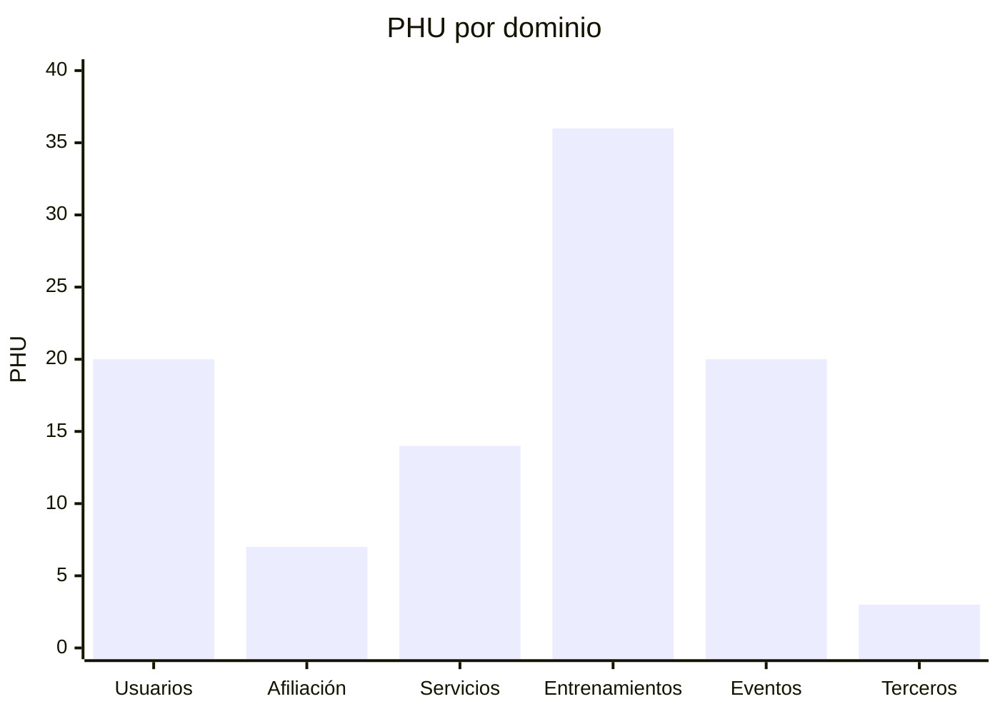
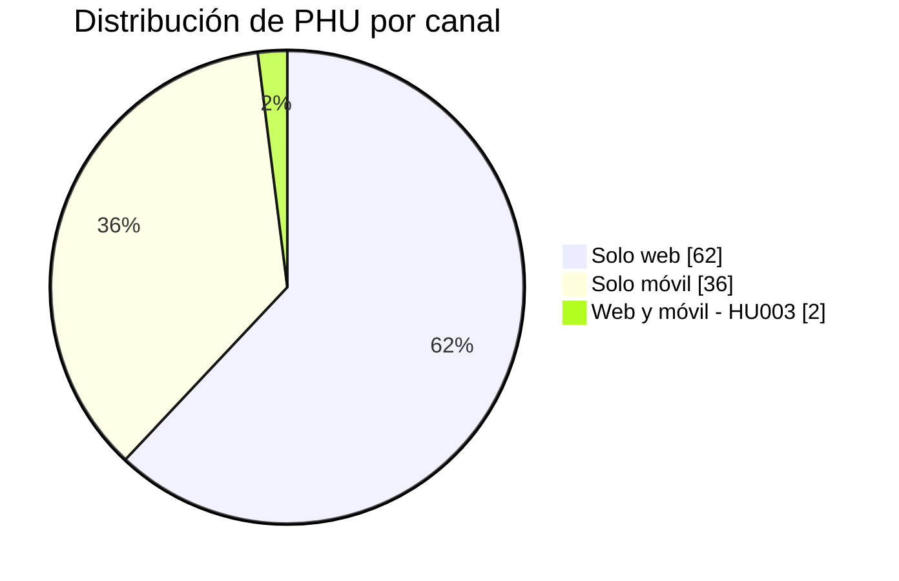
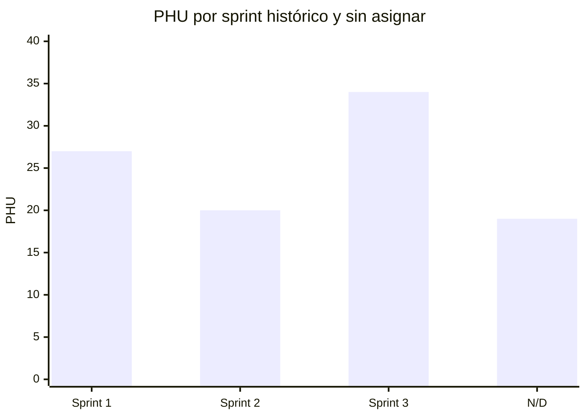
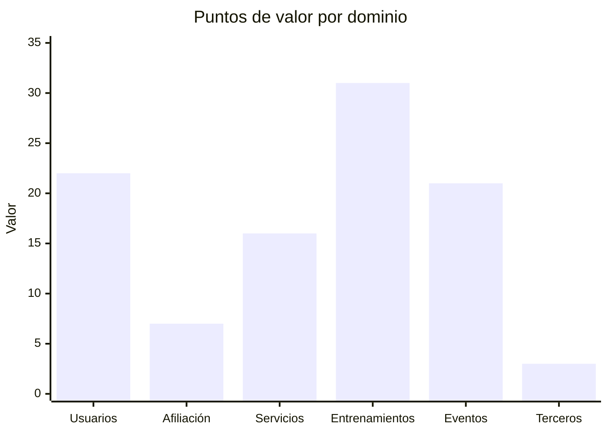
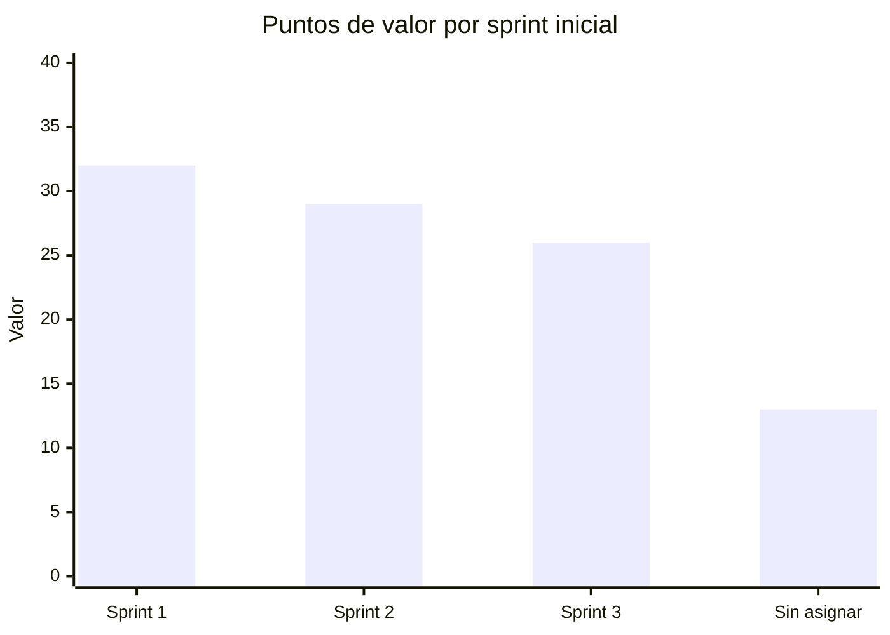

# Catálogo de historias para seguimiento

## Convenciones

- `Valor`: ponderación relativa de negocio; el backlog completo suma 100 puntos. No representa esfuerzo y solo se reconoce cuando la HU es aceptada.
- `Sprint vigente`: asignación operativa del Project 4. Partió de la referencia de 2024, pero registra los cambios reales del ciclo actual; HU001 pasó a Sprint 1 el 2026-10-09.
- `Estado`: `Backlog`, `Preparada`, `En curso`, `En revisión`, `Aceptada`, `Bloqueada` o `Retirada`, según la [guía](../docs/guia-de-actualizacion.md#estados-permitidos).
- `Aceptada`: fecha de aceptación; es la fecha que permite sumar PHU y valor.

El estado `Done` del Project 2 es evidencia histórica y no reemplaza el estado verificable de la reimplementación actual. Las 40 HU se crearon de nuevo en el Project 4; siete permanecen `Sin asignar` hasta que el responsable de producto defina su sprint. La definición funcional se conserva también en `documentacion/arquitectura/historias/catalogo-historias.md`.

HU003 incluye inicio de sesión web y móvil como una sola capacidad de negocio. Sus PHU y su valor no se duplican por canal.

Cada HU se construye mediante tareas técnicas hijas (`T-HUxxx-BE`, `T-HUxxx-WEB`, `T-HUxxx-MOB` y, si aplica, `T-HUxxx-PLAT`) que no tienen PHU ni valor y no cierran la HU por separado. HU001–HU025 son web (BE + WEB), salvo HU003, que también es móvil (BE + WEB + MOB); HU026–HU040 son móviles (BE + MOB). Las tareas se crean en el Project justo a tiempo; ver [Fuente local para GitHub Projects](README.md#historias-y-tareas-técnicas).

Las decisiones de producto del 2026-10-11 establecen que HU001 termina con una suscripción `FREE` automática para `athlete` y que HU016 compara o cambia el plan. El catálogo completo `FREE`/`INTERMEDIATE`/`PREMIUM`, sus versiones, metadatos, capacidades y límites se precarga por migración antes de habilitar Afiliación; no existe una HU ni un CRUD posterior para administrarlo. Para un deportista, cada capacidad vigente aparece en el menú lateral: `INTERMEDIATE` muestra todas las opciones `FREE` más tres y `PREMIUM` agrega dos a las anteriores. HU003 dirige `athlete`, `organizer` y `service_provider` a inicios y menús distintos; los planes solo amplían el menú del deportista. La coordinación Usuarios–Afiliación no duplica PHU ni valor.

| HU | Nombre | Dominio | Canal | PHU | Valor | Sprint vigente | Estado al 2026-10-11 | Aceptada | Evidencia |
| --- | --- | --- | --- | ---: | ---: | --- | --- | --- | --- |
| HU001 | Registrar usuario | Usuarios + Afiliación | Web | 5 | 5 | Sprint 1 | En curso (50 %), abierta: cierre técnico de `T-HU001-BE` integrado en `develop` el 2026-10-17 ([PR #24](https://github.com/lfnavarroj1/sport-app-backend/pull/24), merge `188b813`, `VERIFICADO_EN_CI`): políticas `sportapp-c108-c108plus.v1` y catálogo `plans-2026-10-13.v1` con siete ofertas COP por `0003_plan_price_offers` (`ci-full` 1056 pruebas, 96 %). Antes: `T-HU001-BE` con cuenta y BFF integrados; asignación automática de `FREE` en `affiliation_management` (catálogo precargado, `readiness`, consumidor idempotente, outbox y contrato interno) integrada en `develop` por el PR backend #7 (`40f6a70`, CI en verde): `T-HU001-BE` terminada; `GET /v1/me/capabilities` con `PROVISIONING` disponible en `bff-web` 0.5.0 (PR backend #8, `bf2af06`); faltan `T-HU001-PLAT`, consumir `PROVISIONING`/`FREE` en web, el E2E vertical ampliado y la aceptación funcional; `T-HU001-WEB` con registro integrado en `develop` | — | [Issue #1](https://github.com/lfnavarroj1/sport-app-platform/issues/1), [PR backend #1](https://github.com/lfnavarroj1/sport-app-backend/pull/1), [PR backend #2](https://github.com/lfnavarroj1/sport-app-backend/pull/2), [PR backend #7](https://github.com/lfnavarroj1/sport-app-backend/pull/7) |
| HU002 | Editar información del usuario | Usuarios | Web | 3 | 1 | `N/D` | Backlog | — | — |
| HU003 | Iniciar sesión | Usuarios | Web y móvil | 2 | 5 | Sprint 1 | En curso (50 %) con riesgo: `T-HU003-BE` base integrada en `develop` (PR #3) y `bff-web` 0.4.0 integrado (PR #6, `61494a5`); `T-HU003-WEB` en `8523fc1`, debe adoptar 0.4.0 y ADR-025; `T-HU003-MOB` bloqueada hasta consolidar el andamiaje móvil | — | [Issue #3](https://github.com/lfnavarroj1/sport-app-platform/issues/3), [PR backend #3](https://github.com/lfnavarroj1/sport-app-backend/pull/3), `documentacion/arquitectura/guias-desarrollo/tareas-hu/HU003-iniciar-sesion.md`. Project 4 sincronizado en `In Progress`/`En curso`, 50 %, el 2026-10-11 |
| HU004 | Cerrar sesión | Usuarios | Web y móvil (`athlete`) | 2 | 1 | Sprint 3 | En curso (propuesto al 2026-10-12): `T-HU004-BE` integrada en `develop` por el [PR #11](https://github.com/lfnavarroj1/sport-app-backend/pull/11) (merge `6a5ba68`, CI en verde; `POST /v1/sessions/revoke` en `users-management` 0.5.0, `bff-web` 0.7.0 y `bff-mobile` 0.4.0 con `Idempotency-Key` opcional para la cola offline de ADR-026); faltan `T-HU004-WEB`, `T-HU004-MOB`, E2E y aceptación | — | [Issue #4](https://github.com/lfnavarroj1/sport-app-platform/issues/4), `documentacion/arquitectura/guias-desarrollo/tareas-hu/HU004-cerrar-sesion.md` |
| HU005 | Registrar datos demográficos y fisiológicos | Usuarios | Web | 2 | 3 | Sprint 2 | En curso (propuesto al 2026-10-17): `T-HU005-BE` integrada en `develop` (PR #21, merge `555a2b5`, `VERIFICADO_EN_CI`; ADR-034; `users-management` 0.6.0, `bff-web` 0.13.0; `usuarios-read-projector` creado; R-19 backend); `T-HU005-WEB` ya puede adoptar el contrato 0.13.0; faltan despliegue del proyector y `HEALTH_DATA_CONSENT_VERSION` en plataforma, filtro en GCP y E2E | — | [PR #21](https://github.com/lfnavarroj1/sport-app-backend/pull/21), [ejecución 39020510757](https://github.com/lfnavarroj1/sport-app-backend/actions/runs/39020510757): 1041 pruebas, 96 % |
| HU006 | Registrar hábitos deportivos | Usuarios | Web | 2 | 3 | Sprint 2 | En curso (propuesto al 2026-10-23): `T-HU006-BE` integrada en `develop` por el [PR #37](https://github.com/lfnavarroj1/sport-app-backend/pull/37) (`7fd74f2`; ADR-034; `users-management` 0.9.0, `bff-web` 0.19.0; `ci-full` local 1314 pruebas, 96 %; `security` del PR falla por `certifi`); faltan `T-HU006-WEB`, despliegue y aceptación | — | — |
| HU007 | Consultar estado de cuenta | Afiliación | Web | 5 | 3 | `N/D` | Backlog | — | — |
| HU008 | Actualizar hábitos deportivos | Usuarios | Web | 2 | 2 | `N/D` | Backlog | — | — |
| HU009 | Registrar hábitos alimenticios | Usuarios | Web | 2 | 2 | Sprint 3 | Backlog | — | — |
| HU010 | Crear plan de entrenamiento | Entrenamientos | Web | 5 | 5 | Sprint 1 | En curso (propuesto al 2026-10-17): recorrido vertical real verificado en la composición local por el BFF; motivos de `training_plan_invalid` publicados en `training-management` 0.7.0 / `bff-web` 0.14.0 (PR #25, merge `2b1fba2`, `VERIFICADO_EN_CI`; 1058 pruebas, 96 %). Antes: cierre técnico de `T-HU010-BE` `VERIFICADO_LOCALMENTE` en `feature/HU010-cierre-e2e-vertical` (sin commit): recorrido vertical por Pub/Sub en verde (`test_training_plan_vertical_flow.py`, `ci-full` 1049 pruebas, 96 %) y los workers ya no ocultan una suscripción ausente. E2E integrado `BLOQUEADO` por plataforma: emulador sin recursos, nombres de `pubsub-init` distintos al contrato y ConfigMap sin `HEALTH_DATA_CONSENT_VERSION`. Antes: backend y BFF web integrados en `develop` por el [PR #9](https://github.com/lfnavarroj1/sport-app-backend/pull/9) (merge `67a239d`, CI en verde; autorización previa del deportista, plan, outbox, proyector y consulta; `bff-web` 0.6.0, `training-management` 0.2.0, `users-management` 0.4.0); faltan `usuarios-read-projector` (refactor de HU001), `T-HU010-WEB`, `T-HU010-PLAT` y aceptación; sin issue `T-HU010-BE` en el backend | — | [Issue #10](https://github.com/lfnavarroj1/sport-app-platform/issues/10), `documentacion/arquitectura/guias-desarrollo/tareas-hu/HU010-crear-plan-entrenamiento.md` |
| HU011 | Ver historial de entrenamiento | Entrenamientos | Web | 2 | 2 | Sprint 1 | En curso (propuesto al 2026-10-18, CA5): backend/BFF de la selección directa del profesional integrado en `develop` por el [PR #26](https://github.com/lfnavarroj1/sport-app-backend/pull/26) (merge `dcfc2b1`, CI en verde, 1076 pruebas; `training-management` 0.8.0, `users-management` 0.7.0, `bff-web` 0.15.0 `GET /v1/me/training-athletes`; `ci-full` 1081 pruebas, 96 %); faltan `T-HU011-WEB` de CA5, SLA y aceptación. Antes: En curso (propuesto al 2026-10-18): recorrido real verificado en la composición local con sesiones reales de HU032 (CA1–CA4); faltan `T-HU032-MOB`, el E2E web integrado, el SLA de frescura y la aceptación. Antes: En curso (propuesto al 2026-10-12): `T-HU011-BE` integrada en `develop` por el [PR #12](https://github.com/lfnavarroj1/sport-app-backend/pull/12) (merge `5e6387e`, CI en verde; historial del deportista y del profesional autorizado, autorización proyectada por eventos, paginación por cursor; `training-management` 0.3.0, `bff-web` 0.8.0); depende de que HU032 publique `entrenamiento.finalizado.v1`; faltan `T-HU011-WEB`, E2E y aceptación | — | [Issue #11](https://github.com/lfnavarroj1/sport-app-platform/issues/11), `documentacion/arquitectura/guias-desarrollo/tareas-hu/HU011-ver-historial-entrenamiento.md` |
| HU012 | Ver historial de molestias o lesiones | Entrenamientos | Web | 2 | 2 | `N/D` | Backlog | — | — |
| HU013 | Ver historial de alimentación | Entrenamientos | Web | 2 | 2 | `N/D` | Backlog | — | — |
| HU014 | Crear plan de alimentación | Entrenamientos | Web | 3 | 4 | Sprint 2 | En curso (propuesto al 2026-10-23): `T-HU014-BE` integrada en `develop` por el [PR #36](https://github.com/lfnavarroj1/sport-app-backend/pull/36) (`434bbf8`; ADR-037; `training-management` 0.9.0, `bff-web` 0.18.0, `users-management` 0.8.0; `ci-full` local 1267 pruebas, 96 %; `security` del PR falla por `certifi`); faltan `T-HU014-WEB`, HU009, ratificar el catálogo, despliegue y aceptación | — | — |
| HU015 | Crear servicio | Servicios | Web | 3 | 4 | Sprint 2 | En curso (propuesto al 2026-10-13): `T-HU015-BE` `VERIFICADO_EN_CI`, integrada en `develop` por el [PR #13](https://github.com/lfnavarroj1/sport-app-backend/pull/13) (`604ec00`; `POST /v1/services` según ADR-027; `complementary-services` 0.2.0, `bff-web` 0.9.0); faltan `T-HU015-WEB`, E2E y aceptación | — | [Issue #15](https://github.com/lfnavarroj1/sport-app-platform/issues/15), `documentacion/arquitectura/guias-desarrollo/tareas-hu/HU015-crear-servicio.md` |
| HU016 | Seleccionar o cambiar plan de afiliación | Afiliación | Web | 2 | 4 | Sprint 2 | En curso (propuesto al 2026-10-23): `T-HU016-BE` verificada localmente en `feature/HU016-seleccionar-plan-afiliacion` (ADR-036; `affiliation-management` 0.3.0, `bff-web` 0.20.0; `ci-full` local 1350 pruebas, 96 %; `pip-audit` falla por `certifi`); faltan commit, PR, `T-HU016-WEB`, despliegue y aceptación | — | — |
| HU017 | Asociar servicios médicos deportivos | Servicios | Web | 2 | 3 | Sprint 3 | Backlog | — | — |
| HU018 | Integrar servicios y eventos en calendario | Eventos | Web | 3 | 3 | Sprint 3 | Backlog | — | — |
| HU019 | Publicar servicios | Servicios | Web | 2 | 3 | Sprint 2 | En curso (propuesto al 2026-10-13): `T-HU019-BE` `VERIFICADO_EN_CI`, integrada en `develop` por el [PR #18](https://github.com/lfnavarroj1/sport-app-backend/pull/18) (`7e3560a`; ADR-027 y ADR-038; `complementary-services` 0.3.0, `bff-web` 0.11.0); faltan `T-HU019-WEB`, `T-HU019-PLAT` y aceptación | — | — |
| HU020 | Visualizar disponibilidad | Servicios | Web | 2 | 3 | Sprint 1 | En curso (propuesto al 2026-10-14): `T-HU020-BE` `VERIFICADO_EN_CI`, integrada en `develop` por el [PR #19](https://github.com/lfnavarroj1/sport-app-backend/pull/19) (`17358cb`; ADR-038; `complementary-services` 0.4.0, `bff-web` 0.12.0); faltan `T-HU020-WEB` y aceptación | — | [Issue #20](https://github.com/lfnavarroj1/sport-app-platform/issues/20) |
| HU021 | Crear evento masivo | Eventos | Web | 3 | 4 | Sprint 1 | En curso (propuesto al 2026-10-13): `T-HU021-BE` `VERIFICADO_EN_CI`, integrada en `develop` por el [PR #14](https://github.com/lfnavarroj1/sport-app-backend/pull/14) (`5e5debf`; `POST /v1/events` según ADR-028; `events-management` 0.2.0, `bff-web` 0.10.0; `evento.creado.v1` y proyección `event_read`); faltan `T-HU021-WEB`, `T-HU021-PLAT`, E2E y aceptación | — | — |
| HU022 | Consultar inscritos | Eventos | Web | 2 | 2 | Sprint 3 | Backlog | — | — |
| HU023 | Consultar calendario de eventos | Eventos | Web | 2 | 3 | Sprint 1 | En curso (propuesto al 2026-10-22): `T-HU023-BE` integrada en `develop` por el [PR #35](https://github.com/lfnavarroj1/sport-app-backend/pull/35) (`5de6fb3`; ADR-040; `events-management` 0.6.0, `bff-web` 0.17.0; `ci-full` local 1164 pruebas, 96 %; `security` del PR falla por `certifi`); faltan `T-HU023-WEB`, despliegue y aceptación | — | — |
| HU024 | Publicar evento | Eventos | Web | 2 | 3 | Sprint 2 | En curso (propuesto al 2026-10-18): `T-HU024-BE` `VERIFICADO_LOCALMENTE` sin commit en `feature/HU024-publicar-eventos-deportivos` (ADR-033; `events-management` 0.5.0, `bff-web` 0.16.0; `ci-full` 1125 pruebas, 96 %); faltan PR, `T-HU024-WEB`, plataforma y aceptación | — | — |
| HU025 | Asignar tarifa | Eventos | Web | 2 | 2 | Sprint 3 | Backlog | — | — |
| HU026 | Sugerir rutas | Entrenamientos | Móvil | 2 | 2 | Sprint 3 | Backlog | — | — |
| HU027 | Sugerir eventos | Eventos | Móvil | 2 | 2 | Sprint 3 | Backlog | — | — |
| HU028 | Sugerir planes de entrenamiento | Entrenamientos | Móvil | 2 | 3 | Sprint 2 | Backlog | — | — |
| HU029 | Sugerir servicios de acompañamiento | Servicios | Móvil | 2 | 2 | Sprint 3 | Backlog | — | — |
| HU030 | Sugerir rutinas alimenticias | Entrenamientos | Móvil | 2 | 2 | `N/D` | Backlog | — | — |
| HU031 | Integrar SportApp con Strava | Terceros | Móvil | 3 | 3 | Sprint 3 | Backlog | — | — |
| HU032 | Iniciar o finalizar entrenamiento | Entrenamientos | Móvil | 2 | 3 | Sprint 1 | En curso (propuesto al 2026-10-13): `T-HU032-BE` `VERIFICADO_EN_CI`, integrada en `develop` por el [PR #15](https://github.com/lfnavarroj1/sport-app-backend/pull/15) (`94ff6bf`; ADR-029; `training-management` 0.4.0, `bff-mobile` 0.5.0; `entrenamiento.iniciado.v1` y `entrenamiento.finalizado.v1`); faltan `T-HU032-MOB`, E2E sin red y aceptación | — | — |
| HU033 | Ver tablero de entrenamientos | Entrenamientos | Móvil | 2 | 2 | Sprint 2 | Backlog | — | — |
| HU034 | Calcular FTP y VO2max | Entrenamientos | Móvil | 2 | 1 | Sprint 1 | En curso (propuesto al 2026-10-18): `T-HU034-BE` integrada en `develop` por el [PR #20](https://github.com/lfnavarroj1/sport-app-backend/pull/20) (merge `eb745b7`, CI en verde, 885 pruebas, 96 %) y recorrido real verificado en la composición local por `bff-mobile` 0.8.0 (CA1–CA5); faltan `T-HU034-MOB`, HA014 completo y aceptación. Antes: En curso (propuesto al 2026-10-14): `T-HU034-BE` `VERIFICADO_LOCALMENTE` en `feature/HU034-calcular-ftp-vo2max` (sin commit; ADR-030; `training-management` 0.6.0, `bff-mobile` 0.8.0; `ci-full` local con 891 pruebas (674 unitarias, 138 de integración, 36 de contrato, 43 de componente; ninguna omitida) y 96 % de cobertura combinada); faltan PR, `T-HU034-MOB`, HA014 completo y aceptación | — | — |
| HU035 | Ver calendario deportivo | Eventos | Móvil | 2 | 1 | Sprint 1 | En curso (propuesto al 2026-10-13): `T-HU035-BE` `VERIFICADO_EN_CI`, integrada en `develop` por el [PR #16](https://github.com/lfnavarroj1/sport-app-backend/pull/16) (`d775f52`; ADR-031; `bff-mobile` 0.6.0, `events-management` 0.3.0, `training-management` 0.5.0); faltan `T-HU035-MOB`, HU024 y demás dependencias de ADR-031, E2E y aceptación | — | — |
| HU036 | Monitorear una práctica en tiempo real | Entrenamientos | Móvil | 3 | 1 | Sprint 3 | Backlog | — | — |
| HU037 | Conectar dispositivos de medición | Entrenamientos | Móvil | 5 | 1 | Sprint 3 | Backlog | — | — |
| HU038 | Notificar alimentos y bebidas | Entrenamientos | Móvil | 2 | 1 | Sprint 3 | Backlog | — | — |
| HU039 | Notificación múltiple de eventos | Eventos | Móvil | 2 | 1 | Sprint 3 | Backlog | — | — |
| HU040 | Programar sesiones virtuales | Servicios | Móvil | 3 | 1 | `N/D` | Backlog | — | — |
| **Total** | **40 historias** | — | — | **100** | **100** | **33 asignadas; 7 `N/D`** | **0 aceptadas registradas** | — | — |

## Tareas técnicas activas

Solo se registran las tareas creadas justo a tiempo en el Project 4, como sub-issues de su HU. Su estado no suma PHU ni valor.

| Tarea | HU padre | Repositorio e issue | Estado al 2026-10-11 | Referencia | Siguiente paso |
| --- | --- | --- | --- | --- | --- |
| `T-HU001-BE` | HU001 | [backend #4](https://github.com/lfnavarroj1/sport-app-backend/issues/4) | Terminada (`VERIFICADO_EN_CI`) | Usuarios y BFF web integrados en `develop` (PR #1 y #2); Afiliación (catálogo, consumidor, `FREE`, outbox y contrato interno) integrada por el [PR #7](https://github.com/lfnavarroj1/sport-app-backend/pull/7) (merge `40f6a70`, 2026-10-11, CI en verde) | Sin trabajo backend de la tarea; quedan transversales: HA002, HA003, límite de solicitudes, protección contra enumeración, versión real de políticas y purga de idempotencia |
| `T-HU001-WEB` | HU001 | [frontend #4](https://github.com/lfnavarroj1/sport-app-frontend/issues/4) | En curso (base integrada; contrato `FREE` ya disponible) | Registro integrado en `develop`; `bff-web` 0.5.0 expone `GET /v1/me/capabilities` con `ACTIVE`/`PROVISIONING`/`NOT_APPLICABLE` | Consumir `GET /v1/me/capabilities`, representar `PROVISIONING` sin conceder capacidades, recuperar el estado sin repetir el registro y evidenciar `FREE` en el E2E |
| `T-HU003-BE` | HU003 | [backend #5](https://github.com/lfnavarroj1/sport-app-backend/issues/5) | Terminada (`VERIFICADO_EN_CI`) | Base integrada en `develop` (PR #3); `bff-web` 0.4.0 por el [PR #6](https://github.com/lfnavarroj1/sport-app-backend/pull/6) (merge `61494a5`); `GET /v1/me/capabilities` en ambos BFF con `actor-permissions.v1` por el [PR #8](https://github.com/lfnavarroj1/sport-app-backend/pull/8) (merge `bf2af06`, 2026-10-11, CI en verde; `bff-web` 0.5.0, `bff-mobile` 0.3.0) | Plataforma: Secret `sportapp-users-jwt`, `FORWARDED_ALLOW_IPS` y mismo sitio web/BFF en producción |
| `T-HU003-WEB` | HU003 | [frontend #5](https://github.com/lfnavarroj1/sport-app-frontend/issues/5) | En curso | `feature/HU003-iniciar-sesion`, commit `8523fc1`, consume `bff-web` 0.3.0 | Adoptar `bff-web` 0.4.0 (renovación por cookie) y la navegación por actor de ADR-025; E2E actualizado |
| `T-HU003-MOB` | HU003 | [móvil #1](https://github.com/lfnavarroj1/sport-app-movil/issues/1) | Bloqueada | `sport-app-movil` en `master` (`de526b7`) con cambios locales de andamiaje sin consolidar (47 al 2026-10-11) | Consolidar el andamiaje móvil y su CI; después fijar revisión, rutas y contrato `bff-mobile` antes de asignar |

HU001 no tiene tarea móvil porque su canal aprobado es web.

## Gráficos del backlog

