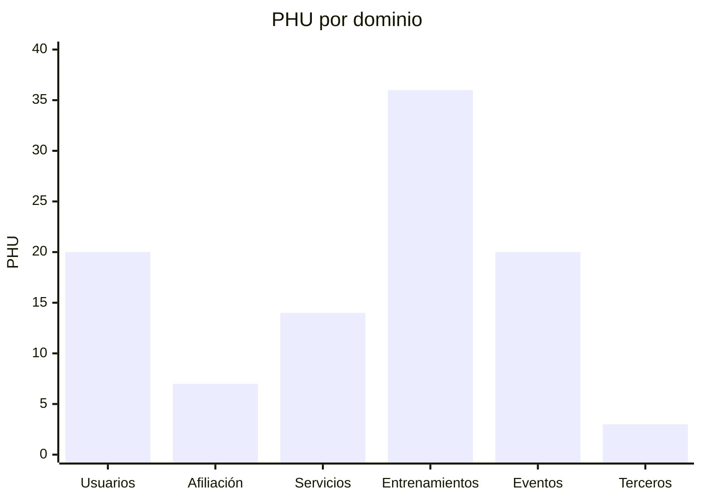
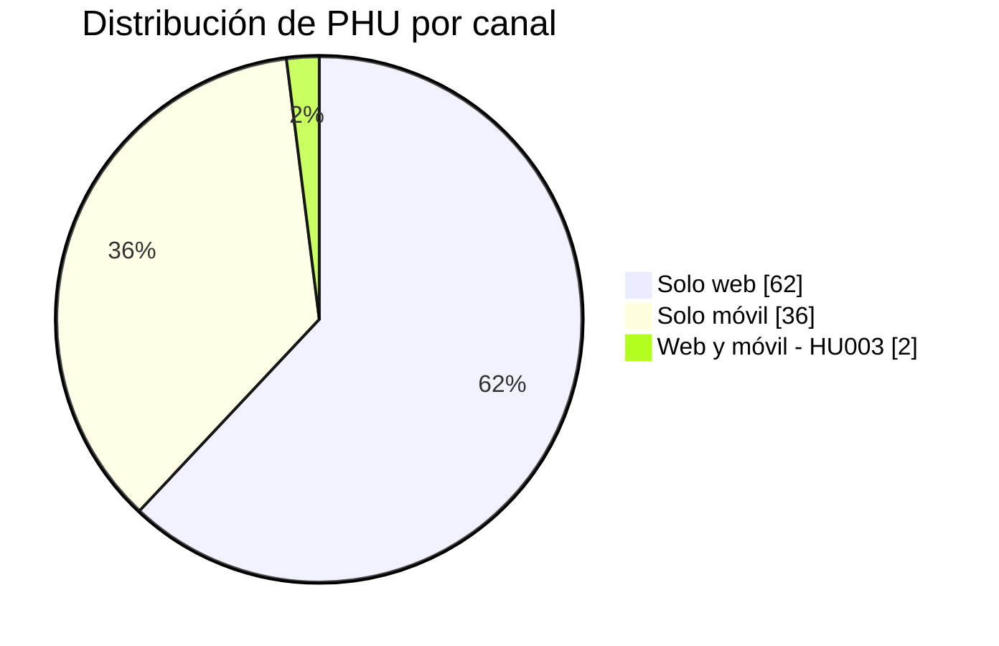
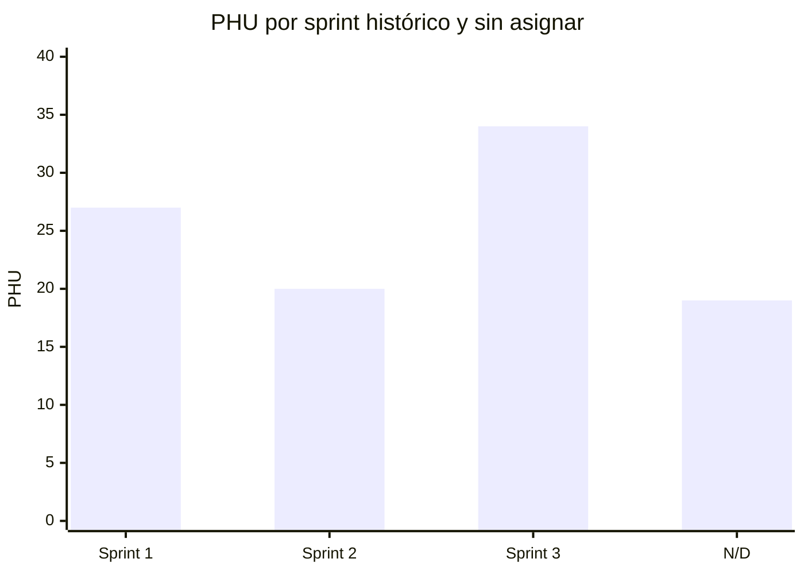
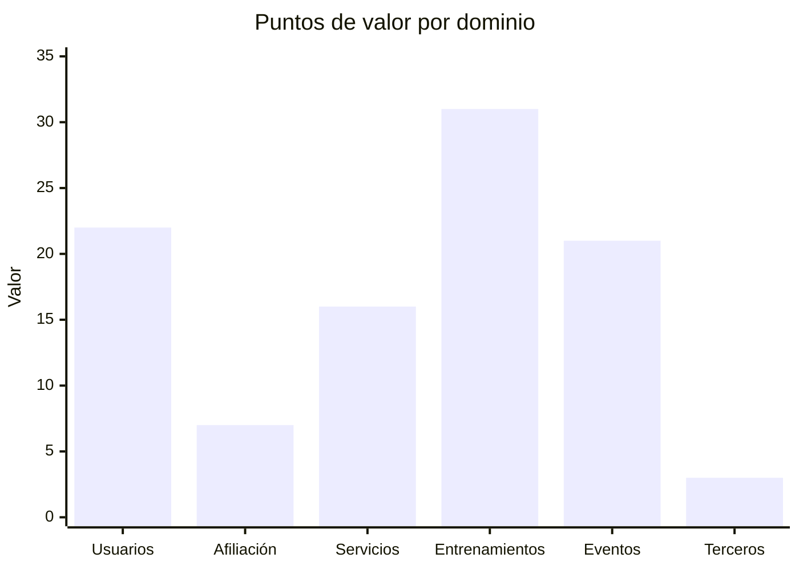
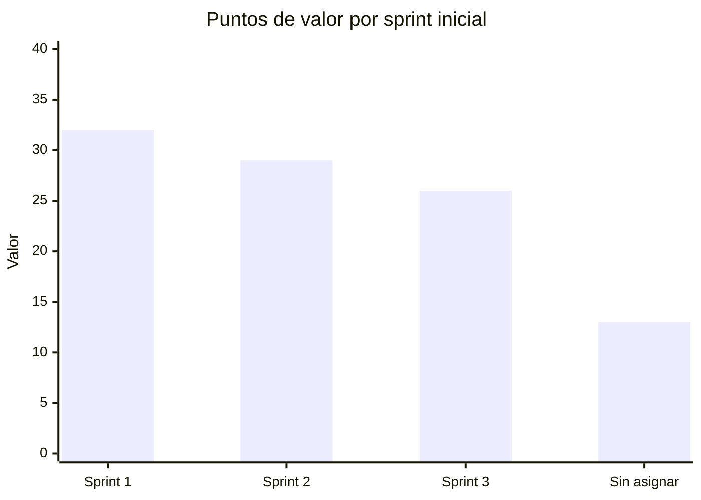

# Catálogo de historias para seguimiento

## Convenciones

- `Valor`: ponderación relativa de negocio; el backlog completo suma 100 puntos. No representa esfuerzo y solo se reconoce cuando la HU es aceptada.
- `Sprint vigente`: asignación operativa del Project 4. Partió de la referencia de 2024, pero registra los cambios reales del ciclo actual; HU001 pasó a Sprint 1 el 2026-10-09.
- `Estado`: `Backlog`, `Preparada`, `En curso`, `En revisión`, `Aceptada`, `Bloqueada` o `Retirada`, según la [guía](../docs/guia-de-actualizacion.md#estados-permitidos).
- `Aceptada`: fecha de aceptación; es la fecha que permite sumar PHU y valor.

El estado `Done` del Project 2 es evidencia histórica y no reemplaza el estado verificable de la reimplementación actual. Las 40 HU se crearon de nuevo en el Project 4; siete permanecen `Sin asignar` hasta que el responsable de producto defina su sprint. La definición funcional se conserva también en `documentacion/arquitectura/historias/catalogo-historias.md`.

HU003 incluye inicio de sesión web y móvil como una sola capacidad de negocio. Sus PHU y su valor no se duplican por canal.

Cada HU se construye mediante tareas técnicas hijas (`T-HUxxx-BE`, `T-HUxxx-WEB`, `T-HUxxx-MOB` y, si aplica, `T-HUxxx-PLAT`) que no tienen PHU ni valor y no cierran la HU por separado. HU001–HU025 son web (BE + WEB), salvo HU003, que también es móvil (BE + WEB + MOB); HU026–HU040 son móviles (BE + MOB). Las tareas se crean en el Project justo a tiempo; ver [Fuente local para GitHub Projects](README.md#historias-y-tareas-técnicas).

Las decisiones de producto del 2026-10-11 establecen que HU001 termina con una suscripción `FREE` automática para `athlete` y que HU016 compara o cambia el plan. El catálogo completo `FREE`/`INTERMEDIATE`/`PREMIUM`, sus versiones, metadatos, capacidades y límites se precarga por migración antes de habilitar Afiliación; no existe una HU ni un CRUD posterior para administrarlo. Para un deportista, cada capacidad vigente aparece en el menú lateral: `INTERMEDIATE` muestra todas las opciones `FREE` más tres y `PREMIUM` agrega dos a las anteriores. HU003 dirige `athlete`, `organizer` y `service_provider` a inicios y menús distintos; los planes solo amplían el menú del deportista. La coordinación Usuarios–Afiliación no duplica PHU ni valor.

| HU | Nombre | Dominio | Canal | PHU | Valor | Sprint vigente | Estado al 2026-10-11 | Aceptada | Evidencia |
| --- | --- | --- | --- | ---: | ---: | --- | --- | --- | --- |
| HU001 | Registrar usuario | Usuarios + Afiliación | Web | 5 | 5 | Sprint 1 | En curso (50 %), abierta: `T-HU001-BE` con cuenta y BFF integrados; asignación automática de `FREE` en `affiliation_management` (catálogo precargado, `readiness`, consumidor idempotente y E2E de backend) verificada localmente en `feature/HU001-afiliacion-free`, sin PR; faltan `T-HU001-PLAT` y `PROVISIONING` en web; `T-HU001-WEB` integrada en `develop` | — | [Issue #1](https://github.com/lfnavarroj1/sport-app-platform/issues/1), [PR backend #1](https://github.com/lfnavarroj1/sport-app-backend/pull/1), [PR backend #2](https://github.com/lfnavarroj1/sport-app-backend/pull/2) |
| HU002 | Editar información del usuario | Usuarios | Web | 3 | 1 | `N/D` | Backlog | — | — |
| HU003 | Iniciar sesión | Usuarios | Web y móvil | 2 | 5 | Sprint 1 | En curso (50 %) con riesgo: `T-HU003-BE` base integrada en `develop` (PR #3) y `bff-web` 0.4.0 integrado (PR #6, `61494a5`); `T-HU003-WEB` en `8523fc1`, debe adoptar 0.4.0 y ADR-025; `T-HU003-MOB` bloqueada hasta consolidar el andamiaje móvil | — | [Issue #3](https://github.com/lfnavarroj1/sport-app-platform/issues/3), [PR backend #3](https://github.com/lfnavarroj1/sport-app-backend/pull/3), `documentacion/arquitectura/guias-desarrollo/tareas-hu/HU003-iniciar-sesion.md`. Project 4 sincronizado en `In Progress`/`En curso`, 50 %, el 2026-10-11 |
| HU004 | Cerrar sesión | Usuarios | Web | 2 | 1 | Sprint 3 | Backlog | — | — |
| HU005 | Registrar datos demográficos y fisiológicos | Usuarios | Web | 2 | 3 | Sprint 2 | Backlog | — | — |
| HU006 | Registrar hábitos deportivos | Usuarios | Web | 2 | 3 | Sprint 2 | Backlog | — | — |
| HU007 | Consultar estado de cuenta | Afiliación | Web | 5 | 3 | `N/D` | Backlog | — | — |
| HU008 | Actualizar hábitos deportivos | Usuarios | Web | 2 | 2 | `N/D` | Backlog | — | — |
| HU009 | Registrar hábitos alimenticios | Usuarios | Web | 2 | 2 | Sprint 3 | Backlog | — | — |
| HU010 | Crear plan de entrenamiento | Entrenamientos | Web | 5 | 5 | Sprint 1 | Backlog | — | — |
| HU011 | Ver historial de entrenamiento | Entrenamientos | Web | 2 | 2 | Sprint 1 | Backlog | — | — |
| HU012 | Ver historial de molestias o lesiones | Entrenamientos | Web | 2 | 2 | `N/D` | Backlog | — | — |
| HU013 | Ver historial de alimentación | Entrenamientos | Web | 2 | 2 | `N/D` | Backlog | — | — |
| HU014 | Crear plan de alimentación | Entrenamientos | Web | 3 | 4 | Sprint 2 | Backlog | — | — |
| HU015 | Crear servicio | Servicios | Web | 3 | 4 | Sprint 2 | Backlog | — | — |
| HU016 | Seleccionar o cambiar plan de afiliación | Afiliación | Web | 2 | 4 | Sprint 2 | Backlog | — | — |
| HU017 | Asociar servicios médicos deportivos | Servicios | Web | 2 | 3 | Sprint 3 | Backlog | — | — |
| HU018 | Integrar servicios y eventos en calendario | Eventos | Web | 3 | 3 | Sprint 3 | Backlog | — | — |
| HU019 | Publicar servicios | Servicios | Web | 2 | 3 | Sprint 2 | Backlog | — | — |
| HU020 | Visualizar disponibilidad | Servicios | Web | 2 | 3 | Sprint 1 | Backlog | — | — |
| HU021 | Crear evento masivo | Eventos | Web | 3 | 4 | Sprint 1 | Backlog | — | — |
| HU022 | Consultar inscritos | Eventos | Web | 2 | 2 | Sprint 3 | Backlog | — | — |
| HU023 | Consultar calendario de eventos | Eventos | Web | 2 | 3 | Sprint 1 | Backlog | — | — |
| HU024 | Publicar evento | Eventos | Web | 2 | 3 | Sprint 2 | Backlog | — | — |
| HU025 | Asignar tarifa | Eventos | Web | 2 | 2 | Sprint 3 | Backlog | — | — |
| HU026 | Sugerir rutas | Entrenamientos | Móvil | 2 | 2 | Sprint 3 | Backlog | — | — |
| HU027 | Sugerir eventos | Eventos | Móvil | 2 | 2 | Sprint 3 | Backlog | — | — |
| HU028 | Sugerir planes de entrenamiento | Entrenamientos | Móvil | 2 | 3 | Sprint 2 | Backlog | — | — |
| HU029 | Sugerir servicios de acompañamiento | Servicios | Móvil | 2 | 2 | Sprint 3 | Backlog | — | — |
| HU030 | Sugerir rutinas alimenticias | Entrenamientos | Móvil | 2 | 2 | `N/D` | Backlog | — | — |
| HU031 | Integrar SportApp con Strava | Terceros | Móvil | 3 | 3 | Sprint 3 | Backlog | — | — |
| HU032 | Iniciar o finalizar entrenamiento | Entrenamientos | Móvil | 2 | 3 | Sprint 1 | Backlog | — | — |
| HU033 | Ver tablero de entrenamientos | Entrenamientos | Móvil | 2 | 2 | Sprint 2 | Backlog | — | — |
| HU034 | Calcular FTP y VO2max | Entrenamientos | Móvil | 2 | 1 | Sprint 1 | Backlog | — | — |
| HU035 | Ver calendario deportivo | Eventos | Móvil | 2 | 1 | Sprint 1 | Backlog | — | — |
| HU036 | Monitorear una práctica en tiempo real | Entrenamientos | Móvil | 3 | 1 | Sprint 3 | Backlog | — | — |
| HU037 | Conectar dispositivos de medición | Entrenamientos | Móvil | 5 | 1 | Sprint 3 | Backlog | — | — |
| HU038 | Notificar alimentos y bebidas | Entrenamientos | Móvil | 2 | 1 | Sprint 3 | Backlog | — | — |
| HU039 | Notificación múltiple de eventos | Eventos | Móvil | 2 | 1 | Sprint 3 | Backlog | — | — |
| HU040 | Programar sesiones virtuales | Servicios | Móvil | 3 | 1 | `N/D` | Backlog | — | — |
| **Total** | **40 historias** | — | — | **100** | **100** | **33 asignadas; 7 `N/D`** | **0 aceptadas registradas** | — | — |

## Tareas técnicas activas

Solo se registran las tareas creadas justo a tiempo en el Project 4, como sub-issues de su HU. Su estado no suma PHU ni valor.

| Tarea | HU padre | Repositorio e issue | Estado al 2026-10-11 | Referencia | Siguiente paso |
| --- | --- | --- | --- | --- | --- |
| `T-HU001-BE` | HU001 | [backend #4](https://github.com/lfnavarroj1/sport-app-backend/issues/4) | En curso | Usuarios y BFF web integrados en `develop` (PR #1 y #2); Afiliación (catálogo, consumidor, `FREE`, outbox y contrato interno) en `feature/HU001-afiliacion-free`, `VERIFICADO_LOCALMENTE` | PR, CI e integración de Afiliación; `T-HU001-PLAT` y medición HA002 |
| `T-HU001-WEB` | HU001 | [frontend #4](https://github.com/lfnavarroj1/sport-app-frontend/issues/4) | En curso (base integrada; espera el contrato `FREE`) | Registro integrado en `develop` | Representar `PROVISIONING` y evidenciar el resultado `FREE` cuando exista el contrato backend |
| `T-HU003-BE` | HU003 | [backend #5](https://github.com/lfnavarroj1/sport-app-backend/issues/5) | En curso | Base integrada en `develop` (PR #3); `bff-web` 0.4.0 integrado por el [PR #6](https://github.com/lfnavarroj1/sport-app-backend/pull/6) (merge `61494a5`, CI en verde) | `GET /v1/me/capabilities` en ambos BFF con `actor-permissions.v1` (ADR-025), después del contrato interno de Afiliación de `T-HU001-BE` |
| `T-HU003-WEB` | HU003 | [frontend #5](https://github.com/lfnavarroj1/sport-app-frontend/issues/5) | En curso | `feature/HU003-iniciar-sesion`, commit `8523fc1`, consume `bff-web` 0.3.0 | Adoptar `bff-web` 0.4.0 (renovación por cookie) y la navegación por actor de ADR-025; E2E actualizado |
| `T-HU003-MOB` | HU003 | [móvil #1](https://github.com/lfnavarroj1/sport-app-movil/issues/1) | Bloqueada | `sport-app-movil` en `master` (`de526b7`) con cambios locales de andamiaje sin consolidar (47 al 2026-10-11) | Consolidar el andamiaje móvil y su CI; después fijar revisión, rutas y contrato `bff-mobile` antes de asignar |

HU001 no tiene tarea móvil porque su canal aprobado es web.

## Gráficos del backlog

