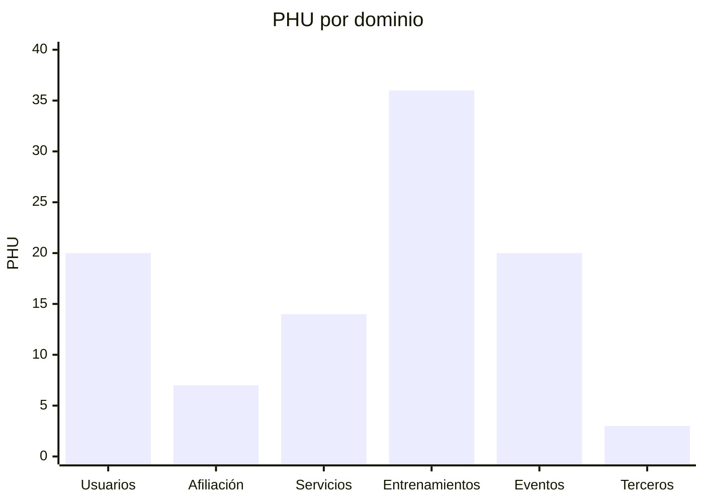
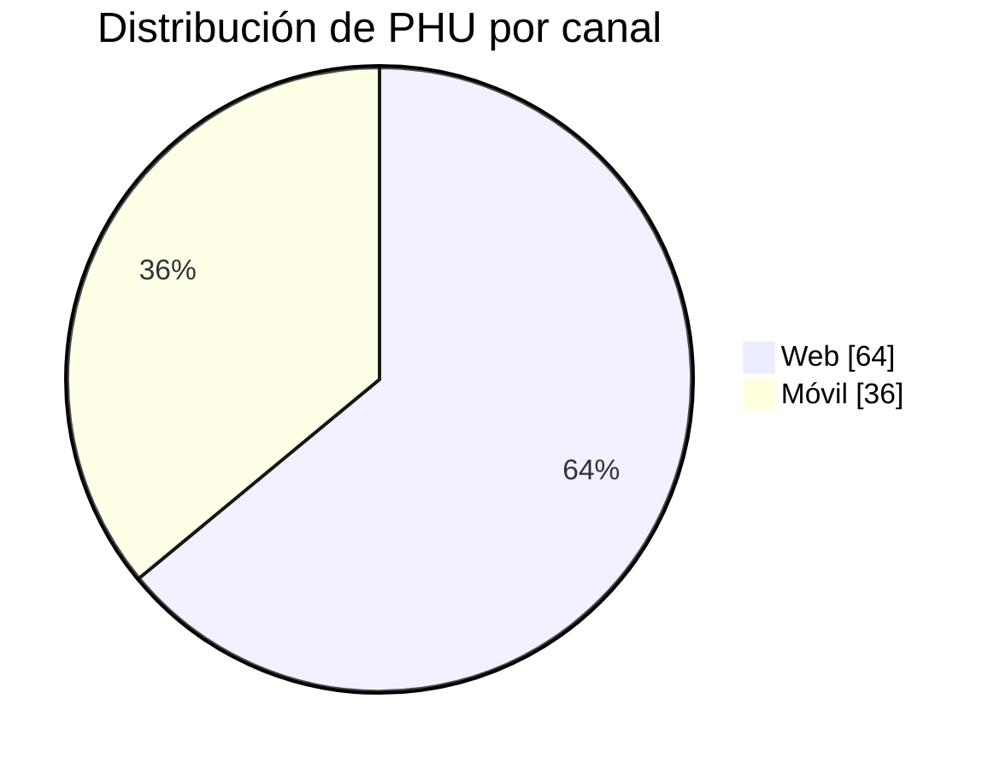
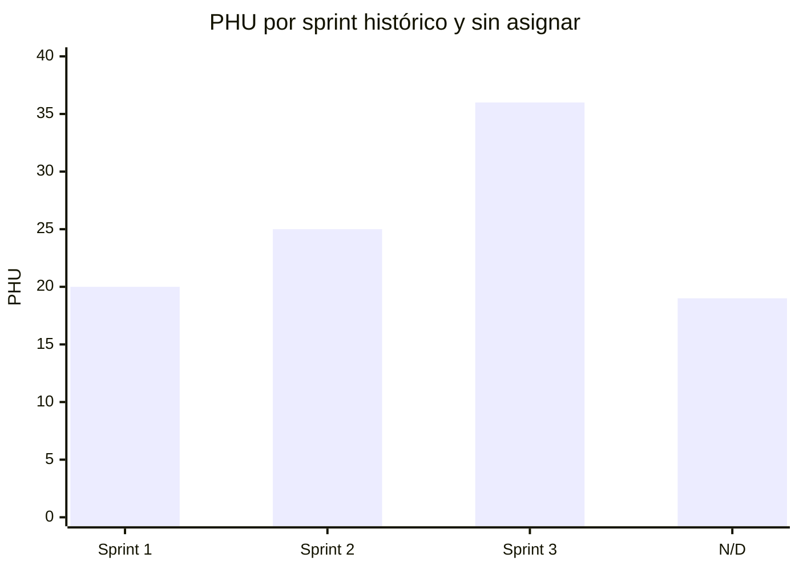

# Catálogo de historias para seguimiento

## Convenciones

- `Valor`: puntuación de negocio de 1 a 10, pendiente de asignar por el responsable de producto.
- `Sprint histórico`: iteración asignada en el [Project 2 de SportApp-G9](https://github.com/users/lfnavarroj1/projects/2), cuya planeación corresponde a 2024.
- `Estado`: uno de los estados definidos en la [guía](../docs/guia-de-actualizacion.md#estados-permitidos).
- `Aceptada`: fecha de aceptación; es la fecha que permite sumar PHU y valor.

El estado `Done` del Project 2 es evidencia histórica y no reemplaza el estado verificable de la reimplementación actual. Las siete historias ausentes del tablero se mantienen como `N/D` hasta que el responsable de producto las asigne.

| HU | Nombre | Dominio | Canal | PHU | Valor | Sprint histórico | Estado al 2026-10-09 | Aceptada | Evidencia |
| --- | --- | --- | --- | ---: | ---: | --- | --- | --- | --- |
| HU001 | Registrar usuario | Usuarios | Web | 5 | `N/D` | Sprint 2 | En curso: backend/BFF verificados; web pendiente | — | [Ficha HU001](../../arquitectura/guias-desarrollo/tareas-hu/HU001-registrar-usuario.md) |
| HU002 | Editar información del usuario | Usuarios | Web | 3 | `N/D` | `N/D` | No iniciada | — | — |
| HU003 | Iniciar sesión | Usuarios | Web | 2 | `N/D` | Sprint 3 | No iniciada | — | — |
| HU004 | Cerrar sesión | Usuarios | Web | 2 | `N/D` | Sprint 3 | No iniciada | — | — |
| HU005 | Registrar datos demográficos y fisiológicos | Usuarios | Web | 2 | `N/D` | Sprint 2 | No iniciada | — | — |
| HU006 | Registrar hábitos deportivos | Usuarios | Web | 2 | `N/D` | Sprint 2 | No iniciada | — | — |
| HU007 | Consultar estado de cuenta | Afiliación | Web | 5 | `N/D` | `N/D` | No iniciada | — | — |
| HU008 | Actualizar hábitos deportivos | Usuarios | Web | 2 | `N/D` | `N/D` | No iniciada | — | — |
| HU009 | Registrar hábitos alimenticios | Usuarios | Web | 2 | `N/D` | Sprint 3 | No iniciada | — | — |
| HU010 | Crear plan de entrenamiento | Entrenamientos | Web | 5 | `N/D` | Sprint 1 | No iniciada | — | — |
| HU011 | Ver historial de entrenamiento | Entrenamientos | Web | 2 | `N/D` | Sprint 1 | No iniciada | — | — |
| HU012 | Ver historial de molestias o lesiones | Entrenamientos | Web | 2 | `N/D` | `N/D` | No iniciada | — | — |
| HU013 | Ver historial de alimentación | Entrenamientos | Web | 2 | `N/D` | `N/D` | No iniciada | — | — |
| HU014 | Crear plan de alimentación | Entrenamientos | Web | 3 | `N/D` | Sprint 2 | No iniciada | — | — |
| HU015 | Crear servicio | Servicios | Web | 3 | `N/D` | Sprint 2 | No iniciada | — | — |
| HU016 | Seleccionar plan de afiliación | Afiliación | Web | 2 | `N/D` | Sprint 2 | No iniciada | — | — |
| HU017 | Asociar servicios médicos deportivos | Servicios | Web | 2 | `N/D` | Sprint 3 | No iniciada | — | — |
| HU018 | Integrar servicios y eventos en calendario | Eventos | Web | 3 | `N/D` | Sprint 3 | No iniciada | — | — |
| HU019 | Publicar servicios | Servicios | Web | 2 | `N/D` | Sprint 2 | No iniciada | — | — |
| HU020 | Visualizar disponibilidad | Servicios | Web | 2 | `N/D` | Sprint 1 | No iniciada | — | — |
| HU021 | Crear evento masivo | Eventos | Web | 3 | `N/D` | Sprint 1 | No iniciada | — | — |
| HU022 | Consultar inscritos | Eventos | Web | 2 | `N/D` | Sprint 3 | No iniciada | — | — |
| HU023 | Consultar calendario de eventos | Eventos | Web | 2 | `N/D` | Sprint 1 | No iniciada | — | — |
| HU024 | Publicar evento | Eventos | Web | 2 | `N/D` | Sprint 2 | No iniciada | — | — |
| HU025 | Asignar tarifa | Eventos | Web | 2 | `N/D` | Sprint 3 | No iniciada | — | — |
| HU026 | Sugerir rutas | Entrenamientos | Móvil | 2 | `N/D` | Sprint 3 | No iniciada | — | — |
| HU027 | Sugerir eventos | Eventos | Móvil | 2 | `N/D` | Sprint 3 | No iniciada | — | — |
| HU028 | Sugerir planes de entrenamiento | Entrenamientos | Móvil | 2 | `N/D` | Sprint 2 | No iniciada | — | — |
| HU029 | Sugerir servicios de acompañamiento | Servicios | Móvil | 2 | `N/D` | Sprint 3 | No iniciada | — | — |
| HU030 | Sugerir rutinas alimenticias | Entrenamientos | Móvil | 2 | `N/D` | `N/D` | No iniciada | — | — |
| HU031 | Integrar SportApp con Strava | Terceros | Móvil | 3 | `N/D` | Sprint 3 | No iniciada | — | — |
| HU032 | Iniciar o finalizar entrenamiento | Entrenamientos | Móvil | 2 | `N/D` | Sprint 1 | No iniciada | — | — |
| HU033 | Ver tablero de entrenamientos | Entrenamientos | Móvil | 2 | `N/D` | Sprint 2 | No iniciada | — | — |
| HU034 | Calcular FTP y VO2max | Entrenamientos | Móvil | 2 | `N/D` | Sprint 1 | No iniciada | — | — |
| HU035 | Ver calendario deportivo | Eventos | Móvil | 2 | `N/D` | Sprint 1 | No iniciada | — | — |
| HU036 | Monitorear una práctica en tiempo real | Entrenamientos | Móvil | 3 | `N/D` | Sprint 3 | No iniciada | — | — |
| HU037 | Conectar dispositivos de medición | Entrenamientos | Móvil | 5 | `N/D` | Sprint 3 | No iniciada | — | — |
| HU038 | Notificar alimentos y bebidas | Entrenamientos | Móvil | 2 | `N/D` | Sprint 3 | No iniciada | — | — |
| HU039 | Notificación múltiple de eventos | Eventos | Móvil | 2 | `N/D` | Sprint 3 | No iniciada | — | — |
| HU040 | Programar sesiones virtuales | Servicios | Móvil | 3 | `N/D` | `N/D` | No iniciada | — | — |
| **Total** | **40 historias** | — | — | **100** | `N/D` | **33 asignadas; 7 `N/D`** | **0 aceptadas registradas** | — | — |

## Gráficos del backlog

