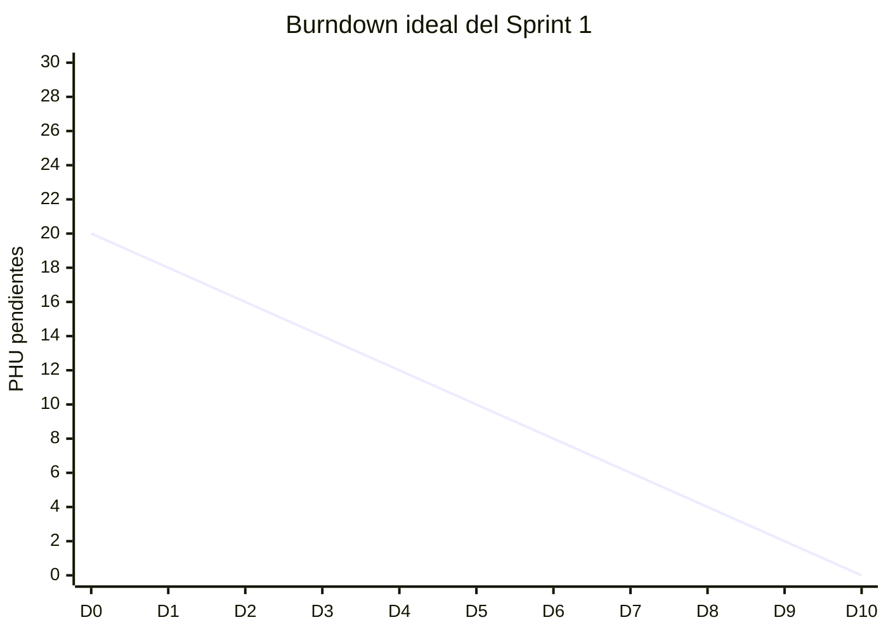

# Registro diario de burndown

Este registro respalda los campos y gráficos publicados desde GitHub Projects.

## Sprint activo

| Campo | Valor |
| --- | --- |
| Sprint | Sprint 1 |
| Fecha de inicio | 2026-10-05 |
| Fecha de fin | 2026-10-18 |
| PHU comprometidos | 20 |

## Mediciones diarias

| Fecha | Día del sprint | PHU ideales pendientes | PHU reales pendientes | PHU agregados | PHU retirados | Motivo del cambio | Evidencia |
| --- | ---: | ---: | ---: | ---: | ---: | --- | --- |
| 2026-10-05 | 0 | 20 | `N/D` | 0 | 0 | Línea base del Sprint 1 | [Project 4](https://github.com/users/lfnavarroj1/projects/4) |

Agregue una fila por día hábil. No sobrescriba filas anteriores. Una HU en curso conserva todos sus PHU pendientes hasta ser aceptada.

## Gráfico inicial

El Sprint 1 tiene 20 PHU inicialmente asignados y diez días hábiles. La línea real se agrega con las mediciones diarias; `N/D` indica que esa medición todavía no fue registrada.

