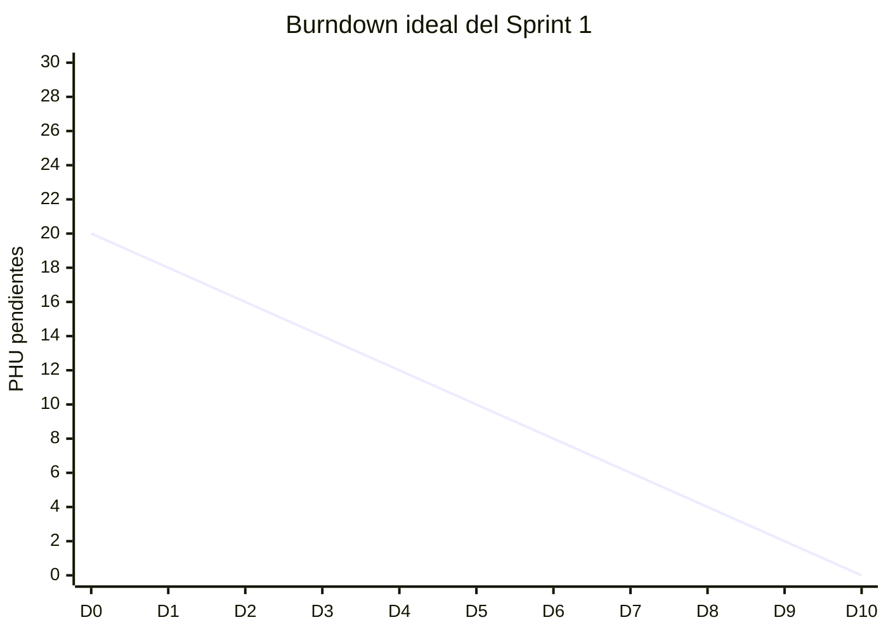
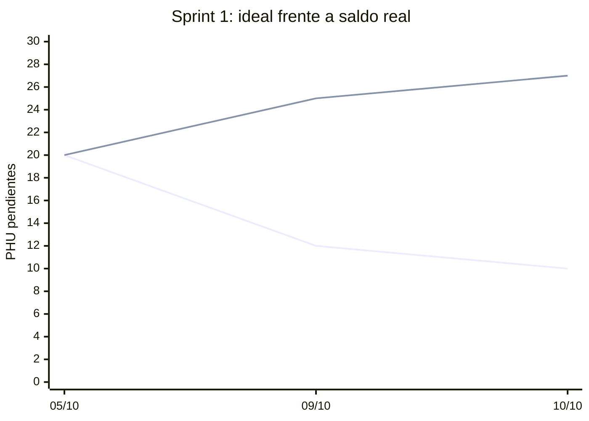

# Registro diario de burndown

Este registro respalda los campos y gráficos publicados desde GitHub Projects.

## Sprint activo

| Campo | Valor |
| --- | --- |
| Sprint | Sprint 1 |
| Fecha de inicio | 2026-10-05 |
| Fecha de fin | 2026-10-18 |
| PHU de la línea base | 20 |
| PHU comprometidos actuales | 27 |

## Mediciones diarias

| Fecha | Día del sprint | PHU ideales pendientes | PHU reales pendientes | PHU agregados | PHU retirados | Motivo del cambio | Evidencia |
| --- | ---: | ---: | ---: | ---: | ---: | --- | --- |
| 2026-10-05 | 0 | 20 | 20 | 0 | 0 | Línea base del Sprint 1 | [Project 4](https://github.com/users/lfnavarroj1/projects/4) |
| 2026-10-09 | 4 | 12 | 25 | 5 | 0 | HU001 se incorpora al Sprint 1 al existir trabajo y CI verificables | [PR backend #1](https://github.com/lfnavarroj1/sport-app-backend/pull/1) |
| 2026-10-10 | 5 | 10 | 27 | 2 | 0 | HU003 se adelanta desde Sprint 3; ninguna HU ha sido aceptada | [Project 4](https://github.com/users/lfnavarroj1/projects/4) |

Agregue una fila por día hábil. No sobrescriba filas anteriores. Una HU en curso conserva todos sus PHU pendientes hasta ser aceptada.

## Gráfico inicial

El Sprint 1 comenzó con 20 PHU y diez días hábiles. HU001 agregó 5 PHU de alcance el 9 de octubre y HU003 agregó 2 PHU el 10 de octubre. La línea ideal no se reescribe; los incrementos aparecen en la línea real y en la columna de alcance.

