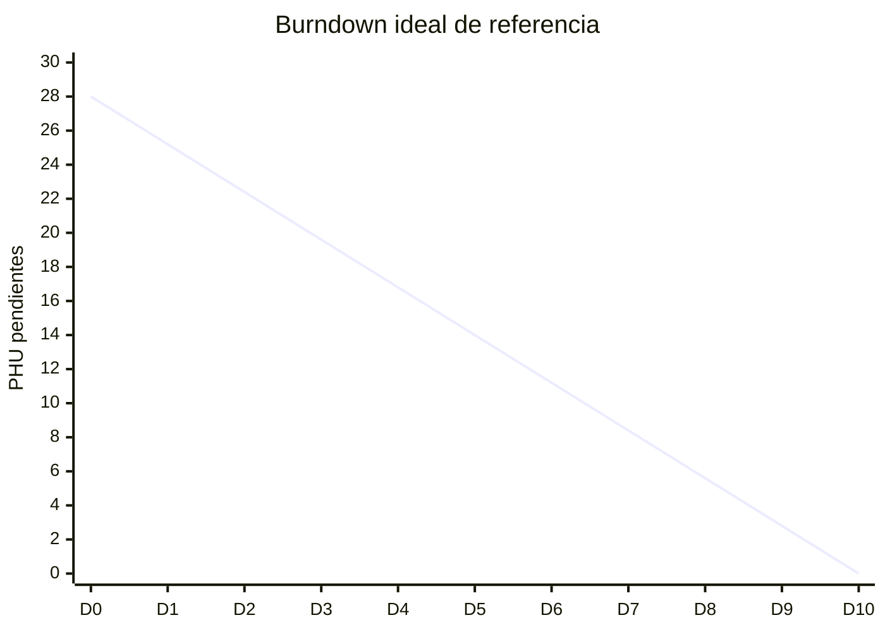

# Registro diario de burndown

Este registro respalda los campos y gráficos publicados desde GitHub Projects.

## Sprint activo

| Campo | Valor |
| --- | --- |
| Sprint | Pendiente de iniciar |
| Fecha de inicio | `N/D` |
| Fecha de fin | `N/D` |
| PHU comprometidos | `N/D` |

## Mediciones diarias

| Fecha | Día del sprint | PHU ideales pendientes | PHU reales pendientes | PHU agregados | PHU retirados | Motivo del cambio | Evidencia |
| --- | ---: | ---: | ---: | ---: | ---: | --- | --- |
| `AAAA-MM-DD` | 0 | `N/D` | `N/D` | 0 | 0 | Línea base al terminar la planeación | Enlace a GitHub Projects |

Agregue una fila por día hábil. No sobrescriba filas anteriores. Una HU en curso conserva todos sus PHU pendientes hasta ser aceptada.

## Gráfico inicial

Mientras el sprint no tenga fechas ni compromiso, solo se muestra la línea ideal de referencia para 28 PHU y diez días hábiles. Reemplácela por la capacidad y duración reales al iniciar el sprint y agregue una segunda línea con los PHU pendientes registrados cada día.

