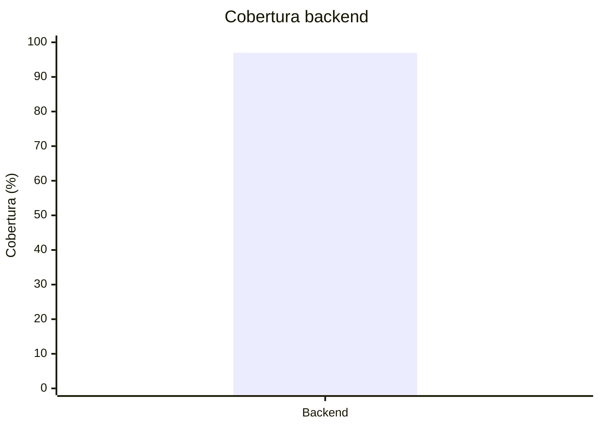

# Registro de calidad

Este registro conserva la evidencia que se enlaza desde el tablero y la wiki.

## Línea base disponible

| Fecha | Repositorio | Revisión | Entorno | Unitarias | Integración | Contrato | Componente/E2E | Total | Cobertura | Seguridad | Resultado | Evidencia |
| --- | --- | --- | --- | ---: | ---: | ---: | ---: | ---: | ---: | --- | --- | --- |
| 2026-10-08 | Backend | `f4ff77f` + árbol sin commit | Local | 117 | 26 | 12 | 2 | 157 | 96 % | Bandit y pip-audit sin hallazgos bloqueantes; Gitleaks sin fugas | Aprobado localmente | `backend/docs/retorno-documental-backend.md` |
| 2026-10-11 | Backend | `92c03d9` + árbol sin commit (`feature/HU003-cookie-refresh-web`, `bff-web` 0.4.0) | Local | `N/D` | `N/D` | `N/D` | `N/D` | 251 | 97 % | Ruff, mypy estricto, Bandit, pip-audit y Gitleaks sin hallazgos | Aprobado localmente (`ci-full`) | Bitácora del 2026-10-11 en `documentacion/arquitectura/guias-desarrollo/configuracion-tareas/02-valores-proyecto.md` |
| 2026-10-11 | Backend | `61494a5` + árbol sin commit (`feature/HU001-afiliacion-free`, Afiliación ADR-024) | Local | `N/D` | `N/D` | `N/D` | `N/D` | 291 | 95 % | Ruff, mypy estricto, Bandit, pip-audit y Gitleaks sin hallazgos | Aprobado localmente (`ci-full`, con PostgreSQL y emulador de Pub/Sub) | Bitácora del 2026-10-11 (HU001 Afiliación) en `02-valores-proyecto.md` |

## Mediciones de sprint

| Fecha | Sprint | Repositorio | Commit | Ejecución CI | Pruebas aprobadas/total | Cobertura sentencias | Cobertura ramas | Vulnerabilidades bloqueantes | Defectos abiertos | Artefacto | Resultado |
| --- | --- | --- | --- | --- | --- | ---: | ---: | ---: | ---: | --- | --- |
| 2026-10-09 | Sprint 1 | Backend | `d13587d` (merge simulado con `develop`: `aaac9cf`) | [PR #1, ejecución 38017064718](https://github.com/lfnavarroj1/sport-app-backend/actions/runs/38017064718) | 157/157 (117 unitarias, 26 integración, 12 contrato, 2 componente) | 96,9 % | 89,2 % | 0 | `N/D` | 8 imágenes construidas sin publicar; `coverage.xml` como artefacto (expira 2026-11-09) | Aprobado en CI; HU001 sigue abierta al 50 % |
| 2026-10-10 | Sprint 1 | Backend | `1f7f824` (PR #2, CORS en `bff-web`) | [PR #2, ejecución 38084452904](https://github.com/lfnavarroj1/sport-app-backend/actions/runs/38084452904) | Job `unit`: 126/126; job `integration-coverage` (unitarias, integración, contrato y componente): 158/158 | 96,9 % | `N/D` | 0 | `N/D` | 8 imágenes construidas sin publicar | Aprobado en CI; integrado en `develop` el 2026-10-11 (`e2f4c12`) |
| 2026-10-11 | Sprint 1 | Backend | `88c594f` (PR #3, HU003 backend/BFF) | [PR #3, ejecución 38100735420](https://github.com/lfnavarroj1/sport-app-backend/actions/runs/38100735420) | Job `unit`: 189/189; job `integration-coverage`: 235/235 | 97,8 % | `N/D` | 0 | `N/D` | 8 imágenes construidas sin publicar | Aprobado en CI; integrado en `develop` (`92c03d9`); HU003 sigue en curso (clientes y producción pendientes) |
| 2026-10-11 | Sprint 1 | Backend | `2046411` (PR #6, HU003 `bff-web` 0.4.0) | [PR #6, ejecución 38156748958](https://github.com/lfnavarroj1/sport-app-backend/actions/runs/38156748958) | Job `unit`: 195/195; job `integration-coverage`: 243/243 | 97,8 % | `N/D` | 0 | `N/D` | 8 imágenes construidas sin publicar | Aprobado en CI; integrado en `develop` (`61494a5`); HU003 sigue en curso |

Cada fila debe corresponder a una revisión inmutable. No combine cobertura de commits distintos ni copie un porcentaje sin conservar el reporte que lo produjo.

## Gráfico de cobertura disponible

La barra representa la cobertura backend verificada localmente y la línea el umbral configurado de 80 %.

Web y móvil se agregan solamente cuando exista un reporte reproducible asociado a una revisión.
