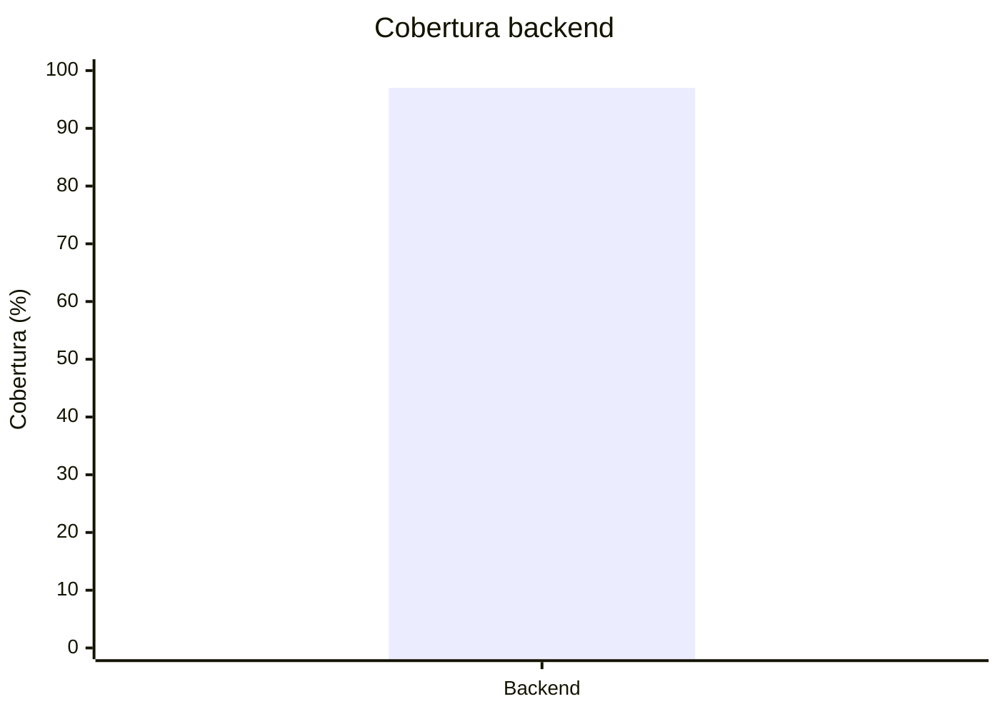

# Registro de calidad

Este registro conserva la evidencia que se enlaza desde el tablero y la wiki.

## Línea base disponible

| Fecha | Repositorio | Revisión | Entorno | Unitarias | Integración | Contrato | Componente/E2E | Total | Cobertura | Seguridad | Resultado | Evidencia |
| --- | --- | --- | --- | ---: | ---: | ---: | ---: | ---: | ---: | --- | --- | --- |
| 2026-10-08 | Backend | `f4ff77f` + árbol sin commit | Local | 117 | 26 | 12 | 2 | 157 | 96 % | Bandit y pip-audit sin hallazgos bloqueantes; Gitleaks sin fugas | Aprobado localmente | `backend/docs/retorno-documental-backend.md` |
| 2026-10-11 | Backend | `92c03d9` + árbol sin commit (`feature/HU003-cookie-refresh-web`, `bff-web` 0.4.0) | Local | `N/D` | `N/D` | `N/D` | `N/D` | 251 | 97 % | Ruff, mypy estricto, Bandit, pip-audit y Gitleaks sin hallazgos | Aprobado localmente (`ci-full`) | Bitácora del 2026-10-11 en `documentacion/arquitectura/guias-desarrollo/configuracion-tareas/02-valores-proyecto.md` |
| 2026-10-11 | Backend | `61494a5` + árbol sin commit (`feature/HU001-afiliacion-free`, Afiliación ADR-024) | Local | `N/D` | `N/D` | `N/D` | `N/D` | 291 | 95 % | Ruff, mypy estricto, Bandit, pip-audit y Gitleaks sin hallazgos | Aprobado localmente (`ci-full`, con PostgreSQL y emulador de Pub/Sub) | Bitácora del 2026-10-11 (HU001 Afiliación) en `02-valores-proyecto.md` |
| 2026-10-12 | Backend | `bf2af06` + árbol sin commit (`feature/HU010-crear-plan-entrenamiento`, `T-HU010-BE`) | Local | 325 | 65 | 15 | 19 | 424 | 95 % | Ruff, mypy estricto, Bandit, pip-audit y Gitleaks sin hallazgos | Aprobado localmente (`ci-full`, con PostgreSQL y emulador de Pub/Sub; ninguna prueba omitida) | Bitácora del 2026-10-12 (HU010) en `02-valores-proyecto.md` |
| 2026-10-12 | Backend | `67a239d` + árbol sin commit (`feature/HU004-cerrar-sesion`, `T-HU004-BE`) | Local | 346 | 69 | 15 | 21 | 451 | 95 % | Ruff, mypy estricto, Bandit, pip-audit y Gitleaks sin hallazgos | Aprobado localmente (`ci-full`, con PostgreSQL y emulador de Pub/Sub; ninguna prueba omitida) | Bitácora del 2026-10-12 (HU004) en `02-valores-proyecto.md` |
| 2026-10-12 | Backend | `6a5ba68` + árbol sin commit (`feature/HU011-ver-historial-entrenamiento`, `T-HU011-BE`) | Local | 373 | 74 | 19 | 22 | 488 | 95 % | Ruff, mypy estricto, Bandit, pip-audit y Gitleaks sin hallazgos | Aprobado localmente (`ci-full`, con PostgreSQL y emulador de Pub/Sub; ninguna prueba omitida) | Bitácora del 2026-10-12 (HU011) en `02-valores-proyecto.md` |
| 2026-10-12 | Backend | `5e6387e` + árbol sin commit (`feature/HU015-crear-servicio`, `T-HU015-BE`) | Local | 407 | 80 | 19 | 24 | 530 | 96 % | Ruff, mypy estricto, Bandit, pip-audit y Gitleaks sin hallazgos | Aprobado localmente (`ci-full`, con PostgreSQL y emulador de Pub/Sub; ninguna prueba omitida) | Bitácora del 2026-10-12 (HU015) en `02-valores-proyecto.md` |
| 2026-10-12 | Backend | `604ec00` + árbol sin commit (`feature/HU021-crear-evento-masivo`, `T-HU021-BE`) | Local | 456 | 91 | 23 | 27 | 597 | 95 % | Ruff, mypy estricto, Bandit, pip-audit y Gitleaks sin hallazgos | Aprobado localmente (`ci-full`, con PostgreSQL y emulador de Pub/Sub; ninguna prueba omitida) | Bitácora del 2026-10-12 (HU021) en `02-valores-proyecto.md` |
| 2026-10-16 | Backend | `eb745b7` + árbol sin commit (`feature/HU005-registrar-datos-demograficos-fisiologicos`, `T-HU005-BE`) | Local | 785 | 162 | 48 | 46 | 1041 | 96 % | Ruff, mypy estricto, Bandit, pip-audit y Gitleaks sin hallazgos | Aprobado localmente (`ci-full`, con PostgreSQL y emulador de Pub/Sub; ninguna prueba omitida) | Bitácora del 2026-10-16 en `documentacion/arquitectura/guias-desarrollo/configuracion-tareas/02-valores-proyecto.md` |
| 2026-10-17 | Backend | `555a2b5` + árbol sin commit (`feature/HU010-cierre-e2e-vertical`, cierre técnico de `T-HU010-BE`) | Local | 791 | 163 | 48 | 47 | 1049 | 96 % | Ruff, mypy estricto, Bandit, pip-audit y Gitleaks sin hallazgos | Aprobado localmente (`ci-full`, con PostgreSQL y emulador de Pub/Sub; ninguna prueba omitida) | Bitácora del 2026-10-17 en `documentacion/arquitectura/guias-desarrollo/configuracion-tareas/02-valores-proyecto.md` |

## Mediciones de sprint

| Fecha | Sprint | Repositorio | Commit | Ejecución CI | Pruebas aprobadas/total | Cobertura sentencias | Cobertura ramas | Vulnerabilidades bloqueantes | Defectos abiertos | Artefacto | Resultado |
| --- | --- | --- | --- | --- | --- | ---: | ---: | ---: | ---: | --- | --- |
| 2026-10-09 | Sprint 1 | Backend | `d13587d` (merge simulado con `develop`: `aaac9cf`) | [PR #1, ejecución 38017064718](https://github.com/lfnavarroj1/sport-app-backend/actions/runs/38017064718) | 157/157 (117 unitarias, 26 integración, 12 contrato, 2 componente) | 96,9 % | 89,2 % | 0 | `N/D` | 8 imágenes construidas sin publicar; `coverage.xml` como artefacto (expira 2026-11-09) | Aprobado en CI; HU001 sigue abierta al 50 % |
| 2026-10-10 | Sprint 1 | Backend | `1f7f824` (PR #2, CORS en `bff-web`) | [PR #2, ejecución 38084452904](https://github.com/lfnavarroj1/sport-app-backend/actions/runs/38084452904) | Job `unit`: 126/126; job `integration-coverage` (unitarias, integración, contrato y componente): 158/158 | 96,9 % | `N/D` | 0 | `N/D` | 8 imágenes construidas sin publicar | Aprobado en CI; integrado en `develop` el 2026-10-11 (`e2f4c12`) |
| 2026-10-11 | Sprint 1 | Backend | `88c594f` (PR #3, HU003 backend/BFF) | [PR #3, ejecución 38100735420](https://github.com/lfnavarroj1/sport-app-backend/actions/runs/38100735420) | Job `unit`: 189/189; job `integration-coverage`: 235/235 | 97,8 % | `N/D` | 0 | `N/D` | 8 imágenes construidas sin publicar | Aprobado en CI; integrado en `develop` (`92c03d9`); HU003 sigue en curso (clientes y producción pendientes) |
| 2026-10-11 | Sprint 1 | Backend | `2046411` (PR #6, HU003 `bff-web` 0.4.0) | [PR #6, ejecución 38156748958](https://github.com/lfnavarroj1/sport-app-backend/actions/runs/38156748958) | Job `unit`: 195/195; job `integration-coverage`: 243/243 | 97,8 % | `N/D` | 0 | `N/D` | 8 imágenes construidas sin publicar | Aprobado en CI; integrado en `develop` (`61494a5`); HU003 sigue en curso |
| 2026-10-12 | Sprint 1 | Backend | `5593d56` (PR #9, HU010 backend/BFF web) | [PR #9, ejecución 38267911373](https://github.com/lfnavarroj1/sport-app-backend/actions/runs/38267911373) | Job `integration-coverage`: 416/416 | 95 % combinado | `N/D` | 0 | `N/D` | 8 imágenes construidas sin publicar | Aprobado en CI; integrado en `develop` (`67a239d`) antes de que terminara `integration-coverage`; HU010 sigue en curso |
| 2026-10-12 | Sprint 1 | Backend | `ca4cb2c` (PR #11, HU004 backend/BFF) | [PR #11, ejecución 38297243258](https://github.com/lfnavarroj1/sport-app-backend/actions/runs/38297243258) | Job `integration-coverage`: 443/443 | 95 % combinado | `N/D` | 0 | `N/D` | 8 imágenes construidas sin publicar | Aprobado en CI; integrado en `develop` (`6a5ba68`) antes de que terminara `integration-coverage`; HU004 sigue en curso |
| 2026-10-12 | Sprint 1 | Backend | `24ef7db` (PR #12, HU011 backend/BFF web) | [PR #12, ejecución 38306786823](https://github.com/lfnavarroj1/sport-app-backend/actions/runs/38306786823) | Job `integration-coverage`: 480/480 | 95 % combinado | `N/D` | 0 | `N/D` | 8 imágenes construidas sin publicar | Aprobado en CI; integrado en `develop` (`5e6387e`) antes de que terminara `integration-coverage`; HU011 sigue en curso (depende de HU032) |
| 2026-10-13 | Sprint 2 | Backend | `eaca5d2` (PR #13, HU015 backend/BFF web) | [PR #13, ejecución 38326794259](https://github.com/lfnavarroj1/sport-app-backend/actions/runs/38326794259) | Job `integration-coverage`: 522/522 (407 unitarias, 80 integración, 12 contrato, 23 componente) | 96 % combinado | `N/D` | 0 | `N/D` | 8 imágenes construidas sin publicar | Aprobado en CI; integrado en `develop` (`604ec00`) antes de que terminara `integration-coverage`; HU015 sigue en curso (cliente web pendiente) |
| 2026-10-13 | Sprint 1 | Backend | `01c314a` (PR #14, HU021 backend/BFF web) | [PR #14, ejecución 38331326965](https://github.com/lfnavarroj1/sport-app-backend/actions/runs/38331326965) | Job `integration-coverage`: 590/590 (456 unitarias, 91 integración, 17 contrato, 26 componente) | 95 % combinado | `N/D` | 0 | `N/D` | 8 imágenes construidas sin publicar | Aprobado en CI; integrado en `develop` (`5e5debf`) antes de que terminara `integration-coverage`; HU021 sigue en curso (web y plataforma pendientes) |
| 2026-10-13 | Sprint 1 | Backend | `4781cc1` (PR #15, HU032 backend/BFF móvil) | [PR #15, ejecución 38335427577](https://github.com/lfnavarroj1/sport-app-backend/actions/runs/38335427577) | Job `integration-coverage`: 638/638 (490 unitarias, 99 integración, 20 contrato, 29 componente) | 95 % combinado | `N/D` | 0 | `N/D` | 8 imágenes construidas sin publicar | Aprobado en CI; integrado en `develop` (`94ff6bf`) antes de que terminara `integration-coverage`; HU032 sigue en curso (app móvil pendiente) |
| 2026-10-13 | Sprint 1 | Backend | `2d39ea3` (PR #16, HU035 backend/BFF móvil) | [PR #16, ejecución 38339933149](https://github.com/lfnavarroj1/sport-app-backend/actions/runs/38339933149) | Job `integration-coverage`: 668/668 (513 unitarias, 104 integración, 20 contrato, 31 componente) | 95 % combinado | `N/D` | 0 | `N/D` | 8 imágenes construidas sin publicar | Aprobado en CI; integrado en `develop` (`d775f52`) antes de que terminara `integration-coverage`; HU035 sigue en curso (app móvil y dependencias de ADR-031 pendientes) |
| 2026-10-13 | Sin asignar | Backend | `8f46620` (PR #17, HU041 backend/BFF móvil) | [PR #17, ejecución 38345700601](https://github.com/lfnavarroj1/sport-app-backend/actions/runs/38345700601) | Job `integration-coverage`: 706/706 (531 unitarias, 111 integración, 29 contrato, 35 componente) | 95 % combinado | `N/D` | 0 | `N/D` | 8 imágenes construidas sin publicar | Aprobado en CI; integrado en `develop` (`0f6a4f0`) antes de que terminara `integration-coverage`; HU041 sigue en curso (app móvil y HU024 pendientes) |
| 2026-10-14 | Sprint 2 | Backend | `c1f63ff` (PR #18, HU019 backend/BFF web) | [PR #18, ejecución 38494966414](https://github.com/lfnavarroj1/sport-app-backend/actions/runs/38494966414) | Job `integration-coverage`: 793/793 (595 unitarias, 128 integración, 32 contrato, 38 componente) | 95 % combinado | `N/D` | 0 | `N/D` | 8 imágenes construidas sin publicar | Aprobado en CI; integrado en `develop` (`7e3560a`) antes de que terminara `integration-coverage`; HU019 sigue en curso (pantalla web y plataforma pendientes) |
| 2026-10-14 | Sprint 1 | Backend | `bcdce86` (PR #19, HU020 backend/BFF web) | [PR #19, ejecución 38498625024](https://github.com/lfnavarroj1/sport-app-backend/actions/runs/38498625024) | Job `integration-coverage`: 816/816 (613 unitarias, 131 integración, 32 contrato, 40 componente) | 95 % combinado | `N/D` | 0 | `N/D` | 8 imágenes construidas sin publicar | Aprobado en CI; integrado en `develop` (`17358cb`) antes de que terminara `integration-coverage`; HU020 sigue en curso (pantalla web pendiente) |
| 2026-10-17 | Sprint 2 | Backend | `1ea49c8` (PR #21, HU005 backend/BFF web y `usuarios-read-projector`) | [PR #21, ejecución 39020510757](https://github.com/lfnavarroj1/sport-app-backend/actions/runs/39020510757) | Job `integration-coverage`: 1041/1041 (785 unitarias, 162 integración, 48 contrato, 46 componente) | 96 % combinado | `N/D` | 0 | `N/D` | 8 imágenes construidas sin publicar | Aprobado; merge `555a2b5` antes de terminar `integration-coverage` |

Cada fila debe corresponder a una revisión inmutable. No combine cobertura de commits distintos ni copie un porcentaje sin conservar el reporte que lo produjo.

## Gráfico de cobertura disponible

La barra representa la cobertura backend verificada localmente y la línea el umbral configurado de 80 %.

Web y móvil se agregan solamente cuando exista un reporte reproducible asociado a una revisión.
