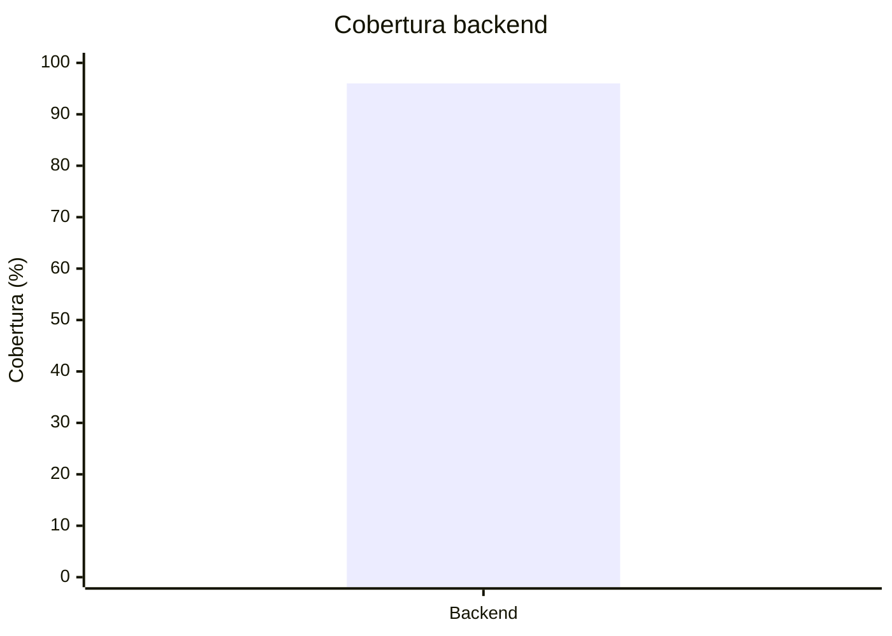

# Registro de calidad

Este registro conserva la evidencia que se enlaza desde el tablero y la wiki.

## Línea base disponible

| Fecha | Repositorio | Revisión | Entorno | Unitarias | Integración | Contrato | Componente/E2E | Total | Cobertura | Seguridad | Resultado | Evidencia |
| --- | --- | --- | --- | ---: | ---: | ---: | ---: | ---: | ---: | --- | --- | --- |
| 2026-10-08 | Backend | `f4ff77f` + árbol sin commit | Local | 117 | 26 | 12 | 2 | 157 | 96 % | Bandit y pip-audit sin hallazgos bloqueantes; Gitleaks sin fugas | Aprobado localmente | `backend/docs/retorno-documental-backend.md` |

## Mediciones de sprint

| Fecha | Sprint | Repositorio | Commit | Ejecución CI | Pruebas aprobadas/total | Cobertura sentencias | Cobertura ramas | Vulnerabilidades bloqueantes | Defectos abiertos | Artefacto | Resultado |
| --- | --- | --- | --- | --- | --- | ---: | ---: | ---: | ---: | --- | --- |
| `AAAA-MM-DD` | Sprint 1 | Pendiente | `N/D` | `N/D` | `N/D` | `N/D` | `N/D` | `N/D` | `N/D` | `N/D` | `N/D` |

Cada fila debe corresponder a una revisión inmutable. No combine cobertura de commits distintos ni copie un porcentaje sin conservar el reporte que lo produjo.

## Gráfico de cobertura disponible

La barra representa la cobertura backend verificada localmente y la línea el umbral configurado de 80 %.

Web y móvil se agregan solamente cuando exista un reporte reproducible asociado a una revisión.
