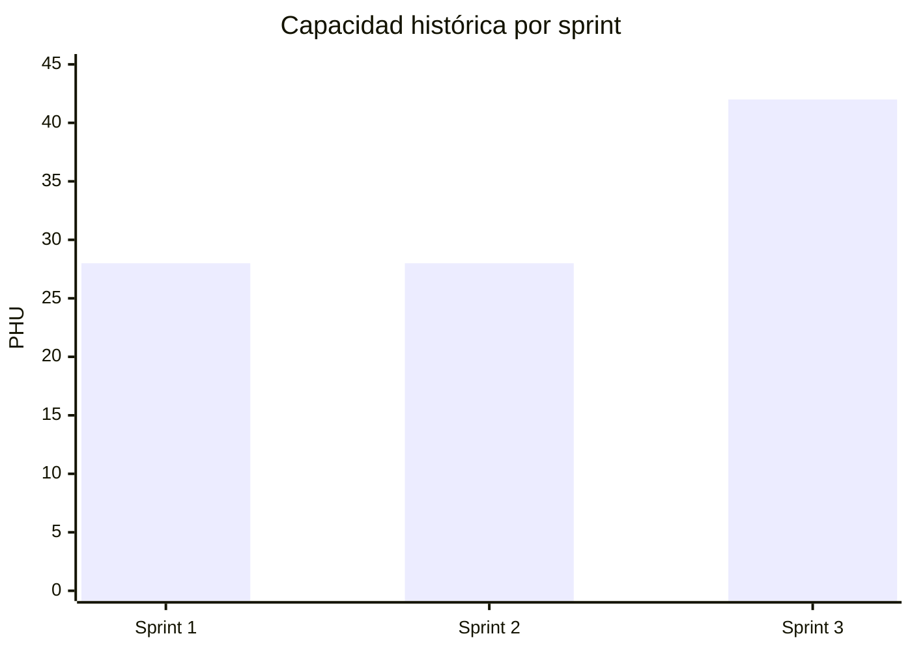
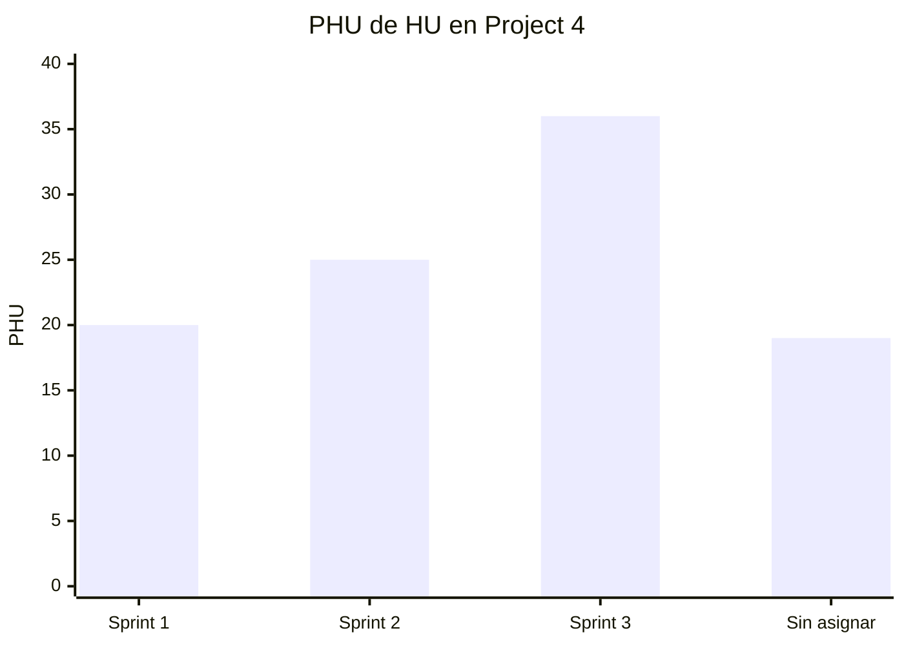

# Registro de sprints

## Línea base histórica importada

Datos históricos verificados el 9 de octubre de 2026 en el Project 2 del equipo anterior. La asignación y el estado `Done` pertenecen al ciclo de 2024; no representan el cierre de la reimplementación actual ni se copiaron al [Project 4 vigente](https://github.com/users/lfnavarroj1/projects/4).

| Sprint | Inicio histórico | Duración | HU asignadas | PHU de HU | Estado en Project 2 |
| --- | --- | ---: | ---: | ---: | --- |
| Sprint 1 | 2024-04-01 | 14 días | 8 | 20 | 8 `Done` |
| Sprint 2 | 2024-04-15 | 14 días | 10 | 25 | 10 `Done` |
| Sprint 3 | 2024-04-29 | 21 días | 15 | 36 | 15 `Done` |
| Sin asignar | — | — | 7 | 19 | Ausentes del Project 2 |
| **Total** | — | **49 días** | **40** | **100** | **33 históricas; 7 sin asignar** |

La relación detallada de HU por sprint está en [Planeación y sprints](../wiki/02-planeacion-y-sprints.md#historias-por-sprint).

## Carga inicial del Project 4

Las 40 HU se crearon nuevamente en `sport-app-platform`. HU001 inicia `En curso`; las otras 39 están en `Backlog`. La asignación por sprint se conserva como referencia inicial y debe ratificarse durante la planeación vigente.

## Cierres

Esta tabla pertenece al ciclo actual. Se completa exclusivamente con aceptación y evidencia de la reimplementación.

| Sprint | Objetivo | Inicio | Fin | Capacidad PHU | PHU comprometidos | PHU aceptados | HU aceptadas | Valor entregado | Predictibilidad | Evidencia |
| --- | --- | --- | --- | ---: | ---: | ---: | ---: | ---: | ---: | --- |
| Sprint 1 | Pendiente | `N/D` | `N/D` | 28 | `N/D` | `N/D` | `N/D` | `N/D` | `N/D` | — |
| Sprint 2 | Pendiente | `N/D` | `N/D` | 28 | `N/D` | `N/D` | `N/D` | `N/D` | `N/D` | — |
| Sprint 3 | Pendiente | `N/D` | `N/D` | 42 | `N/D` | `N/D` | `N/D` | `N/D` | `N/D` | — |

## Cómo cerrar una fila

1. Congele la lista de HU comprometidas al terminar la planeación.
2. Registre por separado cualquier cambio de alcance.
3. Cuente solo HU aceptadas.
4. Calcule `Predictibilidad = PHU aceptados / PHU comprometidos`.
5. Enlace la revisión del sprint y las ejecuciones de CI.

La capacidad 28/28/42 es histórica y debe recalibrarse después de obtener velocidad real.

## Gráfico de capacidad planificada

Al cerrar el Sprint 1 se agrega una serie de PHU aceptados para convertirlo en un velocity chart planificado frente a real.

## Gráfico de la asignación histórica

