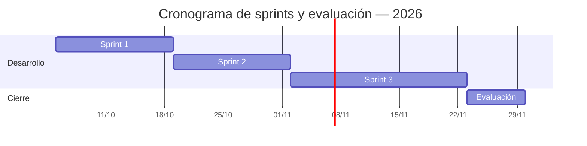
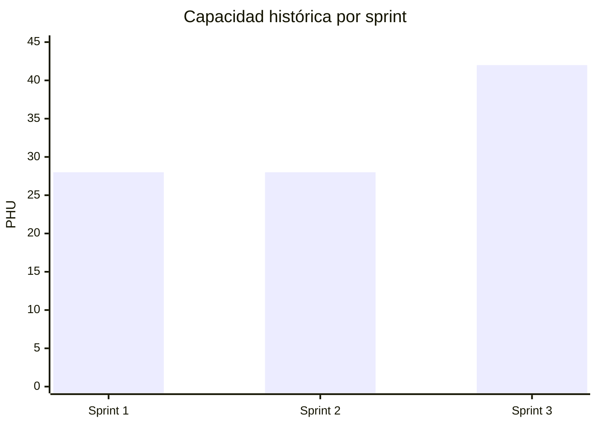
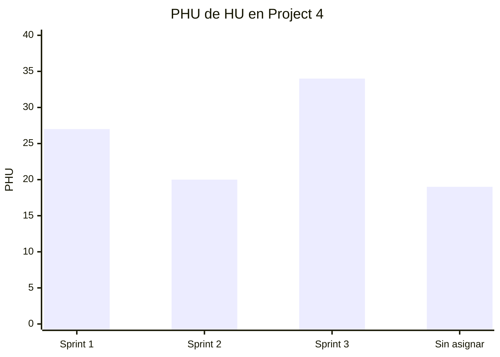

# Registro de sprints

## Línea base histórica importada

Datos históricos verificados el 9 de octubre de 2026 en el Project 2 del equipo anterior. La asignación y el estado `Done` pertenecen al ciclo de 2024; no representan el cierre de la reimplementación actual ni se copiaron al [Project 4 vigente](https://github.com/users/lfnavarroj1/projects/4).

| Sprint | Inicio histórico | Duración | HU asignadas | PHU de HU | Estado en Project 2 |
| --- | --- | ---: | ---: | ---: | --- |
| Sprint 1 | 2024-04-01 | 14 días | 8 | 20 | 8 `Done` |
| Sprint 2 | 2024-04-15 | 14 días | 10 | 25 | 10 `Done` |
| Sprint 3 | 2024-04-29 | 21 días | 15 | 36 | 15 `Done` |
| Sin asignar | — | — | 7 | 19 | Ausentes del Project 2 |
| **Total** | — | **49 días** | **40** | **100** | **33 históricas; 7 sin asignar** |

La relación detallada de HU por sprint está en [Planeación y sprints](../wiki/02-planeacion-y-sprints.md#historias-por-sprint).

## Carga inicial del Project 4

Las 40 HU se crearon nuevamente en `sport-app-platform` y tienen a `lfnavarroj1` como responsable. HU001 está `En curso` con avance verificable del 50 %; las otras 39 están en `Backlog`. El Project también incluye los PR #1 de backend y #41 de plataforma como evidencia técnica, sin asignarles PHU ni valor.

HU001 se trasladó de Sprint 2 a Sprint 1 porque comenzó el 9 de octubre. HU003 se adelantó de Sprint 3 a Sprint 1 el 10 de octubre porque la autenticación web y móvil habilita los recorridos protegidos de las demás historias. El Sprint 1 pasó de una línea base de 20 a 27 PHU; Sprint 2 quedó en 20 PHU y Sprint 3 en 34 PHU. El backlog conserva 100 PHU.

## Cronograma vigente

| Fase | Semanas | Inicio | Fin | Duración |
| --- | --- | --- | --- | ---: |
| Sprint 1 | 1–2 | 2026-10-05 | 2026-10-18 | 14 días |
| Sprint 2 | 3–4 | 2026-10-19 | 2026-11-01 | 14 días |
| Sprint 3 | 5–7 | 2026-11-02 | 2026-11-22 | 21 días |
| Evaluación | 8 | 2026-11-23 | 2026-11-29 | 7 días |

## Cierres

Esta tabla pertenece al ciclo actual. Se completa exclusivamente con aceptación y evidencia de la reimplementación.

| Sprint | Objetivo | Inicio | Fin | Capacidad PHU | PHU comprometidos | PHU aceptados | HU aceptadas | Valor entregado | Predictibilidad | Evidencia |
| --- | --- | --- | --- | ---: | ---: | ---: | ---: | ---: | ---: | --- |
| Sprint 1 | Incrementar la base técnica y avanzar HU001 y HU003 | 2026-10-05 | 2026-10-18 | 28 | 27 | 0 al corte | 0 al corte | 0 al corte | Cierre pendiente | [Project 4](https://github.com/users/lfnavarroj1/projects/4) |
| Sprint 2 | Pendiente de ratificar | 2026-10-19 | 2026-11-01 | 28 | 20 | `N/D` | `N/D` | `N/D` | `N/D` | — |
| Sprint 3 | Pendiente de formular | 2026-11-02 | 2026-11-22 | 42 | 34 | `N/D` | `N/D` | `N/D` | `N/D` | — |

### Corte operativo del 10 de octubre

| Sprint | HU comprometidas | PHU comprometidos actuales | HU en curso | HU aceptadas | PHU aceptados | Valor aceptado |
| --- | ---: | ---: | ---: | ---: | ---: | ---: |
| Sprint 1 | 10 | 27 | 1 | 0 | 0 | 0 |

## Cómo cerrar una fila

1. Congele la lista de HU comprometidas al terminar la planeación.
2. Registre por separado cualquier cambio de alcance.
3. Cuente solo HU aceptadas.
4. Calcule `Predictibilidad = PHU aceptados / PHU comprometidos`.
5. Enlace la revisión del sprint y las ejecuciones de CI.

La capacidad 28/28/42 es histórica y debe recalibrarse después de obtener velocidad real.

## Gráfico de capacidad planificada

Al cerrar el Sprint 1 se agrega una serie de PHU aceptados para convertirlo en un velocity chart planificado frente a real.

## Gráfico de la asignación vigente

