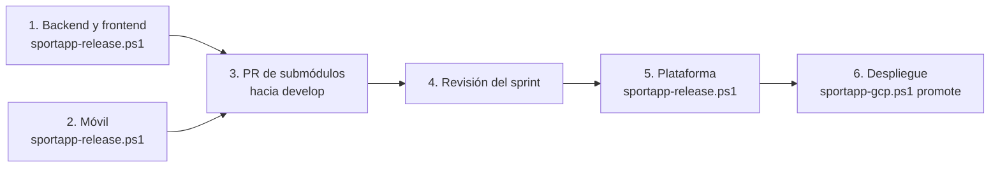

# Orden de los release de SportApp

Esta guía indica **en qué orden se publican las releases** al cerrar un sprint. Todas salen de un solo script, [`sportapp-release.ps1`](sportapp-release.md), que pregunta en un menú qué se publica; su manual tiene los requisitos, las opciones y los problemas frecuentes. Aquí solo se explica la secuencia y por qué es esa.

| Orden | Script | Publica |
| --- | --- | --- |
| 1 | [`sportapp-release.ps1`](sportapp-release.md#5-backend-y-frontend), opción *Backend y frontend* | backend y frontend, con imágenes por digest |
| 2 | [`sportapp-release.ps1`](sportapp-release.md#6-aplicación-móvil), opción *Solo aplicación móvil* | aplicación móvil, con APK firmado |
| 3 | PR de submódulos y manifiesto hacia `develop` de la plataforma | — |
| 4 | Revisión del sprint | HU aceptadas |
| 5 | [`sportapp-release.ps1`](sportapp-release.md#7-versión-de-plataforma), opción *Plataforma* | versión de plataforma (versión del sistema) |
| 6 | [`sportapp-gcp.ps1 promote`](sportapp-gcp.md#6-desplegar-una-release) | despliegue en producción |

Todos se ejecutan desde la raíz de la plataforma, en la estación del operador.

## Contenido

1. [Por qué este orden](#1-por-qué-este-orden)
2. [Preparación única](#2-preparación-única)
3. [Secuencia de cada sprint](#3-secuencia-de-cada-sprint)
4. [Primera release](#4-primera-release)
5. [Si un paso falla](#5-si-un-paso-falla)
6. [Hotfix](#6-hotfix)

## 1. Por qué este orden



- **Los componentes van primero** porque la plataforma no construye nada: solo fija tags ya publicados. Su script lee la evidencia de Cloud Build de backend y frontend y el `SHA256SUMS` del APK; si no existen, se detiene.
- **Backend y frontend antes que el móvil** es una convención, no una dependencia: el móvil no pasa por Cloud Build ni Cloud Deploy y se puede publicar en cualquier momento. Sí debe estar publicado antes del paso 5.
- **El PR de submódulos debe estar fusionado en `develop`** antes del paso 5, porque la release de plataforma parte de `develop` y comprueba que cada tag sea el commit de su submódulo.
- **La revisión del sprint va antes de la plataforma** porque `-Stories` es obligatorio: solo entran las HU aceptadas.
- **El despliegue va al final** y es independiente: `promote` usa las versiones de los componentes. La versión de plataforma documenta qué combinación se aceptó.

## 2. Preparación única

Solo la primera vez, antes de cualquier release:

```powershell
.\scripts\sportapp-release.ps1 prepare -Target frontend   # crea main en el frontend
.\scripts\sportapp-release.ps1 prepare -Target mobile     # renombra master a main en el móvil
.\scripts\sportapp-release.ps1 keystore                   # almacén de claves de firma del APK
.\scripts\sportapp-release.ps1 prepare -Target platform   # crea develop en la plataforma
```

Después, protege `main` (y `develop` en la plataforma) en cada repositorio. Los detalles están en la [preparación única](sportapp-release.md#4-preparación-única) del manual.

Para comprobar que todo está listo:

```powershell
.\scripts\sportapp-release.ps1 check -Target all
```

## 3. Secuencia de cada sprint

### Paso 1. Backend y frontend

```powershell
.\scripts\sportapp-release.ps1 status -Target backend-frontend
.\scripts\sportapp-release.ps1 release -Target backend-frontend
```

Sin `-Target`, el script pregunta en el menú; elige *Backend y frontend*, o solo uno de los dos si el otro no cambió. Crea el PR `develop` → `main`, espera las pruebas, pide tu aprobación, crea el tag y espera Cloud Build. Al final mueve `components/backend` y `components/frontend` a los tags **con imágenes publicadas** y actualiza `release-manifest.yaml`. No hace commit.

Continúa solo cuando el resumen muestre Cloud Build en `SUCCESS` para cada versión.

### Paso 2. Móvil

```powershell
.\scripts\sportapp-release.ps1 status -Target mobile
.\scripts\sportapp-release.ps1 release -Target mobile
```

Mismo flujo de PR y aprobación; después compila, firma y adjunta el APK, mueve `components/mobile` al tag y actualiza el manifiesto. No hace commit.

Si el móvil no tuvo cambios en el sprint, se omite este paso: el manifiesto conserva su versión anterior.

### Paso 3. PR de submódulos hacia `develop`

Los pasos 1 y 2 dejan modificados `components/*` y `release-manifest.yaml`, y muestran los comandos para confirmarlos. Crea una rama desde `develop`, confirma esos archivos y abre el PR hacia `develop`:

```powershell
git switch develop
git pull --ff-only
git switch -c chore/componentes-sprint-N
git add components/backend components/frontend components/mobile release-manifest.yaml
git commit -m "chore(release): componentes del sprint N"
git push --no-recurse-submodules origin chore/componentes-sprint-N
```

Fusiónalo cuando `validate-platform` esté en verde. Para revisar el candidato:

```powershell
.\scripts\sportapp-release.ps1 status -Target platform
```

### Paso 4. Revisión del sprint

Ejecuta contratos, integración y E2E sobre esa combinación y acepta las HU. Anota sus identificadores: se pasan en el paso 5.

### Paso 5. Versión de plataforma

```powershell
.\scripts\sportapp-release.ps1 release -Target platform -Stories HU001,HU010
```

Crea `release/vX.Y.Z` desde `develop`, completa el manifiesto en `released` con la evidencia, lo copia a `releases/vX.Y.Z.yaml`, abre el PR hacia `main`, pide tu aprobación, crea el tag y la GitHub Release y abre el ciclo siguiente en `develop` con otro PR.

Desde aquí, los pasos 1 y 2 del siguiente sprint usan la versión del sistema siguiente.

### Paso 6. Despliegue

```powershell
git switch main
git pull --ff-only
.\scripts\sportapp-gcp.ps1 up        # si producción está apagada
.\scripts\sportapp-gcp.ps1 promote -BackendVersion vX.Y.Z -FrontendVersion vX.Y.Z
```

El comando exacto aparece en las notas de la release de plataforma. Aprueba en Cloud Deploy en este orden:

1. `production-gke-migrations`;
2. promueve y aprueba `production-gke`;
3. `bff-web`, `bff-mobile` y `frontend-web`.

Por último, actualiza el GitHub Project y la wiki según la [guía de actualización](../docs/guia-de-actualizacion.md).

## 4. Primera release

La primera vez cambia el orden de los pasos 1 y 6, porque Cloud Run se crea con los digests de la primera release:

1. `sportapp-gcp.ps1 setup` hasta que pida la primera release ([primera preparación](sportapp-gcp.md#4-primera-preparación));
2. `sportapp-release.ps1 release -Target backend-frontend` (paso 1);
3. `sportapp-gcp.ps1 setup` de nuevo, que crea Cloud Run;
4. continúa con los pasos 2 a 6.

`$initialBackendVersion` y `$initialFrontendVersion` de `.env.ps1` deben coincidir con las versiones publicadas en el paso 1.

## 5. Si un paso falla

| Falla en | Qué hacer |
| --- | --- |
| Paso 1 o 2: pruebas o PR | corrige en una rama hacia `develop` del componente y repite `release`; el PR abierto se reutiliza |
| Paso 1: Cloud Build en `FAILURE` | esa versión no se puede desplegar ni usar en la plataforma; corrige y publica otra con `-Bump patch` |
| Paso 1 o 2: no se movieron los submódulos | `sportapp-release.ps1 submodules` con la opción del componente |
| Paso 5: el submódulo no coincide con el tag | repite `submodules` del componente y fusiona el PR del paso 3 |
| Paso 5: contrato incompatible | el frontend espera un `bff-web` que el backend no ofrece: publica la combinación correcta desde el paso 1 |
| Paso 5: cualquier otro error | corrige y repite `release` con la misma versión; se reutilizan la rama, el PR y la release |
| Paso 6: el despliegue falla | [rollback](../docs/preparacion-terraform-gcp.md#142-rollback) con Cloud Deploy; nunca se mueven tags |

## 6. Hotfix

`release` publica siempre desde `develop`. Un defecto urgente en `main`, cuando `develop` ya tiene trabajo que no se quiere publicar, sale con la opción *Publicar un hotfix desde main* (comando `hotfix`). El orden se conserva, con incremento `PATCH`:

1. `sportapp-release.ps1 hotfix -Target <componente>` ([sección del manual](sportapp-release.md#hotfix)): crea o reutiliza `hotfix/vX.Y.Z` desde `main`, espera a que subas la corrección, abre el PR hacia `main` y sigue como `release` (tag, workflow, Cloud Build o APK, submódulos y manifiesto); al final abre el PR de retorno hacia `develop` del componente, que revisas y fusionas;
2. fusiona el PR de submódulos (paso 3);
3. publica la plataforma con `-Bump patch` (paso 5);
4. despliega (paso 6).

El procedimiento completo está en el [manual de versiones](../docs/manual-versionado.md#hotfix).
