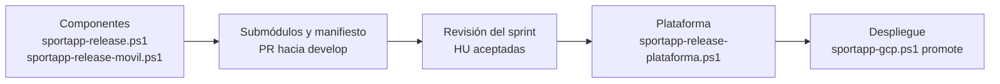

# Uso de `sportapp-release-plataforma.ps1`

[`sportapp-release-plataforma.ps1`](sportapp-release-plataforma.ps1) publica la **versión de la plataforma**, que es la versión del sistema SportApp en un sprint ([manual de versiones](../docs/manual-versionado.md#versión-de-plataforma-por-sprint)). La plataforma no construye nada. Fija la combinación de backend, frontend y móvil ya publicados, y deja constancia de que esa combinación es compatible.

El script sigue el GitFlow de la plataforma. En orden:

1. crea `release/vX.Y.Z` desde `develop`;
2. completa [`release-manifest.yaml`](../release-manifest.yaml) con `status: released` a partir de la evidencia de Cloud Build, y lo copia a `releases/vX.Y.Z.yaml`;
3. abre el pull request `release/vX.Y.Z` → `main` y espera sus pruebas;
4. pide tu aprobación y fusiona;
5. crea la GitHub Release `vX.Y.Z` con sus notas sobre el commit de merge;
6. devuelve el manifiesto a `develop`, en `draft`, con la versión siguiente abierta.

Usa tu sesión de GitHub CLI, tu `git` y tu `gcloud` en modo lectura (solo lee la evidencia). No despliega ni crea credenciales.

## Contenido

1. [Lugar en el ciclo de release](#1-lugar-en-el-ciclo-de-release)
2. [Requisitos](#2-requisitos)
3. [Preparación única](#3-preparación-única)
4. [Antes de publicar](#4-antes-de-publicar)
5. [Publicar la versión](#5-publicar-la-versión)
6. [Qué se valida y qué queda en el manifiesto](#6-qué-se-valida-y-qué-queda-en-el-manifiesto)
7. [Retorno a develop](#7-retorno-a-develop)
8. [Versiones](#8-versiones)
9. [Después de publicar](#9-después-de-publicar)
10. [Comandos y opciones](#10-comandos-y-opciones)
11. [Problemas frecuentes](#11-problemas-frecuentes)

## 1. Lugar en el ciclo de release



- Cada componente conserva su versión. La plataforma registra cuáles van juntas.
- El despliegue es independiente: `promote` usa las versiones de los componentes. La versión de plataforma documenta qué combinación se aceptó y se puede reproducir.

## 2. Requisitos

| Herramienta | Para qué | Instalación |
| --- | --- | --- |
| GitHub CLI (`gh`) con sesión iniciada | PR, merge, release y consulta de tags de los componentes | `winget install --id GitHub.cli -e` y `gh auth login` |
| Git | rama de release en un worktree temporal | `winget install --id Git.Git -e` |
| Python 3 con `pyyaml` y `jsonschema` | componer y validar el manifiesto ([`platform_release.py`](platform_release.py)) | `py -3 -m pip install jsonschema==4.23.0 pyyaml==6.0.2` |
| Google Cloud CLI con la cuenta del operador | leer la evidencia de Cloud Build en el proyecto de gestión | la misma de `sportapp-gcp.ps1` |

El script lee `$mgmt`, `$region` y `$production` de `platform\.env.ps1`, el mismo archivo de [`sportapp-gcp.ps1`](sportapp-gcp.md#2-configurar-envps1). También acepta `$githubOwner` y `$releaseReviewer`, como [`sportapp-release.ps1`](sportapp-release.md#2-configuración).

Para comprobarlo:

```powershell
.\scripts\sportapp-release-plataforma.ps1 check
```

## 3. Preparación única

La plataforma sigue el mismo GitFlow que los componentes: `main` solo recibe releases y hotfix, y el trabajo se integra en `develop`. Para crear `develop` desde el `main` actual:

```powershell
.\scripts\sportapp-release-plataforma.ps1 prepare
```

Después:

- protege `main` y `develop` (*Settings → Rules*: PR obligatorio y una aprobación);
- crea las ramas de trabajo desde `develop` y abre sus PR hacia `develop`. La validación `validate-platform` ya corre en los PR y en los push a `develop`.

## 4. Antes de publicar

| Condición | Cómo se cumple |
| --- | --- |
| Backend y frontend publicados, con imágenes | [`sportapp-release.ps1 release`](sportapp-release.md#4-publicar-una-release); Cloud Build en `SUCCESS` |
| Móvil publicado, con APK | [`sportapp-release-movil.ps1 release`](sportapp-release-movil.md#4-publicar-una-release); la release tiene `SHA256SUMS` |
| Submódulos y manifiesto de `develop` en esos tags | la fase *Plataforma* de cada script (o su comando `submodules`), y el PR de esos archivos hacia `develop` |
| HU aceptadas | la revisión del sprint; se indican con `-Stories` |

Para ver el estado del manifiesto candidato de `develop`:

```powershell
.\scripts\sportapp-release-plataforma.ps1 status
```

## 5. Publicar la versión

```powershell
.\scripts\sportapp-release-plataforma.ps1 release -Stories HU001,HU010
```

| Fase | Qué pasa |
| --- | --- |
| Plan | propone la versión, toma el sprint del manifiesto (o `-Sprint`) y muestra el tag de cada componente; comprueba en GitHub que cada tag sea el commit del submódulo; pide confirmar |
| Composición | descarga la evidencia de Cloud Build de backend y frontend, toma el checksum del APK de la release del móvil, valida todo (sección 6) y escribe el manifiesto y su copia |
| Rama | confirma `release-manifest.yaml` y `releases/vX.Y.Z.yaml` en `release/vX.Y.Z` y la publica; pide confirmar |
| Pull request | crea o reutiliza `release: plataforma vX.Y.Z` hacia `main`, con las notas como descripción, y espera sus pruebas |
| Aprobación | pregunta si apruebas; fusiona con un commit de merge ([aprobación de los PR](sportapp-release.md#5-aprobación-de-los-pr)) |
| Release | crea la GitHub Release `vX.Y.Z` sobre el commit de merge |
| Retorno | abre el ciclo siguiente en `develop` (sección 7), con su propio PR y aprobación |

Todo ocurre en un worktree temporal: tu árbol de trabajo y tus cambios sin confirmar no se tocan.

Si algo falla, corrige y vuelve a ejecutar `release` con la misma versión: se reutilizan la rama, el PR y la release que ya existan.

## 6. Qué se valida y qué queda en el manifiesto

Antes de escribir nada, [`platform_release.py`](platform_release.py) valida lo siguiente:

- **la evidencia de Cloud Build**, con el mismo código del promotor ([`promote_release.py`](promote_release.py)): repositorio, tag, commit, pruebas, allowlist de imágenes, registro propio y digests;
- **que el tag, el commit de la evidencia y el puntero del submódulo coincidan**;
- **que el contrato sea compatible**: el frontend espera una versión de `bff-web` que el backend ofrece (misma MAJOR y MINOR igual o mayor);
- **que haya al menos una HU** y que el APK del móvil tenga checksum;
- **el resultado** contra [`schemas/release-manifest.schema.json`](../schemas/release-manifest.schema.json) con `status: released`.

| Campo | Origen |
| --- | --- |
| `version`, `ref`, `commit` | tag del componente y puntero de su submódulo |
| `artifacts` (backend), `artifact.uri` (frontend) | imágenes por digest de la evidencia |
| `contractVersion`, `expectedBffContract` | evidencia de backend y frontend |
| `evidence` | URI `gs://`, sha256 de los bytes publicados (el mismo que anota el promotor en Cloud Deploy) e ID del build |
| `versionCode`, `artifact.sha256` (móvil) | tag del móvil y `SHA256SUMS` de su release |

`releases/vX.Y.Z.yaml` es la copia inmutable. La prueba `tests/test_platform_release.py` valida en CI cada copia de `releases/`.

## 7. Retorno a develop

Después del merge a `main`, el script crea `chore/abrir-vX.Y+1.0` desde la rama de release y deja el manifiesto así:

- `status: draft`;
- `platformVersion` en la versión siguiente;
- `acceptedStories` vacío;
- los componentes fijados se conservan.

Ese PR hacia `develop` devuelve también `releases/vX.Y.Z.yaml`. Al fusionarse, el script borra las dos ramas temporales en GitHub.

Desde ese momento, `sportapp-release.ps1` y `sportapp-release-movil.ps1` publican sus releases con la versión del sistema siguiente.

## 8. Versiones

- **Propuesta:** la siguiente al último tag estable de la plataforma según `-Bump`. Por defecto es `minor`, porque cada sprint aceptado incrementa MINOR ([manual de versiones](../docs/manual-versionado.md#versión-de-plataforma-por-sprint)).
- **Sin tags:** propone `v0.1.0`.
- **Versión explícita:** `-PlatformVersion vX.Y.Z`.
- **Corrección de una versión publicada:** sale de `develop` con `-Bump patch`. El retorno abre la MINOR siguiente.

## 9. Después de publicar

- **Actualiza tu clon:** `git switch main` y `git pull --ff-only`. `sportapp-gcp.ps1` lee los Services de GKE desde `components/backend` del árbol local, así que para operar producción conviene estar en la versión publicada.
- **Despliega** las versiones de los componentes con el comando que aparece en las notas:
  ```powershell
  .\scripts\sportapp-gcp.ps1 promote -BackendVersion vX.Y.Z -FrontendVersion vX.Y.Z
  ```
- **Actualiza el registro:** el GitHub Project (*Versión entregada*) y la wiki, según la [guía de actualización](../docs/guia-de-actualizacion.md).

## 10. Comandos y opciones

| Comando | Qué hace |
| --- | --- |
| `check` | valida `gh`, ramas, Python y la lectura de la evidencia |
| `status` | `develop` frente a `main`, PR abiertos, última release y componentes del manifiesto candidato |
| `prepare` | crea `develop` (sección 3) |
| `release` | flujo completo (sección 5) |

| Opción | Efecto |
| --- | --- |
| `-Stories HU001,HU010` | HU aceptadas en la revisión del sprint (obligatoria en `release`) |
| `-Sprint "Sprint 2"` | sprint de la versión; por defecto el del manifiesto |
| `-Bump patch\|minor\|major` | incremento propuesto (por defecto `minor`) |
| `-PlatformVersion vX.Y.Z` | versión explícita |
| `-AutoApprove` | omite las confirmaciones de rutina; nunca la aprobación de los PR |
| `-ConfigFile <ruta.ps1>` | otro archivo de configuración |

## 11. Problemas frecuentes

| Síntoma | Acción |
| --- | --- |
| `La plataforma no tiene develop` | ejecuta `prepare` (sección 3) |
| `<componente> no tiene release en el manifiesto de develop` | publica el componente y fusiona en `develop` el PR de sus submódulos (sección 4) |
| `components/<x> apunta a ... pero vX.Y.Z es ...` | el submódulo no está en el tag: ejecuta `submodules` del script del componente y fusiona el PR en `develop` |
| `No se pudo leer la evidencia de <componente>` | su Cloud Build no terminó o falló: `.\scripts\sportapp-release.ps1 builds` |
| `contrato incompatible` | el frontend espera una versión de `bff-web` que el backend no ofrece: publica la combinación correcta |
| `la release no tiene el checksum del APK` | adjunta el APK con `.\scripts\sportapp-release-movil.ps1 apk -MobileVersion vX.Y.Z` |
| `el tag vX.Y.Z ya existe` | indica otra versión con `-PlatformVersion` |
| `el PR tiene conflictos` en el retorno | `develop` cambió el manifiesto mientras tanto: resuelve el conflicto en `chore/abrir-v...` y repite `release` |
