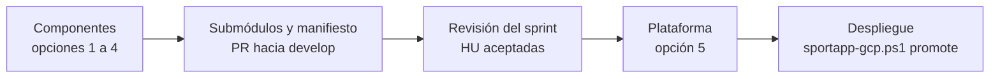

# Uso de `sportapp-release.ps1`

[`sportapp-release.ps1`](sportapp-release.ps1) publica todas las releases de SportApp desde la estación del operador. Es un solo script: al ejecutarlo pregunta qué hacer y, para publicar, qué se publica.

```powershell
.\scripts\sportapp-release.ps1
```

```text
==> ¿Qué quieres hacer?
  1. Publicar una release (backend, frontend, móvil o plataforma)
  2. Publicar un hotfix desde main (backend, frontend o móvil)
  3. Ver cambios pendientes, PR abierto y última release
  4. Consultar o esperar el Cloud Build de un tag
  5. Compilar, firmar y adjuntar el APK de una release móvil
  6. Mover components/* a los tags publicados
  7. Validar gh, permisos, ramas y herramientas
  8. Preparación única: crear o renombrar ramas main/develop
  9. Preparación única: crear el almacén de claves del APK
  10. Ayuda

==> ¿Qué quieres publicar?
  1. Solo backend
  2. Backend y frontend
  3. Solo frontend
  4. Solo aplicación móvil
  5. Plataforma (versión del sistema)
```

| Opción | Qué publica | Sección |
| --- | --- | --- |
| Backend y frontend (juntos o por separado) | releases con imágenes por digest; son los componentes que se despliegan en GCP | [5](#5-backend-y-frontend) |
| Aplicación móvil | release con el APK de producción firmado; no pasa por Cloud Build ni Cloud Deploy | [6](#6-aplicación-móvil) |
| Plataforma | la versión del sistema: fija la combinación de componentes aceptada en el sprint | [7](#7-versión-de-plataforma) |

El script usa tu sesión de GitHub CLI y, en modo lectura, tu `gcloud`. No crea credenciales en GitHub ni despliega: el despliegue se hace después con [`sportapp-gcp.ps1 promote`](sportapp-gcp.md#6-desplegar-una-release). El orden de un cierre de sprint está en [orden de los release](orden-de-release.md).

## Contenido

1. [Comandos y menú](#1-comandos-y-menú)
2. [Requisitos](#2-requisitos)
3. [Configuración](#3-configuración)
4. [Preparación única](#4-preparación-única)
5. [Backend y frontend](#5-backend-y-frontend)
6. [Aplicación móvil](#6-aplicación-móvil)
7. [Versión de plataforma](#7-versión-de-plataforma)
8. [Aprobación de los PR](#8-aprobación-de-los-pr)
9. [Versiones](#9-versiones)
10. [Submódulos y manifiesto de la plataforma](#10-submódulos-y-manifiesto-de-la-plataforma)
11. [Opciones](#11-opciones)
12. [Problemas frecuentes](#12-problemas-frecuentes)

## 1. Comandos y menú

```powershell
.\scripts\sportapp-release.ps1 [comando] [-Target <opción>] [opciones]
```

Sin comando, muestra el menú de comandos; con `-Target` y sin comando, ejecuta `release`. Sin `-Target`, muestra el menú con las opciones que admite el comando; si solo admite una, la toma sin preguntar.

| Comando | Qué hace | Opciones del menú |
| --- | --- | --- |
| `release` | publica lo elegido (secciones 5 a 7) | las cinco |
| `hotfix` | publica una corrección urgente desde `hotfix/vX.Y.Z` hacia `main` y abre su retorno a `develop` ([hotfix](#hotfix)) | backend, frontend y móvil |
| `check` | valida `gh`, permisos, ramas y las herramientas de lo elegido | las cinco y *Todo* |
| `status` | cambios pendientes de `develop`, PR abierto, última release y releases cortadas | las cinco y *Todo* |
| `prepare` | preparación única de las ramas (sección 4) | las cinco |
| `keystore` | crea el almacén de claves del APK (sección 4); `release` y `apk` del móvil también ofrecen crearlo si falta | móvil |
| `builds` | consulta o espera el Cloud Build de los tags publicados y muestra el error si falló | backend y frontend |
| `apk` | compila, firma y adjunta el APK de una release existente del móvil | móvil |
| `submodules` | mueve los submódulos de la plataforma a los tags y actualiza `release-manifest.yaml` | backend, frontend y móvil |
| `help` | muestra la ayuda | — |

Para no pasar por el menú, por ejemplo en una segunda terminal, indica la opción con `-Target`:

| `-Target` | Opción del menú |
| --- | --- |
| `backend` | Solo backend |
| `backend-frontend` | Backend y frontend |
| `frontend` | Solo frontend |
| `mobile` | Solo aplicación móvil |
| `platform` | Plataforma (versión del sistema) |
| `all` | Todo (solo `check` y `status`) |

```powershell
.\scripts\sportapp-release.ps1 status -Target all
.\scripts\sportapp-release.ps1 release -Target backend -Bump patch
```

## 2. Requisitos

| Herramienta | Para qué | Instalación |
| --- | --- | --- |
| GitHub CLI (`gh`) con sesión iniciada | PR, merge y releases | `winget install --id GitHub.cli -e` y `gh auth login` |
| Git | submódulos de la plataforma, clones locales y worktrees temporales | `winget install --id Git.Git -e` |
| Google Cloud CLI con la cuenta del operador | Cloud Build de backend y frontend, evidencia de la plataforma y URL de `bff-mobile` | la misma de `sportapp-gcp.ps1` |
| Java 17 o superior | solo móvil: iniciar Gradle, que descarga el JDK 25 del proyecto | ya instalado si `java -version` responde |
| Android SDK con build-tools | solo móvil: compilar y verificar el APK (`apksigner`, `aapt2`) | Android Studio o `ANDROID_HOME` |
| Python 3 con `pyyaml` y `jsonschema` | solo plataforma: componer y validar el manifiesto ([`platform_release.py`](platform_release.py)) | `py -3 -m pip install jsonschema==4.23.0 pyyaml==6.0.2` |

Tu cuenta debe ser administradora de cada repositorio, o tener permiso de escritura y una cuenta revisora (sección 8).

Para comprobarlo:

```powershell
.\scripts\sportapp-release.ps1 check -Target all
```

## 3. Configuración

El script lee `platform\.env.ps1`, el mismo archivo de [`sportapp-gcp.ps1`](sportapp-gcp.md#2-configurar-envps1). Todas las variables son opcionales; la plantilla es [`.env.example.ps1`](../.env.example.ps1).

| Variable | Valor por defecto | Uso |
| --- | --- | --- |
| `$githubOwner` | `lfnavarroj1` | dueño de los repositorios |
| `$releaseReviewer` | — | cuenta de GitHub de un compañero que aprueba los PR (sección 8) |
| `$frontendRepoPath` | `..\frontend` | clon local del frontend, para `prepare` |
| `$mgmt`, `$region`, `$production` | los de `sportapp-gcp.ps1` | Cloud Build, evidencia de la plataforma y URL de `bff-mobile` |
| `$mobileRepoPath` | `..\movil` | clon local del móvil |
| `$mobileKeystoreFile` | `%USERPROFILE%\.sportapp\sportapp-release.jks` | almacén de claves de firma, fuera del repositorio |
| `$mobileKeyAlias` | `sportapp` | alias de la clave de firma |
| `$mobileBffBaseUrl` | `https://bff-mobile-<número de $production>.<$region>.run.app/` | URL de producción que usa el APK |

Nunca guardes tokens ni contraseñas en `.env.ps1`. Las contraseñas de firma se piden al compilar. Si prefieres no escribirlas cada vez, defínelas solo en la sesión con `SPORTAPP_SIGNING_STORE_PASSWORD` y `SPORTAPP_SIGNING_KEY_PASSWORD`; el script las borra al terminar.

## 4. Preparación única

```powershell
.\scripts\sportapp-release.ps1 prepare      # elige el repositorio en el menú
.\scripts\sportapp-release.ps1 keystore     # almacén de claves del APK
```

| Repositorio | Qué hace `prepare` | Después |
| --- | --- | --- |
| Backend | comprueba que existan `main` y `develop` | — |
| Frontend | crea `main` en el primer commit de `develop`, para que el primer PR muestre todo el historial | protege `main` como en el backend (*Settings → Rules*: PR obligatorio y una aprobación) |
| Móvil | renombra `master` a `main`; GitHub conserva los PR, redirige la rama y actualiza la rama por defecto | protege `main` |
| Plataforma | crea `develop` desde el `main` actual | protege `main` y `develop`; las ramas de trabajo salen de `develop` y su PR va a `develop` |

Además:

- **Cloud Build:** antes de la primera release, `cloudbuild.release.yaml` debe estar en `develop` del backend y del frontend. Al fusionarse llega a `main` y Cloud Build lo lee desde el commit del tag.
- **Almacén de claves del móvil:** `keytool` pide una contraseña y los datos del certificado. **Guarda una copia del archivo y de la contraseña en un lugar seguro:** sin ellos no podrás publicar actualizaciones de la app instalada.
- **Versión y firma del APK:** fusiona en `develop` del móvil la rama `chore/apk-produccion-versionado`, que hace que `app/build.gradle.kts` reciba la versión, la versión del sistema y la firma. Sin ella el script se detiene antes de compilar.

## 5. Backend y frontend

```powershell
.\scripts\sportapp-release.ps1 status -Target backend-frontend
.\scripts\sportapp-release.ps1 release -Target backend-frontend
```

Por cada repositorio con cambios ejecuta estas fases:

| Fase | Qué pasa |
| --- | --- |
| Plan | muestra la versión actual, la propuesta y los commits de `develop`; omite los repositorios sin cambios; pide confirmar. Si una release anterior se cortó después del merge (PR `develop` → `main` fusionado y sin tag), la retoma desde la fase 4 con la versión del título de ese PR |
| 1. Pull requests | crea `release: <componente> vX.Y.Z` de `develop` a `main`, o reutiliza el PR abierto |
| 2. Pruebas | espera los checks de CI de los PR a la vez; un repositorio con pruebas fallidas se detiene y el otro continúa |
| 3. Aprobación | por cada PR muestra el resumen y pregunta si lo apruebas (sección 8); fusiona con un commit de merge |
| 4. Releases | crea la GitHub Release y su tag sobre el commit de merge, con notas generadas y la versión del sistema |
| 5. Validación | espera `release-validation` (backend) o `release-web` (frontend) |
| 6. Cloud Build | espera `release-backend` o `release-frontend` del tag; si terminan en `FAILURE`, muestra el paso que falló, sus líneas de error y el enlace al log. Si el build no arranca en 10 minutos (triggers deshabilitados), da el comando para lanzarlo |
| 7. Plataforma | por cada versión validada **y con imágenes publicadas**, mueve el submódulo al tag y actualiza `release-manifest.yaml` (sección 10) |

Al final imprime un resumen con el resultado de Cloud Build y el comando `promote` para desplegar.

- El comando `sportapp-gcp.ps1 promote` solo incluye las versiones con imágenes.
- En la primera release, antes va `sportapp-gcp.ps1 setup`, que crea Cloud Run.
- Una versión cuyo build falló no se puede desplegar: corrige en `develop` y publica una nueva con `-Bump patch`. Volver a lanzar el build del mismo tag no sirve, porque Cloud Build lee el `cloudbuild.release.yaml` del commit del tag.

Para consultar o esperar el build de tags ya publicados sin repetir la release:

```powershell
.\scripts\sportapp-release.ps1 builds -Target backend-frontend                     # último tag de cada uno
.\scripts\sportapp-release.ps1 builds -Target backend -BackendVersion v0.1.1
```

Si algo falla, corrige y vuelve a ejecutar `release`:

- los PR abiertos se reutilizan;
- una release cortada después del merge se retoma;
- los repositorios ya publicados no tienen cambios nuevos en `develop` y se omiten.

## 6. Aplicación móvil

```powershell
.\scripts\sportapp-release.ps1 status -Target mobile
.\scripts\sportapp-release.ps1 release -Target mobile
```

Las fases de plan, PR, pruebas, aprobación, release y validación (`release-mobile`) son las mismas de la sección 5. Después:

1. **APK:** si `release-mobile` terminó bien, compila y adjunta el APK de producción.
2. **Plataforma:** mueve `components/mobile` al tag y actualiza en `release-manifest.yaml` su `version`, `ref`, `commit`, `versionCode` y el `sha256` del APK (sección 10).

El móvil no influye en los despliegues y se puede publicar en cualquier momento. El APK apunta al `bff-mobile` de producción: funciona solo mientras el plano operativo esté encendido (`sportapp-gcp.ps1 up`), pero publicarlo no depende de que lo esté.

### APK de producción

`release-mobile` valida la release en GitHub Actions y produce un APK sin firmar, que Android no instala. El APK que se publica lo compila el script en tu estación; así la clave de firma nunca sale de tu equipo.

1. Crea un `git worktree` temporal en el commit exacto del tag.
2. Ejecuta `:app:assembleRelease` con:
   - `versionName` = versión del tag;
   - `versionCode` = `MAJOR*1000000 + MINOR*1000 + PATCH` (`v0.2.0` → `2000`);
   - `BuildConfig.SYSTEM_VERSION` = versión del sistema;
   - la URL de `bff-mobile` en Cloud Run.
3. Firma con `$mobileKeystoreFile`. `apksigner` verifica la firma y `aapt2` la versión.
4. Adjunta a la release:
   - `sportapp-movil-vX.Y.Z-sistema-vA.B.C.apk`;
   - `SHA256SUMS`;
   - `artifact.txt`, con versión, `versionCode`, sistema, commit, URL y huella del certificado.

Para repetir o rehacer solo el APK de una release existente:

```powershell
.\scripts\sportapp-release.ps1 apk -MobileVersion v0.2.0
```

## 7. Versión de plataforma

La versión de plataforma es la versión del sistema SportApp en un sprint ([manual de versiones](../docs/manual-versionado.md#versión-de-plataforma-por-sprint)). La plataforma no construye nada: fija la combinación de backend, frontend y móvil ya publicados, y deja constancia de que esa combinación es compatible.



### Antes de publicar

| Condición | Cómo se cumple |
| --- | --- |
| Backend y frontend publicados, con imágenes | opciones 1 a 3 (sección 5); Cloud Build en `SUCCESS` |
| Móvil publicado, con APK | opción 4 (sección 6); la release tiene `SHA256SUMS` |
| Submódulos y manifiesto de `develop` en esos tags | la fase *Plataforma* de cada release (o `submodules`) y el PR de esos archivos hacia `develop` |
| HU aceptadas | la revisión del sprint |

Para ver el manifiesto candidato de `develop`:

```powershell
.\scripts\sportapp-release.ps1 status -Target platform
```

### Publicar

```powershell
.\scripts\sportapp-release.ps1 release -Target platform -Stories HU001,HU010
```

Si eliges la opción en el menú y no pasas `-Stories`, el script pide las HU aceptadas.

| Fase | Qué pasa |
| --- | --- |
| Plan | propone la versión, toma el sprint del manifiesto (o `-Sprint`) y muestra el tag de cada componente; comprueba en GitHub que cada tag sea el commit del submódulo; pide confirmar |
| Composición | descarga la evidencia de Cloud Build de backend y frontend, toma el checksum del APK de la release del móvil, valida todo y escribe el manifiesto y su copia |
| Rama | confirma `release-manifest.yaml` y `releases/vX.Y.Z.yaml` en `release/vX.Y.Z` y la publica; pide confirmar |
| Pull request | crea o reutiliza `release: plataforma vX.Y.Z` hacia `main`, con las notas como descripción, y espera sus pruebas |
| Aprobación | pregunta si apruebas; fusiona con un commit de merge (sección 8) |
| Release | crea la GitHub Release `vX.Y.Z` sobre el commit de merge |
| Retorno | abre el ciclo siguiente en `develop`, con su propio PR y aprobación |

Todo ocurre en un worktree temporal: tu árbol de trabajo y tus cambios sin confirmar no se tocan. Si algo falla, corrige y vuelve a ejecutar `release` con la misma versión: se reutilizan la rama, el PR y la release que ya existan.

### Qué se valida y qué queda en el manifiesto

Antes de escribir nada, [`platform_release.py`](platform_release.py) valida lo siguiente:

- **la evidencia de Cloud Build**, con el mismo código del promotor ([`promote_release.py`](promote_release.py)): repositorio, tag, commit, pruebas, allowlist de imágenes, registro propio y digests;
- **que el tag, el commit de la evidencia y el puntero del submódulo coincidan**;
- **que el contrato sea compatible**: el frontend espera una versión de `bff-web` que el backend ofrece (misma MAJOR y MINOR igual o mayor);
- **que haya al menos una HU** y que el APK del móvil tenga checksum;
- **el resultado** contra [`schemas/release-manifest.schema.json`](../schemas/release-manifest.schema.json) con `status: released`.

| Campo | Origen |
| --- | --- |
| `version`, `ref`, `commit` | tag del componente y puntero de su submódulo |
| `artifacts` (backend), `artifact.uri` (frontend) | imágenes por digest de la evidencia |
| `contractVersion`, `expectedBffContract` | evidencia de backend y frontend |
| `evidence` | URI `gs://`, sha256 de los bytes publicados (el mismo que anota el promotor en Cloud Deploy) e ID del build |
| `versionCode`, `artifact.sha256` (móvil) | tag del móvil y `SHA256SUMS` de su release |

`releases/vX.Y.Z.yaml` es la copia inmutable. La prueba `tests/test_platform_release.py` valida en CI cada copia de `releases/`.

### Retorno a develop

Después del merge a `main`, el script crea `chore/abrir-vX.Y+1.0` desde la rama de release y deja el manifiesto así:

- `status: draft`;
- `platformVersion` en la versión siguiente;
- `acceptedStories` vacío;
- los componentes fijados se conservan.

Ese PR hacia `develop` devuelve también `releases/vX.Y.Z.yaml`. Al fusionarse, el script borra las dos ramas temporales en GitHub. Desde ese momento, las releases de componentes llevan la versión del sistema siguiente.

### Después de publicar

- **Actualiza tu clon:** `git switch main` y `git pull --ff-only`. `sportapp-gcp.ps1` lee los Services de GKE desde `components/backend` del árbol local, así que para operar producción conviene estar en la versión publicada.
- **Despliega** las versiones de los componentes con el comando que aparece al final:

  ```powershell
  .\scripts\sportapp-gcp.ps1 promote -BackendVersion vX.Y.Z -FrontendVersion vX.Y.Z
  ```

- **Actualiza el registro:** el GitHub Project (*Versión entregada*) y la wiki, según la [guía de actualización](../docs/guia-de-actualizacion.md).

## 8. Aprobación de los PR

GitHub no permite que el autor de un PR lo apruebe. La pregunta de la fase de aprobación es la aprobación humana del operador, y siempre se hace, incluso con `-AutoApprove`. Responder algo distinto de `si` omite ese repositorio.

Después de tu aprobación, el script fusiona de una de dos formas:

| Situación | Cómo fusiona |
| --- | --- |
| Hay una cuenta revisora: `$releaseReviewer` con sesión en `gh` en esta estación (`gh auth login` con la cuenta del compañero), o un token en `SPORTAPP_REVIEWER_TOKEN` | la cuenta revisora aprueba el PR y se fusiona de forma normal; la regla de una aprobación de `main` se cumple |
| No hay cuenta revisora | deja un comentario con tu aprobación y fusiona con `--admin`; GitHub registra que se omitió la regla de revisión |

El token de la cuenta revisora nunca se imprime ni se guarda.

## 9. Versiones

- **Propuesta:** el script toma el último tag estable `vX.Y.Z` del repositorio y propone el siguiente según `-Bump`. Por defecto es `minor`, porque un sprint con HU incrementa MINOR ([manual de versiones](../docs/manual-versionado.md#regla-de-incremento-por-componente)).
- **Sin tags:** propone `v0.1.0`; la serie `0.x` se usa hasta el MVP.
- **Versión explícita:** `-BackendVersion`, `-FrontendVersion`, `-MobileVersion` o `-PlatformVersion`.
- **Release retomada:** usa la versión del título del PR fusionado, que es la que aprobaste.
- **Versión del sistema:** es la de plataforma, `platformVersion` de [`release-manifest.yaml`](../release-manifest.yaml). Se puede reemplazar con `-SystemVersion`. Aparece en las notas de cada release y, en el móvil, en el nombre del APK y en `BuildConfig.SYSTEM_VERSION`.
- **Corrección de una versión de plataforma publicada:** sale de `develop` con `-Bump patch`. El retorno abre la MINOR siguiente.

Cada componente conserva su versión individual. En la primera release, `$initialBackendVersion` y `$initialFrontendVersion` de `.env.ps1` deben coincidir con las versiones publicadas: `sportapp-gcp.ps1 setup` las usa para crear Cloud Run.

### Hotfix

`release` siempre publica desde `develop`. Cuando hay un defecto urgente en `main` y `develop` ya tiene trabajo que no se quiere publicar, se usa `hotfix` (opción *Publicar un hotfix desde main*). Sirve para backend, frontend y móvil:

```powershell
.\scripts\sportapp-release.ps1 hotfix -Target mobile
```

1. **Versión y rama:** siempre `PATCH` sobre el último tag (o la de `-MobileVersion` y similares). Usa la rama `hotfix/vX.Y.Z[-descripcion]` si ya existe en GitHub; si no, la crea desde `main` al confirmar el plan.
2. **Corrección:** si la rama todavía es igual a `main`, el script muestra los comandos para traerla, espera a que subas la corrección y presiones Enter. Con `omitir` deja ese componente fuera.
3. **Publicación:** PR `hotfix/vX.Y.Z` → `main` y las mismas fases de `release`: pruebas, tu aprobación, tag, workflow, Cloud Build o APK, submódulos y manifiesto.
4. **Retorno:** al final abre el PR `hotfix/vX.Y.Z` → `develop` del componente. Revísalo y fusiónalo: puede tener conflictos con lo que `develop` avanzó.

Si se corta, repetir el mismo comando retoma: reutiliza la rama y el PR abierto, o sigue desde el tag si el PR ya se fusionó.

## 10. Submódulos y manifiesto de la plataforma

El [cierre de sprint](../docs/manual-versionado.md#cierre-del-sprint) pide que la plataforma apunte a los tags publicados. Esto importa en producción: `sportapp-gcp.ps1` toma los Services de GKE de `components/backend`, así que el submódulo debe estar en el tag que se despliega.

Al final de cada release de componente, el script hace lo siguiente:

1. Descarga el submódulo si falta. `.gitmodules` declara `update = none`, por eso usa `--checkout`; también activa las rutas largas de Windows.
2. Lo mueve al tag publicado. Si el submódulo tiene cambios locales, no lo mueve, para no perderlos, y te avisa.
3. Actualiza `version`, `ref` y `commit` del componente en `release-manifest.yaml` (en el móvil, también `versionCode` y el `sha256` del APK).
4. Muestra `git status` de esos archivos y los comandos para confirmarlos en una rama con PR hacia `develop` de la plataforma. **El script no hace commit:** lo haces tú.
5. Si se publicó el backend, recuerda ejecutar `sportapp-gcp.ps1 up` para reconciliar los Services de GKE.

El manifiesto sigue en `status: draft`. Los digests, `contractVersion`, `expectedBffContract` y la evidencia los completa y valida la versión de plataforma (sección 7).

Para hacerlo por separado, por ejemplo si usaste `-SkipPlatform` o publicaste una release a mano:

```powershell
.\scripts\sportapp-release.ps1 submodules
.\scripts\sportapp-release.ps1 submodules -Target backend -BackendVersion v0.1.0
```

## 11. Opciones

| Opción | Aplica a | Efecto |
| --- | --- | --- |
| `-Target <opción>` | todos | lo que se publica o consulta, sin pasar por el menú (sección 1) |
| `-Bump patch\|minor\|major` | `release` | incremento propuesto (por defecto `minor`) |
| `-BackendVersion`, `-FrontendVersion`, `-MobileVersion` | `release`, `builds`, `apk`, `submodules` | versión explícita `vX.Y.Z` del componente |
| `-PlatformVersion vX.Y.Z` | plataforma | versión explícita de la plataforma |
| `-SystemVersion vX.Y.Z` | componentes | versión del sistema en lugar de la de `release-manifest.yaml` |
| `-Stories HU001,HU010` | plataforma | HU aceptadas en la revisión del sprint; si faltan, se piden |
| `-Sprint "Sprint 2"` | plataforma | sprint de la versión; por defecto el del manifiesto |
| `-SkipCloudBuild` | backend y frontend | no espera Cloud Build; se puede consultar después con `builds` |
| `-SkipApk` | móvil | no compila el APK; se puede hacer después con `apk` |
| `-SkipPlatform` | componentes | no mueve los submódulos ni el manifiesto; se puede hacer después con `submodules` |
| `-AutoApprove` | todos | omite las confirmaciones de rutina; nunca la aprobación de los PR |
| `-ConfigFile <ruta.ps1>` | todos | otro archivo de configuración |

## 12. Problemas frecuentes

| Síntoma | Acción |
| --- | --- |
| `no existe main: ejecuta prepare` | `prepare` con esa opción (sección 4) |
| `<comando> no admite -Target <opción>` | usa una de las opciones que muestra el mensaje, o quita `-Target` para ver el menú |
| `pruebas fallidas: ...` | corrige en una rama hacia `develop`; el PR de release se actualiza solo y basta con repetir `release` |
| `el PR tiene conflictos con main` | integra `main` en `develop` y repite |
| `ya está en main (PR #N) pero no tiene release` o, en `status`, `se fusionó en main sin release` | una release anterior se cortó después del merge; repite `release`: crea el tag sobre ese merge y sigue con la validación y Cloud Build |
| `el tag vX.Y.Z ya existe` | indica otra versión con la opción `-...Version` del componente |
| `no apareció release-*.yml` | revisa *Actions* del repositorio; en el móvil, si la validación pasó, adjunta el APK con `apk` |
| `release-backend` o `release-frontend` terminó en `FAILURE` | el script muestra el paso y el error; corrige el `cloudbuild.release.yaml` (o el código) en `develop` y publica una versión nueva con `-Bump patch` |
| Cloud Build no arrancó con el tag | los triggers estaban deshabilitados al crear el tag: `gcloud builds triggers run release-backend --region=us-central1 --project=<gestión> --tag=vX.Y.Z` (igual con `release-frontend`) |
| `gh pr merge` rechaza el merge | tu cuenta no es administradora: configura una cuenta revisora (sección 8) |
| `release-mobile no terminó correctamente` | no se publica APK; corrige y publica una versión nueva |
| `El tag ... no incluye la versión y la firma configurables` | fusiona `chore/apk-produccion-versionado` en `develop` del móvil y publica una versión nueva |
| `No existe el almacén de claves` | `keystore` |
| `Gradle no produjo un APK firmado` | revisa las contraseñas y el alias; la salida de Gradle muestra el error |
| `Se requiere Java 17 o superior` | instala un JDK 17+; `gradlew.bat` exige Java 21, por eso el script usa directamente el JAR del wrapper |
| `La plataforma no tiene develop` | `prepare` con la opción Plataforma |
| `<componente> no tiene release en el manifiesto de develop` | publica el componente y fusiona en `develop` el PR de sus submódulos (sección 7) |
| `components/<x> apunta a ... pero vX.Y.Z es ...` | el submódulo no está en el tag: ejecuta `submodules` y fusiona el PR en `develop` |
| `No se pudo leer la evidencia de <componente>` | su Cloud Build no terminó o falló: `builds` |
| `contrato incompatible` | el frontend espera una versión de `bff-web` que el backend no ofrece: publica la combinación correcta |
| `la release no tiene el checksum del APK` | adjunta el APK con `apk -MobileVersion vX.Y.Z` |
| `el PR tiene conflictos` en el retorno de la plataforma | `develop` cambió el manifiesto mientras tanto: resuelve el conflicto en `chore/abrir-v...` y repite `release` |
